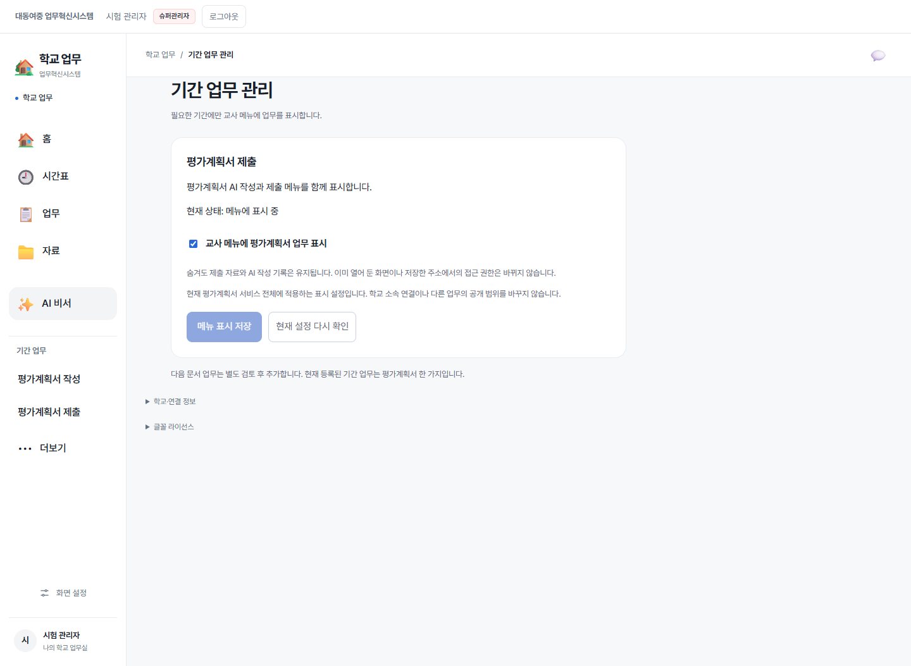
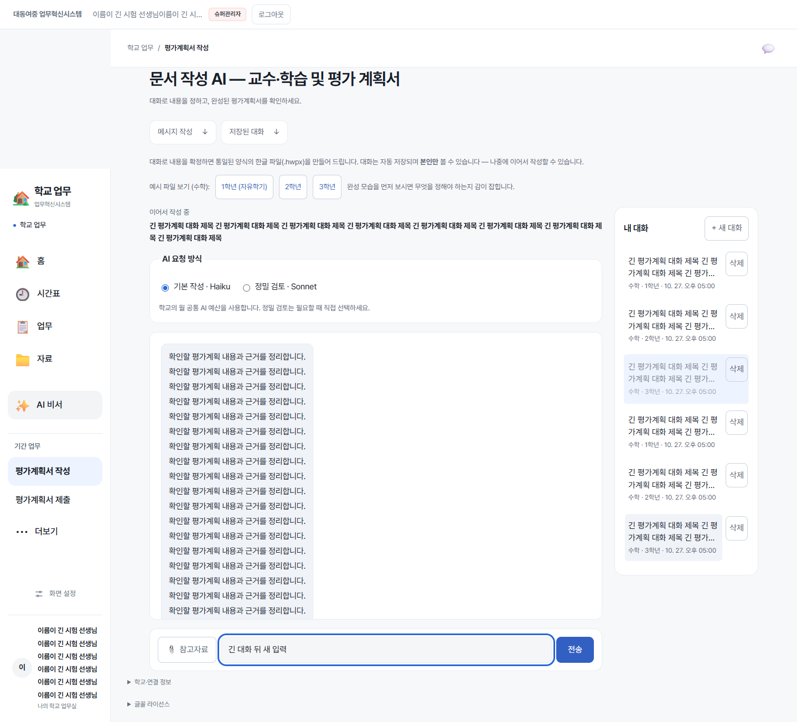

# 모듈화·통합 화면 검증 — 2026-10-31

기준 main: `49b389d179aac86cd628244879df3afabd77cd71`. 브랜치: `feat/site-modular-shell`.
운영 DB 실행·기능 활성화·main 병합·운영 배포는 하지 않았다.

## 최종 결과

| 검사 | 결과 | 검증 범위 |
|---|---|---|
| `npm test` | 5,272건 통과 | 기존 생성·계약·복구 회귀 포함, Python 시험 생략 없음 |
| `npm run check:workhub` | 통과 | TypeScript |
| `npm run check:workhub:design` | 통과 | 기존 설계 문서·파일 연결 일관성 |
| `npm run build` | 통과 | 운영 앱 빌드 |
| `npm run build:workhub` | 통과 | 업무 모듈 빌드 |
| 전체 브라우저 회귀 | 147개 파일 실행, 수정 후 재검사 포함 모두 통과 | 실제 React·합성 서버 응답·로컬 Chrome |
| 최종 연관 브라우저 재검사 | 11개 파일 모두 통과 | 변경된 공통 메뉴, 기존 문서, 메신저 제한 참여, 복구·로그인 |
| 신규 SP1 SQL·앱 계약 | 13건 통과 | 격리 PGlite PostgreSQL에 실제 SQL 설치·역할·접수증·판 충돌 |
| 신규 모듈 경계 회귀 | 4건 통과 | 정적 실행 import 순환, 순수 서비스 의존, 화면/컨트롤러 방향 |
| 신규 기간 메뉴 브라우저 | 8건 통과 | 관리자 표시·숨김, 일반 교사, 편집 보존, 미확정 복구, 모바일 |
| 기존 상태·명령 본문 보존 | 5/5 일치 | 분리 전 함수 본문과 컨트롤러의 AST 추출·esbuild 정규화 비교 |

SP1 13건과 모듈 경계 4건은 npm test 5,272건 안에 포함된다. 신규 메뉴 브라우저 8건은 147개 파일 안의 한 파일이다. 숫자를 합산하지 않는다.

## 전체 실행 후 수정한 것

첫 전체 실행은 147개 중 142개 통과였다. 다음 5개는 실패 원인을 고친 뒤 관련 11개와 함께 다시 실행해 통과했다.

- email-login: 새 공통 홈 제목에 맞춘 조회. 계정 승인 판정은 유지.
- workhub-messaging-pilot: 상단의 옛 메뉴를 없앤 뒤 메신저 한정 교사에게 공통 메뉴가 없던 문제를 수정. 메시지 범위만 보이며 입력 잠금·만료·권한 철회 검사는 유지.
- workhub-school-preparation-connected: 공통 메뉴의 접근성 이름 변경 반영.
- workhub-foundation: 공통 경로 안내의 학교 업무 표기 반영.
- workhub-module-loading: Chrome 버전에 따라 실패한 모듈을 다시 요청하는 동작이 달라 서버 실패를 지속시키는 시험으로 보강. 오류 중 잘못된 성공·자동 새로고침이 없고, 사용자의 명시 재시도/새로고침 뒤 복구되는지 확인. 제품의 로딩·재시도 코드는 변경하지 않음.

추가로 기존 문서를 공통 틀에 넣을 때 스타일이 파일 입력·radio 크기를 덮는 문제를 발견해 CSS 경계를 수정했다. 실제 평가계획서 화면에서 숨긴 파일 입력·radio 크기, 320px 화면·시험용 200% 확대, 원본 문서 입력·다운로드 동작을 다시 검사했다.
질문형 문서의 생성→수합 첨부→ZIP 시험도 실제 생성 경로를 유지해 통과했다.

## 보존 확인

기준 커밋과 비교해 다음 경로에는 변경이 없다: `packages/shared`, `apps/main/api`, `migrations`, 기존 `database/workhub`, 기존 `database/workhub-timetable`, AuthContext, MessagingPilotContext 및 기존 참여 권한 판정 파일.
기존 `createScopedRpc` 본문·인증 전후 검증은 그대로이며 순수 검증기와 오류 정의만 `service-values.ts`로 이동했다.
새 SP1 저장소만 추가했다. DB 구조·권한 변경은 이 신규 표시 설정의 표·RPC에 한정되며 운영에는 실행하지 않았다.
가상 학교 전용 파일·기존 운영 자료·학교 회원 연결·API 모델·단가·HWPX 생성 엔진은 수정하지 않았다.

## 실제 환경과의 경계

- 브라우저 시험은 실제 화면과 로컬 전송 대역을 사용한다. 운영 Supabase·PostgREST 연결 성공을 대신하지 않는다.
- SP1 SQL은 실제 SQL을 격리 PostgreSQL 엔진에서 실행했다. 운영 설치와 실제 동시 연결 경합 시험은 하지 않았다.
- 공통 메뉴의 모바일 크기·확대 회귀는 자동 브라우저 환경이다. 실제 휴대폰 키보드는 이 검증에 포함하지 않는다.
- 기존 API·비용 계약을 보존했지만 실제 유료 AI 호출을 이번에 다시 실행한 것은 아니다.
- 운영 빌드는 기존과 같이 500KB 초과 청크 안내를 출력한다. 빌드는 성공했고, 코드 분리만으로 로딩 성능이 좋아졌다고 보고하지 않는다.
- GitHub CI 결과는 PR의 최신 커밋에서 별도로 확인한다.

## 화면

합성 계정·합성 설정으로 실행한 실제 화면이다. 운영 화면이 이미 바뀌었다는 의미는 아니다.

설치 순서는 [SP1 실행 안내](../../database/site-presentation/sp1/README.md), 구조와 후속 개발 지침은 [모듈화 설명](README.md)을 따른다.

## PR #102 CI 환경 보완

첫 CI(41186404638)는 npm test와 PostgreSQL 독립 연결 경쟁 검사를 통과한 뒤 R0·R1 시험 서버 준비에서 중단됐다.
실패 원인은 GitHub runner 기본 `psql 18`이 embedded PostgreSQL 17의 `libpq`를 읽어 `PQfullProtocolVersion` 심벌을 찾지 못한 것이다.
시험에 사용하는 클라이언트를 `/usr/lib/postgresql/17/bin/psql`로 고정하고, 같은 라이브러리 경로에서 버전을 사전 확인하도록 했다.
운영 앱·운영 SQL·기존 판정 기준은 수정하지 않았다. SQL 시험을 생략하지 않고 동일한 전체 CI를 재실행한다.
