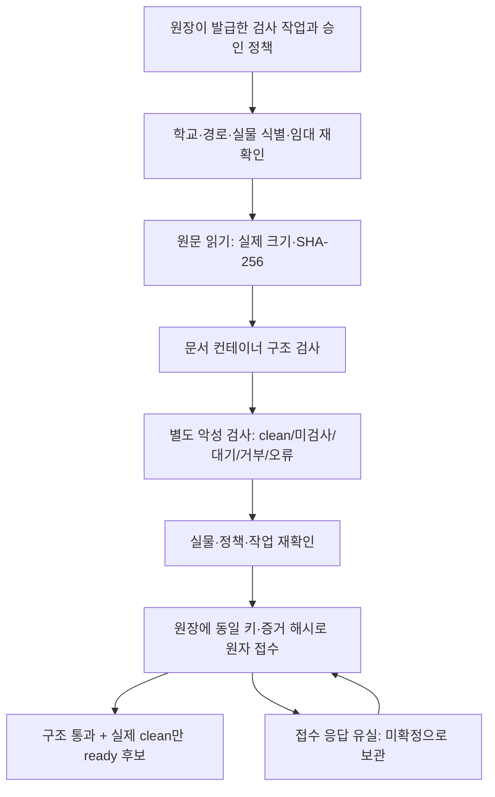
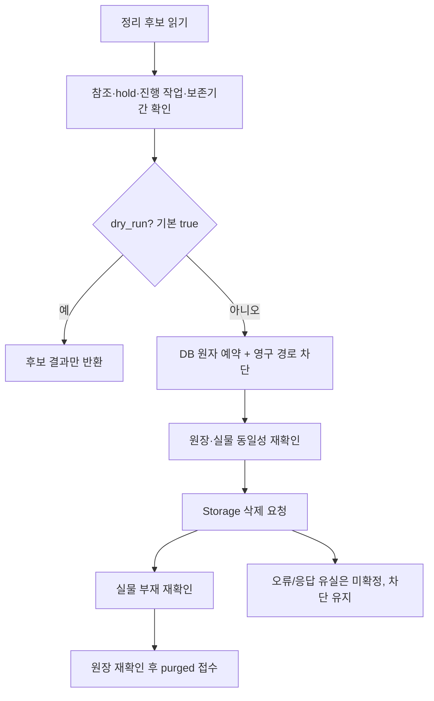

# 서버 파일 검사·임시 파일 정리 구현 인계

2026-10-15 · PR #36의 `feat/workhub-collection-export` → `feat/workhub-file-workers`

> 이 문서는 PR #37 당시의 처리 코어와 지원 범위 기록이다. 이후 PDF/HWP 전용 검사와 HWPX 기본 스크립트 호환성을 추가한 최신 범위는 [형식 지원 보완](37-document-format-support.md)에 있다. 아래의 파서 미지원·양식 3개 거부는 이전 구현 상태다.

## 1. 이번 결과와 범위

파일형 수합은 실제 원문 검사와 저장소 정리가 있어야 서버 연결을 완성할 수 있다. SQL 작성과 병행할 수 있도록 세 처리 코어를 구현했다.

1. HWPX·DOCX·XLSX·PPTX의 제한된 컨테이너 구조 검사.
2. 실제 바이트·해시·정책·악성 검사 결과를 묶어 원장에 접수하는 검증 처리.
3. 미첨부 파일의 참조·보존·동시 작업을 확인하고 실물 삭제를 재확인하는 정리 처리.

모두 `workers/collection_files/`에 있으며, 앱/API에 연결하지 않았다. 실제 DB·Storage 접근, 파일 삭제, SQL 실행, 설정 변경, 준비 상태 활성화는 없다. 현재 교사 화면은 달라지지 않는다. 사용자 요청에 따라 실사용 확인은 나중에 모은다.

기존 [R1 SQL 요청서](32-collection-server-sql-request.md)의 계약은 그대로다. 아래 포트는 구현을 시험하기 위한 **내부 인터페이스 제안**이며, Claude SQL의 함수명·표·접수 형식을 새로 확정한 것이 아니다. `common.py`의 경로는 기존 요청서대로 `school_id/file_id/opaqueKey`이고 마지막 키는 16~100자 영숫자·`_`·`-`다.

## 2. 처리 흐름

도식의 원장·Storage·스캐너는 지금은 시험 대역이다. 운영 인프라 구축이 끝났다는 뜻이 아니다.

## 3. 문서 구조 검사

`inspect_document(bytes, extension, limits)` → `{status, code, mime}`. 상태는 `passed/rejected/unsupported/error`다. `passed`는 **제한된 구조 검사만 통과**했다는 의미다.

- 실제 확장량·CRC·압축률을 확인한다. ZIP 선언 크기만 믿지 않으며 중앙/지역 헤더 차이, 디렉터리 데이터 위장, 누락 파트, 암호화, 중첩 컨테이너 등을 검사한다.
- 경로 이탈, 역슬래시, 중복/Unicode 혼동, 심볼릭 링크, 허용되지 않은 압축 형식을 제한한다. ZIP64·분할 ZIP은 미지원이다.
- XML을 네트워크/엔티티 해석 없이 읽으며 DTD·엔티티·XInclude·위험 관계를 거부한다. UTF-16 등 인코딩 변형도 시험한다.
- OOXML의 Content Types·필수 문서·관계와 HWPX의 필수 파트·매니페스트를 확인한다. 전체 표준/XSD·문서 렌더링 검증은 아니다.
- 외부 콘텐츠 관계와 스크립트/매크로/임베디드 객체는 제한한다. 웹·메일 하이퍼링크는 관계 종류를 구분하고 실제로 접속하지 않는다.
- 디스크로 풀거나 외부에 접속하지 않는다. 승인된 정책의 한도를 입력받으며 학교별 운영 한도를 임의 확정하지 않는다.

**지원 제한:** PDF·구형 HWP 전용 파서는 아직 없어 `unsupported`다. 표식만 맞는 파일을 정상 문서로 통과시키지 않는다. 기존 보호 HWPX 6종은 읽기 전용으로 검사했으며 3개 통과·3개 거부다. 거부된 `tpl-g2-exam1.hwpx`, `tpl-g2-perf3-arts.hwpx`, `tpl-g3-perf3.hwpx`에는 `Scripts/headerScripts.js`·`Scripts/sourceScripts.js`가 있다. 악성 판정이 아니라 현재 엄격 프로필의 제한이다. 이 양식이나 기존 엔진은 수정하지 않았다. 정상 HWPX 호환성을 검토하기 전 모든 HWPX를 지원한다고 표시하면 안 된다.

형식 참고: [한컴 HWPX 소개](https://tech.hancom.com/hwpxformat/), [Microsoft Open Packaging Conventions](https://learn.microsoft.com/en-us/previous-versions/windows/desktop/opc/open-packaging-conventions-overview). 이 코드는 두 표준 전체를 구현한 것이 아니다.

## 4. 검증 처리의 내부 계약

모든 포트는 신뢰된 서버 내부 객체다. 브라우저에서 임의 객체를 전달해 이 코어를 호출하는 경로는 만들지 않았다. 승인 문자열이나 Python 객체가 서버 권한 증명 자체가 되지는 않는다.

### 공통 입력

| 객체 | 정확한 필드와 의미 |
|---|---|
| `ref` | `school_id, file_id, bucket, path, identity`. bucket은 `workhub-collection-files`; identity는 어댑터가 증명하는 불변 객체/판 식별자 |
| `lease` | `job_id, run_id, lease_token, expires_at, object: ref, policy_version` |
| 검증 `job` | `lease, file: {name, extension, claimed_bytes, claimed_sha256, declared_mime}` |
| 정책 | `school_id, purpose: collection_upload, version, approval_ref, extensions, max_file_bytes, limits` |
| `limits` | `max_archive_entries, max_entry_bytes, max_expanded_bytes, max_compression_ratio, max_xml_bytes` |

실물 identity에 이름·ETag 하나를 임의로 대입하면 안 된다. 경로 교체 금지와 객체판을 실제 어댑터가 증명해야 한다. 현재 코어의 100MiB 입력 상한은 기술 상한이며, 실제 허용량은 승인 정책의 더 작은 값으로 제한한다.

### 포트와 접수

| 포트 | 응답/책임 |
|---|---|
| `ledger.inspect(job)` | `{job, policy}`. 저장된 작업·현 정책을 돌려준다. 전달된 값과 검사 전후 비교 |
| `storage.stat(ref)` | `{object: ref, bytes, mime}`. 읽기 전후 및 스캔 후 동일 실물·메타 확인 |
| `storage.read(ref, max_bytes, deadline)` | bytes 청크. 실제 누적량 제한·취소·임대 확인·스트림 닫기 |
| `scanner.scan(...)` | `status, sha256, object_identity, run_id, engine, engine_version, signature_version, scan_id, scanned_at` |
| `ledger.commit_result(lease, evidence, key, hash)` | 현재 임대·주체·정책·실물을 원자 확인해 접수. `{request_key, evidence_hash, decision, status}` 반환 |

스캐너 상태는 `pending/clean/rejected/error/not_scanned`다. 검사 해시·실물판·실행 ID·검사 시각이 일치해야 한다. 승인 스캐너 신원과 서명 최신성의 신뢰는 실제 어댑터/서비스 등록이 맡아야 하며 아직 구현하지 않았다. 스캐너가 없으면 `not_scanned`, 실패/잘못된 응답이면 `error`로 남는다.

증거에는 계약판, job/run, 실물, 정책판/정책해시, 실제 바이트 수/SHA-256, 구조 결과, 별도 스캔 결과, 판정, 확인 시각이 들어간다. 구조 거부 또는 악성 거부는 `rejected`; 구조 통과와 실제 `clean`이 모두 있어야 `ready`; 나머지는 `pending`이다. 실제 SQL 봉인은 자체 권한/현재 상태 검증을 해야 한다.

접수 키는 `verify_<run_id>`, 증거 해시는 정규화 JSON의 SHA-256이다. 접수증의 키·해시·판정과 `recorded/already_recorded`를 확인한다. 응답을 모르면 성공으로 표시하지 않는다. 같은 프로세스에서 생성한 동일 접수 객체·동일 원장·유효 임대에서만 같은 내용으로 재전송한다. 임의로 조립/변경한 접수 객체는 거부한다.

**재시작·임대 만료 뒤의 복구는 아직 없다.** 메모리의 접수 객체는 영속 outbox가 아니다. 만료/재시작 시 기존 결과를 읽고 새 임대로 재인수하는 별도 원장 계약이 필요하다. 이미 일치하는 확정 접수증을 받았다면 응답 시점의 임대 만료 때문에 확정 사실을 미확정으로 바꾸지는 않는다.

`SIZE_LIMIT`·`POLICY_DENIED`·`OBJECT_CHANGED` 같은 사전 오류는 원장 접수 없이 반환되고 미지원 형식은 `pending`으로 남는다. 후속 작업자는 영속 실패 분류·재시도 상한·미지원 대기 처리를 구현해야 한다. 모든 오류/대기를 자동으로 무한 재시도하면 안 된다.

## 5. 정리 처리의 내부 계약

`run_cleanup(job, ledger, storage, now=..., dry_run=True)`의 기본은 **원장 조회만**이다. 실제 Storage 조회/삭제·예약·확정 호출이 없다. 기본 보존기간을 임의 설정하지 않고 승인된 기간·정리 가능 시각을 받는다.

| 객체/포트 | 필드/책임 |
|---|---|
| 정리 `job` | `lease, approval` |
| `approval` | `approved: true, reference, policy_version, retention_seconds, eligible_after`. 원장 조회 결과와 대조 |
| 조회 snapshot | `object, policy_version, approval, state, orphaned_at, references, holds, active_uploads, active_verifiers, recoverable_requests, ticket` |
| `references` | `template, draft, submission, other` 각각의 개수. 과거 제출본 포함 |
| `ledger.reserve(job, inspection_hash)` | 동일 파일 잠금 안에서 참조·정책·보존·진행 작업 재확인 후 영구 차단과 티켓 발급 |
| ticket | `deletion_id, deletion_token, lease, object, policy_version, inspection_hash, approval_hash, blocked: true, immutable_path_fence: true` |
| `ledger.recheck(ticket)` | 동일 snapshot 형식. 최초 근거 해시·전체 티켓·정리 가능 상태를 재확인 |
| `storage.head(ref)` | `{exists, object}`. 권한/네트워크 실패를 부재로 바꾸면 안 됨 |
| `storage.remove(ref, ticket)` | 실제 Storage API. 반환값만으로 삭제 완료 판정하지 않음 |
| `ledger.finalize(ticket, evidence_hash)` | `{status: purged, deletion_id, ticket_fingerprint, evidence_hash}`가 정확히 일치해야 확정 |

양식·초안·현재/과거 제출 참조, hold, 진행 업로드/검사, 복구 가능한 요청이 있으면 정리하지 않는다. 고아 상태가 된 시점부터 승인 보존기간을 확인한다. 삭제 전후 원장을 다시 확인하며 Storage에서 부재를 확인한 다음 확정한다.

**영구 차단은 SQL 쪽 필수 조건이다.** 예약 이후 파일 첨부·경로 덮어쓰기·새 hold가 생기지 않도록 모든 쓰기 주체가 같은 파일 잠금을 사용해야 한다. 임대가 끝나도 차단을 풀면 안 된다. Storage의 조건부 삭제 기능을 가정하지 않는다. DB가 이를 보장하지 못하면 `dry_run=False`로 연결하지 않는다.

예약/삭제/확정 중 응답이 사라지면 `result_unknown`을 반환하고 차단을 유지한다. 같은 유효 임대 재시도에서 실물이 이미 없으면 재삭제 없이 확정을 시도한다. 만료 후 재인수는 별도 SQL 계약이 필요하다. 새 임대를 과거 티켓에 임의로 끼워 넣지 않는다. 이미 확정된 접수증은 응답 시점 취소/만료 때문에 미확정으로 되돌리지 않는다.

## 6. Claude SQL과 맞출 항목

기존 요청서 §6·§8의 구현을 대체하지 않는다. SQL 검토 시 다음을 대조하고 확정된 이름·형식에 맞는 어댑터를 추가한다.

1. 검증 job 선점/임대/재인수와 결과 접수 조회, 동일 요청 키·증거 해시의 멱등성. 만료된 작업의 늦은 결과 봉인 거부.
2. 전용 서버 주체·승인 스캐너 등록과 결과 봉인 권한. `service_role`을 쓴다는 이유만으로 모든 payload를 신뢰하지 않기.
3. 예약 당시/현재 학교·공통 정책의 교집합, 판과 승인 참조. 검사 도중 변경되면 재검증.
4. 실제 객체 identity와 불변 경로. 검사 중 교체·결과와 다른 파일 연결을 봉인 단계에서 거부.
5. typed 참조·복구 요청·업로드/검사·hold를 같은 잠금에서 확인하는 GC 예약. 모든 첨부/교체/hold 쓰기가 영구 차단을 따름.
6. 삭제 전후 불명 상태, 실제 Storage 부재 증거, 같은 삭제 ID로의 재인수/정리. 임대 만료만으로 재첨부 허용 금지.
7. 준비 상태의 활성화 증거·만료·실제 지원 형식. PDF/HWP와 스크립트 HWPX 미지원이 남아 있는 상태에서 기존 6개 형식 전체가 준비됐다고 표시하지 않기.

이번 PR은 SQL 적용 순서가 없다. 이후 R1은 **Claude SQL 작성 → Codex 교차 검토 → 사용자 적용 → 실제 어댑터·검사기 배포와 자동 통합 검증 → 준비 상태 활성화** 순서다. 실제 외부 설정과 삭제를 수행할 때는 별도로 해당 작업 범위를 확인한다. 사용자 실사용 확인은 이후 모아서 한다.

## 7. 검증과 판단해서 정한 것

검사기 80건, 검증 처리 35건, 정리 처리 48건을 추가했다. 기존 시험과 합친 최종 수치는 [진행 현황](PROGRESS.md)에 기록한다. 실제 ZIP/XML과 보호 양식은 읽기 전용으로 검사하며, 원장·Storage·스캐너는 합성 대역이다. 실제 PostgREST 권한, DB 원자성, 실물 Storage 삭제, 악성 엔진 자체의 탐지 성능을 증명하지 않는다.

| 결정 | 이유 | 변경 위치/후속 |
|---|---|---|
| 독립 Python 처리 코어 | 기존 Python/lxml 기반 검사와 시험 자산 재사용, 미완성 서버 연결 방지 | `workers/collection_files/`; 배포 런타임은 후속 결정 |
| 스캐너 없으면 미검사, PDF/HWP는 미지원 | 표식/구조 검사만으로 정상·안전 판정하지 않기 | `inspection.py`, `verification.py`; 실제 파서/엔진 연결 |
| 내장 스크립트 엄격 거부 | 현재 검사 프로필의 지원 범위를 명확히 제한 | `inspection.py`; 정상 HWPX 호환성 별도 검토. 보호 양식 수정 없음 |
| 정리 기본값 후보 조회 | DB 영구 차단 검증 전 실제 삭제 실행 방지 | `cleanup.py`의 `dry_run`; 운영 어댑터 미구현 |
| 응답 유실은 미확정 | 중복 결과·삭제 성공 오인 방지 | `verification.py`, `cleanup.py`; 만료/재시작 복구는 SQL 계약 필요 |
| API/준비 상태/인증 설정 유지 | 준비 코어와 배포 완료의 구분 | 실제 어댑터/배포/준비 상태는 후속 PR |

원시 예외·학교/파일 경로·임대 토큰은 처리 결과에 싣지 않고 고정 오류 코드만 사용한다. 현재 코어의 크기 검사는 배포 환경의 CPU·메모리·시간 강제 제한을 대신하지 않는다. 파서를 격리된 작업 프로세스에서 실행하고 Storage/스캐너 어댑터에 네트워크 timeout을 강제하는 작업이 남아 있다.
