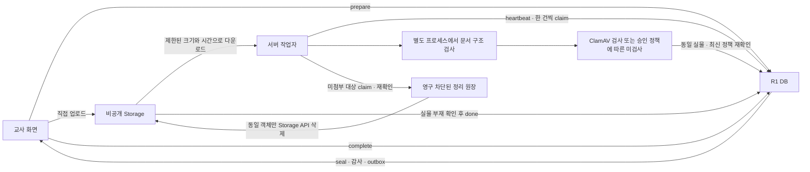

# 수합 R1 서버 연결과 검사기 운영 인계

2026-10-15 · `feat/workhub-r1-worker-connection` · PR #41을 잇는 서버 연결 구현

> **후속 사용자 결정 — HWPX 전용 최소 확인으로 전환:** 별도 검사 서버·ClamAV 배포와 기존 R1-05·06 활성화 절차는 보류한다. 이 문서는 기존 구현과 시험의 이력이며 현재 실행 지시가 아니다. 새 앱·Vercel 최소 확인 API 및 Claude에게 요청한 R1S 증분 계약은 [HWPX 전용 간소 수합 요청서](42-hwpx-basic-collection-request.md)를 따른다. 이미 적용한 R0·R1과 기존 자료는 보존하며, 새 SQL·서버 환경값·배포 확인 전에는 새 수합을 준비 완료로 표시하지 않는다.

## 현재 결과

사용자가 R1-00~04를 지정 Supabase `dhaoszbqtbofqftgjfyb`에 적용했고 기존 사이트도 확인했다. 전후 보존 지문 F1~F9가 같았다는 적용 결과를 전달받았다. R1-05(작업자 연결)·06(정책 게시)은 아직 하지 않았다. 이번 작업은 SQL을 바꾸거나 실행하지 않았다.

앱의 기존 RPC/Storage 어댑터가 R1과 맞는지 확인하고, 실제 서버용 HTTP 전송·검사·정리 실행기를 추가했다. 코드만 병합해도 서버 작업자가 자동 배포되거나 `verification_missing`이 해제되지는 않는다. 실제 Supabase/PostgREST/Storage 서비스에서의 종단 확인은 사용자 요청에 따라 나중에 모아 진행한다.



## 구현 파일과 계약

| 파일 | 역할 |
|---|---|
| `workers/collection_files/transport.py` | R1 RPC 8개와 Storage 직접 다운로드·삭제. 서버 키, 요청 시간, 응답 크기, HTTP 오류 처리 |
| `r1_worker.py` | 확정 R1의 필드/정책/정수 임대 토큰으로 검사·정리·재전송 수행 |
| `runtime.py` | 기존 PDF/HWP/HWPX/Office 검사 코어를 별도 프로세스에서 실행. 선택형 ClamAV Unix 소켓 연결 |
| `__main__.py` | 로컬 자체 점검, 단발 검사, 단발 정리 명령. 기본값은 외부 요청 없음 |
| `workers/.env.example` | 서버 환경 변수 이름만 제공. 실제 비밀값 없음 |
| `workers/Dockerfile` 및 전용 ignore | 비관리자 Linux 실행 이미지 준비. 기본 시작은 자체 점검 |
| `tests/test_workhub_r1_*.py` | HTTP 전송·프로세스·스캐너·복구·정책 경합 회귀 |
| `tests/integration/workhub-r1-worker.py` | 별도 로컬 PostgreSQL 17에 설치된 승인 SQL과 실제 작업자 왕복 |

구 `verification.py`·`cleanup.py`는 독립 코어/기존 시험용 계약으로 보존했다. R1에는 파일명·가상의 승인 참조·runId·정리 manifest가 응답에 없으므로 임의로 만들어 채우지 않는다. 새로운 실행기가 `inspection.py`와 형식별 파서를 그대로 재사용하며 확정 RPC에 직접 대응한다.

- JSON 응답의 필드·자료형, 학교/파일 경로, 고정 Storage 객체 ID, 임대 토큰을 대조한다. worker RPC는 앱의 `{ok,data}` 봉투와 달리 직접 JSON을 반환한다.
- 미확정 `seal`·`cleanup_done`은 같은 인자를 한 번만 재전송한다. 계속 불명확하면 그대로 멈추고 서버의 임대 만료/재인수로 복구한다. 결과를 새로 만들거나 `fail`로 덮어쓰지 않는다.
- 작업은 한 건씩 인수한다. 처리 실패 시 그 배치를 멈춰 다른 파일의 임대까지 소모하지 않는다. 일시 장애는 SQL의 재시도 상한을 따른다.
- 정리 원장이 생기면 정상 첨부·업로드 확인·같은 경로 재업로드를 영구 차단하는 R1 계약에 의존한다. 삭제 직전 다시 확인하며, 실제 삭제는 Storage API만 사용한다. `storage.objects` 직접 삭제는 운영 코드에 없다.
- 정리 기본값은 실행 안 함이다. `cleanup_claim` 자체가 영구 차단을 만들기 때문에 미리보기라고 부르면서 claim하지 않는다.
- 로그에는 고정 상태/코드만 남는다. 키·임대 토큰·학교/학생/파일명·본문·경로·외부 오류 원문은 출력하지 않는다.

## 실행 준비

Python 3.12와 저장소의 의존성을 사용한다. 기존 앱 배포에 Python을 끼워 넣지 않으며 이 작업자는 독립 서버 프로세스다.

```bash
python3 -m venv .venv
.venv/bin/pip install -r workers/requirements.txt
.venv/bin/python -m workers.collection_files check
```

정상 자체 점검 결과는 `status=checked`, `mode=local_only`, 기본 검사 5개, `databaseCalled=false`, `storageCalled=false`, `malwareChecked=false`다. 이는 R1 연결 완료를 뜻하지 않는다. `verify`와 `cleanup`도 `--execute`가 없으면 같은 로컬 점검만 한다.

서버 비밀 저장소에 `workers/.env.example`의 값들을 등록한다. `.env`를 자동으로 읽지는 않는다. 프로세스 환경으로 주입해야 한다.

| 변수 | 넣을 값 |
|---|---|
| `WORKHUB_SUPABASE_URL` | 현재 프로젝트의 HTTPS URL |
| `WORKHUB_EXPECTED_PROJECT_REF` | 의도한 프로젝트 ID. 현재 지정값은 `dhaoszbqtbofqftgjfyb` |
| `WORKHUB_SERVICE_ROLE_KEY` | 서버용 secret 또는 기존 service_role 키. 교사 access token/공개 키 사용 금지 |
| `WORKHUB_SCHOOL_ID` | R1-05에서 연결을 승인한 실제 학교 ID. `daedong-ms` 같은 학교 코드와 다름 |
| `WORKHUB_WORKER_ID` | 운영자가 구별할 서버 작업자 이름 |
| `WORKHUB_WORKER_RELEASE` | 검토·배포한 코드 판 표식 |
| `WORKHUB_SCANNER_MODE` | 기본 `clamav`. `policy_unscanned`는 미검사 허용을 승인한 경우의 명시적 선택 |
| `WORKHUB_CLAMAV_SOCKET` | 같은 서버/승인 컨테이너 볼륨의 Unix 소켓 절대 경로 |

새 Supabase secret은 `apikey`에만, 기존 service_role JWT는 `apikey`와 Bearer에 넣는다. 설정 검사는 서버의 실제 인증을 대신하지 않는다. [Supabase API 키 문서](https://supabase.com/docs/guides/getting-started/api-keys)를 따랐다. 키를 Vite 환경값이나 GitHub PR·메신저·브라우저에 넣지 않는다.

Linux 컨테이너를 사용할 때:

```bash
docker build -f workers/Dockerfile -t workhub-collection-worker .
docker run --rm --read-only --memory=1536m --cpus=1 --pids-limit=32 \
  --cap-drop=ALL --security-opt=no-new-privileges workhub-collection-worker check
```

이미지에는 작업자 소스와 의존성 명세만 보낸다. Docker 엔진이 없는 현재 Windows에서는 이미지를 실제로 빌드하지 않았다. 이미지 실행 검증·비밀값 주입·소켓 접근 권한·실제 스캐너 설치는 배포 단계에서 확인한다. `check`가 기본이며 이미지 시작만으로 DB를 변경하지 않는다.

## ClamAV와 검사 한도

기본 `clamav` 모드에서 스캐너가 없거나, 서명이 낡았거나, 자체시험에 실패하면 heartbeat를 보내지 않는다. 연결 후에도 heartbeat 갱신 시마다 상태와 표준 시험 문자열 검출을 확인한다. 검사 실패는 `clean`으로 바꾸지 않는다. 미검사 모드에서도 각 파일의 예약/현재 승인 정책 모두가 허용해야 `not_scanned`로 완료할 수 있다. 임의 허용 정책을 코드에 넣지 않았다.

운영 ClamAV는 `TZ=UTC`, 로컬 Unix 소켓만 사용한다. TCP 공개 포트를 만들지 않는다. `freshclam`으로 서명을 갱신한다. 다음은 배포 시 실제 데몬 설정과 경계 파일로 확인해야 할 조건이다.

- `StreamMaxLength`, `MaxFileSize`가 승인된 최대 파일 크기보다 작지 않아야 한다. 작업자의 기술상 최대는 100 MiB다.
- `MaxScanSize`는 허용되는 원본+확장량을 감당해야 한다. 작업자의 확장량 상한은 128 MiB이며, 기본 배포 준비 기준은 총 256 MiB 이상으로 검토한다.
- `AlertExceedsMax yes` 등 한도 초과를 알리는 설정을 사용한다. 일부 검사를 건너뛰고 `OK`를 주는 설정으로 활성화하지 않는다. 압축·문서 검사 관련 기능이 실제로 켜졌는지도 확인한다.
- 데몬은 임시 파일을 사용할 수 있다. 별도 임시 저장소·권한·보존/정리를 설정한다. Python 작업자 본문을 디스크에 저장하지 않는다는 사실을 데몬 전체의 무저장 보장으로 해석하지 않는다.

자체시험은 엔진 동작과 서명 시각을 확인하지만 데몬의 모든 설정·문서 형식·악성 코드 탐지를 보증하지 않는다. 이번 시험에서 실제 ClamAV 데몬은 실행하지 않았으며 소켓 프로토콜 대역을 사용했다. [ClamAV 공식 설정](https://docs.clamav.net/manual/Usage/Configuration.html), [프로토콜](https://docs.clamav.net/manual/Usage/ClamdProtocol.html).

기존 구조 검사도 모든 PDF/HWP 변형의 호환을 보장하지 않는다. [형식별 실측 결과](38-document-compatibility.md)를 따른다. 미지원 문서는 `unsupported`로 확정 거절하며, 파서 장애는 재시도한다. 승인 없이 미지원 파일을 통과시키지 않는다.

## 활성화 순서 — 사용자·Claude와 진행할 후속 단계

1. 이 PR의 코드 검토와 필요한 선행 앱 PR을 통합한다. SQL #39의 사용자 적용과 GitHub 병합은 별도다.
2. 서버 실행 위치·비밀값 주입·ClamAV 및 서명 갱신을 준비하고 로컬 자체 점검을 통과시킨다. 실제 실행은 별도 서버 작업자이며 현재 Vercel 앱에 자동으로 생기지 않는다.
3. Claude와 R1-06 정책값(형식/크기/개수·미검사 허용·철회/정정·보존일)을 확정하고 사용자가 적용한다. R1-05의 작업자·학교 범위 연결도 사용자가 적용한다. 이번 PR이 대신 실행하지 않는다.
4. 서버에서 승인된 환경값으로 한 번 실행한다.

```bash
python -m workers.collection_files verify --execute --max-jobs 1
```

5. 성공한 실행의 로그를 확인한 뒤 외부 스케줄러에서 검사를 1분 간격으로 실행한다. 중복 실행이 쌓이지 않게 설정한다. heartbeat TTL은 120초이므로 작업자가 멈추면 새 업로드/제출 준비 상태도 닫힌다. 파일당 다운로드·파서·스캐너 제한과 실행 지연을 고려해 감시한다. 종료 코드 1이나 `unknown/retry/stopped`를 성공으로 숨기지 않는다.
6. 정리는 따로 설정한다. 승인 정책과 실제 Storage 시험을 마친 뒤에만 다음 명령을 정기 실행한다.

```bash
python -m workers.collection_files cleanup --execute --max-jobs 1
```

작업자 중지/연결 회수는 Claude의 R1 실행 안내를 따른다. 원장이 막은 파일을 임의로 다시 열거나 DROP/직접 객체 행 삭제로 복구하지 않는다.

## 자동 검증 범위와 남은 한계

- `npm test`: 기존 전체 회귀와 새 전송/실행/프로토콜/복구 시험을 함께 실행한다. Python 의존성을 설치하지 않아 생기는 건너뜀은 통과로 세지 않는다.
- `python -m workers.collection_files check`: 실제 격리 프로세스에서 의존성과 정상 PDF·서명/해시 검사 자체 점검.
- 로컬 PostgreSQL 17.6 통합: 승인된 R1 SQL 함수, 서버 역할/학교 범위, 실제 HTTP 전송 어댑터, 검사 결과 봉인·감사·정리를 함께 확인. PostgREST 모양의 HTTP 대역과 Storage 본문/메타데이터 대역을 사용하므로 실제 Supabase 검증은 아니다.
- 전체 회귀 **2,198건**, 새 작업자 시험 **103건**(위 전체에 포함), 로컬 실제 R1 SQL 통합 **23건** 모두 통과했다. Windows/Ubuntu WSL에서 런타임 **39건**과 실제 CLI 자체 점검을 통과했다. Linux에서는 실제 자원 제한과 Unix 소켓 대역 왕복도 확인했다.

통합 시험은 `--sql-root`에 승인 R1 소스, `--database`에 `codex_r1_worker_*` 전용 빈 DB, `--port`, `--expected-data-directory`를 명시해야 한다. localhost/PG17/실제 데이터 디렉터리/빈 상태를 확인한 뒤 합성 승인·회원·파일만 추가한다. 운영 DSN을 받거나 기존 DB를 삭제하지 않는다. 다시 실행하려면 별도 새 시험 DB가 필요하다. `psycopg2-binary`는 이 선택형 통합 시험용이며 운영 작업자의 의존성이 아니다.

남은 실제 확인은 PostgREST 응답, 교사 Storage 업로드/서명 URL 차단/내려받기, 실제 데몬 검사와 설정 경계, 다중 계정·모바일·ZIP·제출/철회/정정이다. 실사용 확인은 나중에 묶는다.

파서 프로세스 분리는 시간·CPU·메모리 제한이다. 동일 OS 사용자로부터 부모 프로세스/네트워크까지 완전히 격리하는 보안 샌드박스는 아니다. 배포 환경의 권한·네트워크·컨테이너 격리를 별도 확인한다. 정책을 최종 조회한 직후 바뀌는 경우까지 SQL `seal`이 원자적으로 다시 대조하지는 않는다. 첨부·내려받기는 SQL의 현재 정책 검사로 차단되며, 봉인 자체까지 원자적 정책 검사가 필요하면 Claude의 후속 SQL 개선 대상으로 삼는다.

## 판단해서 정한 것

| 결정 | 이유 | 바꾸는 위치 |
|---|---|---|
| 독립 서버 실행기 | 브라우저/Vercel 앱에 서비스 키·긴 문서 검사를 넣지 않음 | `workers/`와 배포 설정 |
| ClamAV 선택형 연결, 기본 필수 | 특정 외부 유료 검사 서비스나 비용 계약을 가정하지 않음. 미검사는 승인 정책 필요 | `WORKHUB_SCANNER_MODE`, R1-06 |
| 한 번에 1건 인수 | 큰 배치 뒤쪽의 임대 만료를 피함 | `r1_worker.run_once` |
| 원문/접수 정보를 로컬 영속 저장하지 않음 | 민감 파일·토큰 저장을 늘리지 않고 SQL 멱등/만료 재인수를 사용 | `_retry_sealed`, SQL 복구 계약 |
| 미지원은 명시적 확정 거절 | 무한 재시도를 피하며 사용자에게 다시 제출할 상태 제공 | `verify` 결과 분류 |
| 기술상 크기/압축 상한 | 학교 정책을 새로 만드는 것이 아닌 서버 자원 보호. 더 엄격한 학교 정책 우선 | `DEFAULT_LIMITS`, runtime 상한 |
| 정리 명시 실행 | claim만 해도 영구 차단이 생기므로 기본 실행으로 삭제 작업을 시작하지 않음 | CLI `cleanup --execute` |
