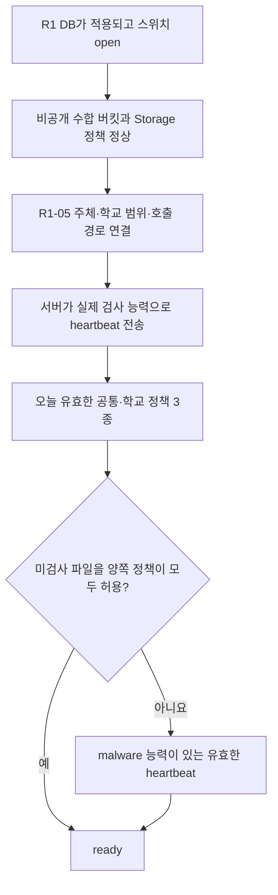

# 파일 검사기 배포와 R1-05·06 연결 준비 인계

2026-10-15 · `chore/workhub-worker-deployment` · PR #43 통합본의 후속 준비

## 1. 이번 작업의 도착점

파일 검사기를 서버에 올리기 전에 실행 환경·정책 입력·연결 순서·검증 증거를 준비한다. **이 문서는 R1-05·06 실행 승인서가 아니다.** SQL 확정·적용은 계란님과 Claude가 진행하며, 실사용 확인은 이후 한 번에 모아서 한다.

R0와 R1-00~04는 현재 Supabase `dhaoszbqtbofqftgjfyb`에 적용했다는 사용자 확인을 받았다. R1-05 작업자 연결과 R1-06 정책 게시는 아직 하지 않았다. 이번 준비 작업은 회원·DB·Storage·Vercel 설정을 변경하지 않으며, 교사 공개 범위도 넓히지 않는다.

원본 계약은 다음을 따른다. SQL 파일과 SQL 배포 묶음의 문서는 수정하지 않았다.

- [R1-05 연결 양식](../../database/workhub/r1/R1-05_검증작업자연결_양식.sql)
- [R1-06 정책 게시 양식](../../database/workhub/r1/R1-06_정책게시_양식.sql)
- [R1 실행 안내](../../database/workhub/r1/R1_실행안내.md)
- [R1 후속 구현 계약](../../database/workhub/r1/R1_검증작업자_후속명세.md)
- [구현된 R1 연결 실행기](40-collection-r1-connection.md)

## 2. 준비 상태가 열리는 실제 조건



서버는 위 그림의 원인 중 처음 걸리는 항목만 표시한다. 따라서 `verification_missing`이라는 결과만으로 정책이 이미 정상이라고 판단하지 않는다.

| 실제 상태 | 일반적으로 보이는 결과 | 해석 |
|---|---|---|
| R1 미설치 또는 스위치가 `open`이 아님 | `database_missing` | 설치 여부 외에 의도적인 중지도 확인 |
| 수합 버킷·Storage 정책 불일치 | `storage_missing` | 작업자를 먼저 실행해도 해결되지 않음 |
| R1-05 미연결, 주체/학교 승인 회수, heartbeat 없음·만료 | `verification_missing` | 기본 검사 능력 확인 전 단계 |
| 기본 5종 heartbeat는 유효하지만 현재 정책 3종이 없거나 형식 교집합이 빔 | `policy_missing` | 시행일이 아직 오지 않은 게시판도 해당 |
| 정책이 미검사를 허용하지 않는데 heartbeat에 `malware`가 없음 | `verification_missing` | 구조 검사와 악성 검사는 서로 다른 조건 |
| 위 조건 모두 충족 | `ready` | 수합 준비 조건 충족. 실제 업로드·권한·화면 시험까지 완료했다는 뜻은 아님 |

`R1-05 → heartbeat`의 순서는 필수다. 작업자가 등록되기 전에 heartbeat를 보내면 `FORBIDDEN`이 정상이다. **heartbeat도 DB에 이력을 기록하는 변경 작업**이므로 사전점검 명령에 끼워 넣지 않는다.

R1-06은 R1-05보다 먼저 게시할 수 있지만, 작업자가 없으면 닫힌 상태를 유지한다. 반대로 R1-05 이후 정책 없이 heartbeat를 보낼 수 있으나 수합은 열리지 않는다. 이미 유효한 정책이 있다면 첫 정상 heartbeat만으로 `ready`가 될 수 있으므로 단발 실행도 실제 활성화 단계로 다룬다.

## 3. SQL을 적용하기 전에 준비할 것

### 3-1. 서버 환경과 설정 대응

| 설정 | 출처·확인 기준 | 보관 위치 |
|---|---|---|
| `WORKHUB_SUPABASE_URL` | `https://dhaoszbqtbofqftgjfyb.supabase.co` | 서버 환경 설정 |
| `WORKHUB_EXPECTED_PROJECT_REF` | `dhaoszbqtbofqftgjfyb`; URL 호스트와 일치 | 서버 환경 설정 |
| `WORKHUB_SCHOOL_ID` | 승인할 실제 `workhub.schools.id`. 학교 이름·`daedong-ms` 같은 코드·관리자 UID와 구별 | 서버 환경 설정 |
| `WORKHUB_WORKER_ID` | 실행 인스턴스 이름. `[A-Za-z0-9_.:-]` 1~100자 | 서버 환경 설정 |
| `WORKHUB_WORKER_RELEASE` | 검토·배포한 코드 판 표식. `[A-Za-z0-9_.:+-]` 1~50자 | 서버 환경 설정과 배포 기록 |
| 서버 키 | 해당 프로젝트의 서버용 키. 사용자 access token·공개 키를 넣지 않음 | 호스트 비밀 저장소 또는 승인된 secret 파일 |
| `WORKHUB_SCANNER_MODE` | 기본 `clamav`. `policy_unscanned`는 별도 승인된 정책과 일치할 때만 선택 | 서버 환경 설정 |
| `WORKHUB_CLAMAV_SOCKET` | 검사기 컨테이너에서 보이는 로컬 Unix 소켓 절대 경로 | 서버 환경 설정 |

예시 환경 파일을 복사했다고 Python이 자동으로 읽지는 않는다. Compose 또는 서버 실행 환경에서 주입한다. 키는 Vite 변수·브라우저·PR·일반 인계 보고서에 넣지 않는다. 컨테이너 기본 `check` 및 `--execute` 없는 `verify`/`cleanup`은 키 파일을 읽지 않는다. 실제 실행 또는 별도 `preflight`에서만 `/run/secrets/workhub_service_key`를 읽는다. 파일 방식은 호스트에서 UID 10001 소유·0400으로 준비한다. Compose 파일형 secret의 uid/mode 선언만으로 호스트 권한이 바뀌지는 않는다.

키 없는 기본 `check`는 파서 자체 점검이다. 별도 `preflight`는 실제 배포 설정과 로컬 키 형식·파일 권한을 읽어 검사하며 파서도 확인한다. `--scanner`를 추가하면 실제 로컬 ClamAV 소켓도 확인하지만 DB·Storage로 요청하지 않는다. 따라서 이 점검은 프로젝트 키의 유효성, 실제 학교 소속, R1-05 연결 여부를 검증하지 않는다.

### 3-2. R1-05 입력표

| 입력·전제 | 채울 내용 | 결정/확인 주체 |
|---|---|---|
| `approver_user_id` | 현재 활성·가입 승인된 학교 관리자의 **Auth UID**. 이메일을 넣지 않음 | 계란님·Claude |
| `approval_ref` | 날짜·승인자·배포 확인 근거, 1~200자 | 계란님 |
| 대상 학교 | 위 관리자가 `school_admin`인 활성 학교가 정확히 한 곳이어야 함 | Claude의 적용 전 확인 |
| 기존 연결 유무 | `svc_file_worker` 또는 활성 service_role 연결이 이미 있으면 원본 양식은 중단 | Claude의 적용 전 확인 |
| 연결 전 검증 증거 | 아래 5절의 서버 준비 증거와 실제 Storage 점검의 구분 | 계란님·Claude |

R1-05는 입력으로 학교 ID를 받지 않고 관리자 소속에서 결정한다. 서버에 넣은 `WORKHUB_SCHOOL_ID`와 그 결과가 같은지 확인해야 한다. 다른 학교를 가리키면 작업자 함수는 거부된다.

R1-05가 만드는 것은 작업자 주체, 학교 범위 승인, service_role 호출 경로 연결이다. **작업자 배포·주기 실행·정책 게시를 대신하지 않는다.** 연결 후 heartbeat가 아직 없는 상태는 정상이다. 이미 연결한 양식을 재실행하거나 연결 회수 뒤 다시 쓰는 방식으로 복구하지 않는다. 변경·재연결 SQL은 Claude가 별도로 정리한다.

### 3-3. R1-06 정책 결정표

아래 값은 아직 확정하지 않았다. 시험 값이나 기술상 최대값을 학교 정책으로 복사하지 않는다. Claude가 승인 내용을 원본 양식의 JSON 자료형에 맞게 작성하고 계란님이 적용한다.

| 정책 입력 | 현재 SQL이 허용하는 범위 | 확정할 내용 |
|---|---|---|
| `approver_user_id`, `approval_ref` | R1-05와 같은 관리자 조건; 근거 1~200자 | 승인자와 근거 |
| `effective_from` | `YYYY-MM-DD`, 학교 시간대의 시행일 | 실제 시행일 |
| 공통 `extensions` | `pdf,hwp,hwpx,docx,xlsx,pptx` 중 중복 없는 1개 이상 배열 | 공통 허용 형식 |
| 학교 `extensions` | 동일 범위 | 학교 허용 형식 |
| 공통·학교 `maxFileBytes` | 각각 정수 1~104857600바이트 | 두 수준의 파일당 한도 |
| 공통·학교 `maxFiles` | 각각 정수 1~512 | 두 수준의 파일 개수 한도 |
| 공통·학교 `allowUnscanned` | 각각 JSON `true` 또는 `false` | 악성 검사를 안 한 파일을 허용할지 |
| 학교 `uploadTtlMinutes` | 정수 5~1440분 | 업로드 예약 유효시간 |
| `allowWithdrawal` | JSON boolean | 직접 철회 허용 |
| `allowCorrectionWindow` | JSON boolean | 정정 기간 허용 |
| `maxCorrectionDays` | 정수 1~365일 | 정정 최대 기간 |
| `unattachedRetentionDays` | 정수 1~365일 | 미첨부/거절 파일 정리에 쓰는 보존 기간 |

적용 규칙:

- 허용 형식은 공통과 학교 목록의 **교집합**이다. 비어 있으면 준비되지 않은 상태다.
- 크기·개수는 두 정책 중 작은 값이다. 개별 수합에서 더 적은 한도를 정할 수 있다.
- 미검사 허용은 양쪽 모두 `true`여야 한다. `policy_unscanned` 설정만으로 허용되지 않는다.
- R1-06은 **공통 정책 `file.safety`까지 게시**한다. 학교 두 정책과 달리 이후 다른 학교에도 공통 제한으로 작용하므로, 다학교 운영 관점에서 승인한다.
- JSON 배열·정수·boolean을 문자열로 넣지 않는다. 예를 들어 허용 여부는 `false`이며 `"false"`가 아니다.
- 정책 3종을 같은 시작일로 게시한다. 기존 게시판과 기간이 겹치면 중단한다. 후속 수정은 종료일을 정한 새 정책판으로 처리하는 별도 SQL이 필요하다.
- `unattachedRetentionDays`는 첨부되어 사용 중인 제출 파일 전체의 보존기간이 아니다. 만료된 업로드 예약은 원본 SQL에서 만료 후 1일을 별도 조건으로 사용한다. 이 조건을 학교 정책 값 하나로 바꿀 수 있다고 안내하지 않는다.

PDF·HWP는 파서가 있지만 모든 변형을 지원하지 않는다. [실측 호환성](38-document-compatibility.md)을 보고 초기 허용 형식을 정한다. R1에는 형식별 검사 능력 신고가 없으므로 `ready`만 보고 HWP/PDF 전체 지원으로 간주하지 않는다. 기존 SQL 후속 명세의 미지원 형식 제외 안내와 실제 지원 프로필을 Claude가 함께 확인해야 한다.

## 4. 검사기 설정과 정책을 맞추는 기준

| 항목 | 구현 기준 | 배포 시 확인 |
|---|---|---|
| 원본 최대 크기 | 작업자 기술상 최대 100 MiB | 학교 유효 한도 이하의 파일을 끝까지 검사할 수 있어야 함 |
| 파서 압축 확장량 | 총 128 MiB, 개별 항목 32 MiB, 항목 수 4096, 압축률 100, XML 16 MiB | 학교 정책이 아닌 기술상 한도. 실제 자료 호환성은 별도 확인 |
| `StreamMaxLength`, `MaxFileSize` | 학교 유효 최대 파일 크기 이상 필요 | 실행 중인 ClamAV 설정과 경계 파일로 확인 |
| `MaxScanSize` | 원본과 허용 확장량을 감당해야 함 | 배포 구성의 검사 예산과 실제 한도 초과 처리 확인 |
| 한도 초과 | 검사 생략을 `clean`으로 처리하면 안 됨 | `AlertExceedsMax` 및 관련 기능 활성화, 초과 문서 시험 |
| 데몬 통신 | 로컬 Unix 소켓 | 작업자 UID/GID가 접속 가능한지; 공개 TCP 포트 불필요 |
| 서명 갱신 | 기본 48시간 이내, 미래 시각 오차 5분 이내 | `freshclam` 갱신 및 서버/데몬 시계, `TZ=UTC` |
| 자체 악성 검사 시험 | 표준 무해 EICAR 시험 문자열 검출 | 실제 엔진이 검출해야 `malware` 능력 신고 가능 |
| 파서 격리 | 별도 프로세스, Linux 주소 공간/CPU 제한, 비밀 환경값 제거 | 컨테이너 메모리·권한·네트워크 통제는 별도 경계 |

구조 검사 통과는 악성 검사 통과와 다르다. EICAR 검출도 모든 문서 형식·악성 코드의 검출을 보증하지 않는다. Python 파서가 본문을 디스크에 쓰지 않아도 ClamAV는 임시 파일을 사용할 수 있으므로 데몬의 임시 저장소·권한·정리도 확인한다.

검사기 실행 위치·서버 요금·리소스·서명 갱신 운영자는 아직 선택하지 않았다. 이번 Linux/Docker 구성은 배포 가능한 준비 자료이며 외부 호스팅을 구매하거나 계정을 만들지 않는다.

## 5. 단계별 연결 순서와 완료 증거

**현재 진행 범위는 1~3단계의 준비까지다. 4단계 이후는 Claude·계란님과 후속으로 진행한다.**

| 단계 | 할 일 | 완료 증거 | 이번에 실제 서비스 변경 여부 |
|---|---|---|---|
| 1 | PR #43 및 후속 배포 준비 코드 검토 | 검토한 커밋, 테스트 결과, 원본 SQL 보존 확인 | 없음 |
| 2 | 이미지·비밀값 없는 설정·로컬 파서 사전점검 준비 | 명령과 로컬 결과, 코드 판/설정 판 | 없음 |
| 3 | 실제 배포 서버·ClamAV·서명 갱신·소켓·자원 계획, 정책 입력표 정리 | 미확정 항목 목록, 실제 데몬 점검이 끝났다면 그 결과 | 현재는 계획/도구만 준비 |
| 4 | Claude와 연결 전 Storage 점검 및 SQL 적용 선후관계 확정 | 아래 선행조건 해석과 적용 체크리스트 | 승인된 실제 환경 점검 필요 |
| 5 | 계란님이 R1-05 연결, 승인 내용에 따라 R1-06 게시 | 양식 실행 결과와 승인 근거; 실제 학교 ID 일치 | DB 변경, 사용자 실행 |
| 6 | 서버에서 승인된 단발 검사 실행 | heartbeat 수신/만료시각·준비 상태·고정 상태 로그 | DB/RPC·필요 시 Storage 접근 |
| 7 | 실제 교사 업로드·제출·다운로드·권한·오류 회복을 모아서 확인 | 실사용 점검표와 실패/재시험 결과 | 나중에 묶어 진행 |
| 8 | 검증된 실행 주기와 정리 작업을 개별 활성화 | 스케줄 중복 방지·장애 확인·정리 승인 기록 | 외부 설정과 실제 삭제 포함, 별도 진행 |

### 원본 R1-05 주석의 선행조건을 Claude가 정리할 것

원본 R1-05는 **“실제 Storage 실물로 시험한 뒤”** 연결한다고 적었다. 반면 앱에서 새 파일을 올리는 종단 경로는 R1-05·정책·heartbeat가 모두 있어야 열리므로, 전체 종단시험을 R1-05 이전에 마치도록 읽으면 순서가 순환한다.

이 문서는 그 조건을 삭제하거나 로컬 대역시험으로 충족했다고 선언하지 않는다. Claude에게 다음을 분리해 최종 안내를 요청한다.

1. 연결 전에 가능한 서비스 키/버킷/Storage 통신의 인프라 확인과 필요한 승인 범위.
2. R1-05 연결 후 가능한 실제 PostgREST 작업자 식별과 heartbeat 확인.
3. 정책·heartbeat 뒤 가능한 교사 앱 전체 시험. 사용자 요청대로 나중에 모아서 진행.
4. 시험 중 공개/쓰기 제한이 필요하다면 기존 R1-80/81의 실제 효과를 고려한 사용자 실행 절차. `writes_stopped`에서는 새 작업 인수도 멈추므로 검사 완료가 가능하다고 안내하지 않음.

실사용 확인을 나중으로 미뤘으므로 현재는 이 항목이 **연결 준비에서 남은 조건**이다. SQL을 바로 적용해도 된다는 근거로 사전점검 통과만 제시하지 않는다.

### 단발 실행과 주기 운영의 구분

후속 활성화 시 사용할 명령은 기존 `verify --execute --max-jobs 1`이다. 이는 연결 상태를 읽기만 하는 명령이 아니다. heartbeat 이력을 쓰고, 대기 중인 파일이 있으면 인수·검사·봉인한다. `check` 또는 새 배포 사전점검을 대신하지 않는다.

현재 실행기는 heartbeat TTL을 **120초**로 보낸다. 한 파일씩 인수하고 정상 처리 후 heartbeat를 갱신한다. 외부 실행 간격은 1분을 준비 기준으로 삼되 서버 성능·기동 지연·검사시간을 확인하고 중복 실행을 막아야 한다. 검사 실패/미확정 접수는 성공으로 숨기지 않는다. 작업자 멈춤이나 서명 갱신 실패로 heartbeat가 만료되면 새 업로드·제출 준비 상태가 닫힌다. 기존 내려받기는 별도의 정책·Storage·중지 상태를 따른다.

`cleanup`은 heartbeat를 갱신하지 않는다. 검사기 상태 확인 대신 정리를 실행하지 않는다. **`cleanup_claim`만 호출해도 대상 경로가 영구 차단**되므로 조회용 시험으로 사용하지 않는다. 실제 Storage 삭제·만료 재인수·이미 첨부된 파일 보존 시험을 마친 뒤, 계란님 승인 하에 정리를 개별 활성화한다. 이번 준비에서는 정리 스케줄을 켜지 않는다.

## 6. 준비 명령과 결과의 읽는 법

저장소 루트에서 Python 3.12와 [의존성](../../workers/requirements.txt)을 사용한다.

```bash
# 기존 로컬 파서 자체점검: 외부 접속 없음
python -m workers.collection_files check

# 배포 설정과 로컬 파서 점검: 서비스 키·DB·Storage 요청 없음
python -m workers.collection_files.deployment

# 같은 서버의 실제 ClamAV 소켓까지 확인: DB·Storage 요청 없음
python -m workers.collection_files.deployment --scanner
```

Docker 구성은 [기본 사전점검 구성](../../workers/deploy/compose.yaml)과 [명시적 실제 실행 구성](../../workers/deploy/compose.runtime.yaml)을 분리한다. 실제 이미지 빌드·구성 검사·명령은 배포 구성의 README를 따른다. 단순 `up`만으로 작업자가 실제 DB 작업을 시작하도록 만들지 않는다.

| 증거 | 증명하는 것 | 증명하지 못하는 것 |
|---|---|---|
| `check` 성공 | 설치한 파서가 자체시험에 통과 | 배포 환경값, 스캐너, Supabase 연결 |
| 배포 사전점검 성공 | 입력 형식·프로젝트 호스트 일치와 파서 실행 | 키 유효성·실제 학교 ID·R1-05 연결 |
| `--scanner` 실제 데몬 점검 성공 | 소켓 통신·서명 시각·표준 시험 검출 | 모든 데몬 설정, 한도 경계, 실제 Storage 파일 전체 경로 |
| 로컬 PostgreSQL R0/R1 시험 | 승인 SQL의 제약·권한·멱등·복구 | 실제 Supabase의 PostgREST/Storage 배포 상태 |
| 소켓/HTTP 대역시험 | 오류·접수 유실·경합 처리 | 실제 외부 서비스 호환 |
| 실제 환경 종단시험 | 사용한 계정·파일·기기·실행 시점의 정상 동작 | 미시험 형식·장애·계정 조합 전체 |

배포 증거에는 커밋/이미지 식별자, 설정 판, 점검 시각과 고정 상태 코드, 시험 항목만 남긴다. 키·사용자 토큰·파일 본문·학생 정보는 포함하지 않는다. 필요한 관리자 UID·학교 ID·승인 문서는 계란님과 Claude의 제한된 적용 자료에 두며 공개 PR에 복사하지 않는다. 실제로 수행하지 못한 Docker/데몬 시험을 다른 대역시험으로 대체해 “완료”로 표시하지 않는다.

## 7. Claude에게 전달할 내용

> PR #43 검토와 별도로 파일 검사기 배포 및 R1-05·06 연결 준비를 진행했습니다. SQL 원본과 운영 설정은 바꾸지 않았습니다.
>
> 1. R1-05의 “실제 Storage 실물 시험 뒤 연결” 조건을 연결 전 인프라 점검과 연결 후 앱 종단시험으로 구분해 최종 적용 순서를 정리해 주세요. heartbeat도 R1-05가 있어야 가능하며 DB 이력을 기록합니다. 실사용 시험은 계란님 요청대로 나중에 모아서 합니다.
> 2. R1-05 적용 전 관리자 Auth UID·활성 학교 한 곳·기존 주체/연결 유무와 서버의 실제 학교 ID가 일치하는지 확인할 절차를 준비해 주세요. 이메일이나 학교 코드를 UID/ID 자리에 넣지 않도록 해 주세요.
> 3. R1-06 정책은 아직 확정하지 않았습니다. 공통/학교 형식·파일당 크기·개수·미검사 허용·업로드 예약 시간·철회/정정·미첨부 보존일·시행일을 계란님과 결정한 뒤 양식으로 작성해 주세요. 공통 `file.safety`가 다른 학교에도 영향을 준다는 점을 포함해 주세요.
> 4. 기존 연결이나 게시판이 있다면 원본 양식을 재실행하지 말고 상태를 확인해 주세요. 재연결·정책 갱신이 필요하면 별도 SQL로 정리해 주세요.
> 5. 스캐너 모드와 유효 정책이 맞아야 합니다. 구조 검사만 통과한 경우 `malware` 능력을 신고하지 않습니다. `policy_unscanned`는 양쪽 정책이 모두 허용해야 하며, 이번에 임의로 선택하지 않았습니다.
> 6. 실제 PostgREST·Storage 업로드/서명 URL 차단·다운로드·실제 데몬·정리 삭제 확인은 별도 남아 있습니다. 자동검증 및 로컬 사전점검 결과와 구별해 주세요.
>
> 검토 후 필요한 SQL 확정과 실행은 계란님과 진행해 주세요. Codex는 서버 준비·설정 검증·자동시험 결과를 인계하겠습니다.

## 8. 판단해서 정한 것

| 판단 | 이유 | 변경 위치 |
|---|---|---|
| 실제 연결과 사전점검 명령 분리 | heartbeat/claim을 읽기 점검처럼 실행하지 않음 | `deployment.py`, 배포 Compose 구성 |
| 정책 값을 비워 둠 | 기술상 최대/시험 값을 학교 승인으로 오해하지 않음 | 이 문서 3절, Claude의 R1-06 작성 |
| R1-05 주석 선행조건은 Claude에게 해석·안내 보완 요청 | SQL 원본을 건드리지 않고 순환하는 종단시험 순서를 명확히 함 | 이 문서 5절, 후속 실행 안내 |
| 공통 정책 영향 별도 표시 | 처음 한 학교만 사용해도 이후 학교 범위를 고려해야 함 | 이 문서 3절 |
| 정리 활성화는 분리 | 정리 인수부터 영구 차단·삭제 흐름이 시작됨 | 배포 운영 설정, 사용자 승인 단계 |
| 실사용 시험은 후속 묶음으로 남김 | 사용자의 현재 작업 범위와 일치 | 이 문서 5~6절, 후속 점검 기록 |
