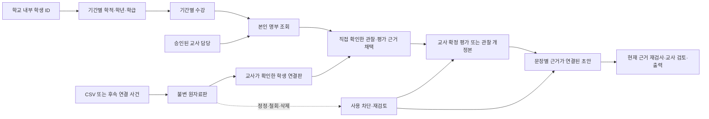

# 학생·수업·개인 기록·수업 사이트 연계 DB 설계안

작성 기준: 2026-10-11. **실행용 SQL이나 확정된 개인정보 처리 정책이 아니다.** 이 문서는 테이블·명령·검증 계약을 제안하며 실제 DB, 인증, RLS, 기존 마이그레이션을 변경하지 않는다. SQL 확정·실행은 저장소의 승인 절차를 따른다.

근거는 `apps/workhub/src/students/contracts.ts`, `store.ts`, `docs/workhub/05-students.md`, 바탕화면 `GPT작업/업무혁신시스템 기획서.md`의 C07~C12·M11~M14·DB-K/L·V40~V48이다. M09~M10은 **교사·수업·학급·학기 ID의 연결 접점만** 반영한다. 현재 시간표 작업은 보류 상태이며 편성·솔버·시간표 SQL을 이 설계에서 확장하지 않는다.

## 1. 현재 구현과 서버에서 추가할 범위

현재 구현은 합성 자료용 메모리 store다. 불변 학생 ID, 승인된 수업 담당, 학적·수강 기간, 작성자 전용 관찰, 정정·철회, 원자료판·학생 연결판, 멱등 명령, 변경된 근거의 내보내기 차단을 구현했다. 실제 RLS·CSV 파서·상담·평가·생기부 생성·물리 삭제를 구현했다는 뜻은 아니다.

현재 `Course.classId`와 `studentFor()`의 학급 일치 검사는 일반학급 합성 사례의 제약이다. 서버에서 이를 그대로 복사하면 여러 학적 학급의 학생이 듣는 선택과목을 처리하지 못한다. 아래에서는 `courses`와 `academic_classes`를 분리하고 **개별 `course_memberships`를 수강 권한의 근거**로 사용한다. `course_class_links`는 명부 설정·표시를 돕는 관계이며 학생 수강이나 시간표 집단의 동일성을 자동 증명하지 않는다.

자료 흐름은 다음과 같다.



학생을 전국 단일 ID나 로그인 계정으로 만들지 않는다. 같은 학생이 다른 학교에 입학하더라도 별도의 학교 내부 ID를 발급한다. 이름·반·번호·외부 별명으로 학교 간 기록을 병합하거나 개인 기록을 자동 이전하지 않는다.

## 2. 공통 표기와 강제 조건

### 2.1 타입·키·NULL

아래 테이블명은 모두 `public.workhub_` 접두사를 갖는다. 이후 표의 짧은 이름도 이 접두사가 붙은 **정확한 물리 테이블명**을 뜻한다. `?`만 NULL 허용이며 표시하지 않은 열은 NOT NULL이다. 기본값이 있는 열도 NOT NULL이다. `date`는 학교 현지 날짜, `timestamptz`는 서버가 기록한 실제 시각이다. 본문 길이·바이트는 공통 규칙 자산에서 검증하며 SQL과 동일한 문자 단위를 사용한다.

모든 테이블에 공통 열 **B**를 둔다.

| 공통 열 | 타입·제약 |
|---|---|
| `id` | TEXT PK, 기본 `gen_random_uuid()::text`; 생성 뒤 변경 금지 |
| `school_id` | TEXT FK → `workhub_schools.id`; 생성 뒤 변경 금지 |
| `created_at` | TIMESTAMPTZ, 서버 시각 |
| 공통 UNIQUE | `(school_id,id)` |

개인 본문 또는 그 관계표에는 **P**를 추가한다: `owner_user_id TEXT` → `public.users.id`, `created_by_member_id TEXT` → 같은 학교 `workhub_memberships.id`, `UNIQUE(school_id,owner_user_id,id)`. 소유자는 현재 세션에서 결정하고 이후 바꾸지 않는다. 작성 당시 소속과 소유 계정을 분리하므로 같은 계정의 새 학교 소속 행이 생겨도 옛 소속 ID를 덮어쓰지 않는다. 소속 FK는 `(school_id,created_by_member_id)`를 검사하고 해당 행의 `user_id=owner_user_id`를 명령에서 검증한다. 필요하면 기반 SQL에 `(school_id,user_id,id)` UNIQUE를 추가해 이 일치도 복합 FK로 강제한다는 **변경 제안**으로 남긴다.

개인 자식표의 부모 FK는 `(school_id,owner_user_id,parent_id)` → 부모의 동일 3열 UNIQUE를 사용한다. 단순 ID FK만 걸어 학교나 소유자가 다른 자료를 연결할 수 없게 한다. 학생·학년·학기·교과·수업 FK는 모두 `(school_id,x_id)`로 강제한다. 아래의 ‘FK → 표’는 이 공통 규칙을 생략 표기한 것이다. 열 여러 개가 같은 대상판을 가리킬 때는 개별 FK 외에도 함께 일치하는 복합 UNIQUE/FK를 둔다.

`sha256`, `payload_hash`, `evidence_hash`는 TEXT 소문자 64자리 16진수이며 알고리즘/정규화 버전을 함께 고정한다. 해시는 익명화가 아니므로 원문과 같은 접근 제한을 적용한다. 원문을 멱등 접수증·로그에 중복 저장하지 않는다.

공통 기간 **D**는 `valid_from DATE`, `valid_to DATE`, `CHECK(valid_from<valid_to)`이며 **[시작 포함, 종료 제외)**다. 학년·학기와의 포함 관계는 FK만으로 해결하지 않고 승인 명령 및 DB 제약 트리거에서 검사한다. 기존 `workhub_memberships.valid_through`는 종료일 포함을 유지한다. 비교 시에만 `valid_from <= 날짜 <= valid_through` 또는 동등한 종료제외 범위로 변환한다. 기존 날짜에 1일을 더하는 대량 수정이나 DTO 의미 변경은 하지 않는다.

### 2.2 버전·보존

- **H(원본 머리)**: `current_revision_id TEXT?`, `version BIGINT DEFAULT 0`, `evidence_epoch BIGINT DEFAULT 0`, `lifecycle TEXT`, `updated_at TIMESTAMPTZ`. 최초 개정본 생성과 머리 포인터 연결은 한 트랜잭션이며 빈 머리는 외부 조회하지 않는다.
- **R(불변 개정본)**: B+P에 `revision_no INTEGER CHECK >0`, `previous_revision_id TEXT?` 자기 표 FK, `reason TEXT`, `content_hash TEXT`, `hash_version TEXT`, `confirmed_at TIMESTAMPTZ?`를 둔다. `UNIQUE(school_id,parent_id,revision_no)`; 이전판과 부모·소유자·학교가 같아야 한다. 부모의 `current_revision_id`는 해당 부모의 개정본에만 연결하며 양방향 FK는 지연 제약으로 확정 시 검사한다.
- 본문 개정본은 일반 UPDATE/DELETE를 허용하지 않는다. 정정은 새 판이다. **승인된 파기 작업은 예외적으로 본문을 지우며**, `payload_state=available/redacted/purged`와 원문이 사라진 이유를 남긴다. 불변 원칙을 근거로 원문을 영구 보관하지 않는다. 내용이 파기된 판을 재현 가능하다고 표시하지 않는다.
- `needs_review`는 목록용 물리 열로 유지할 수 있지만 권한이나 출력의 최종 판정 근거는 아니다. 현재 조상 원본판·연결판·철회·접근·파기 상태와 epoch를 동기 검사한다.
- 표의 삭제 기본값은 **RESTRICT**다. 학생·소속·파일을 지울 때 개인 본문을 연쇄 CASCADE 삭제하거나 다른 교사에게 소유권을 넘기지 않는다. 승인된 파기 함수만 대상 순서에 따라 처리한다.

### 2.3 함께 일치해야 하는 FK와 실제 열 이름

R의 `parent_id`는 설명용 이름이다. 실제 열은 `observation_revisions.observation_id`, `counseling_revisions.counseling_id`, `assessment_rubric_revisions.rubric_id`, `assessment_revisions.assessment_id`, `record_draft_revisions.draft_id`, `activity_item_revisions.item_id`다. 각 표에 `UNIQUE(school_id,owner_user_id,실제부모열,id)`와 `UNIQUE(school_id,실제부모열,revision_no)`를 둔다. 머리의 `(school_id,owner_user_id,id,current_revision_id)`가 개정본의 해당 4열을 참조한다. `previous_revision_id`도 `(school_id,owner_user_id,실제부모열,previous_revision_id)`로 자기 표를 참조하므로 다른 원본의 이전판을 지정할 수 없다. 학생 프로필의 current 포인터도 `(school_id,id,current_profile_revision_id)` → `student_profile_revisions(school_id,student_id,id)`로 같은 학생임을 강제한다.

다음 UNIQUE와 이를 사용하는 복합 FK를 추가한다. 열이 겹치는 것은 의도된 무결성 검사이며 클라이언트 검증으로 대체하지 않는다.

- `student_enrollments(school_id,id,student_id)`; 수강·관찰·상담·평가·mapping의 `(school_id,enrollment_id,student_id)`가 참조한다.
- `teacher_course_assignments(school_id,id,course_id)` 및 `(school_id,id,course_id,member_id)`; 개인 기록/활동의 `(school_id,teaching_assignment_id,course_id)`가 전자를 참조한다. 해당 담당의 member가 작성자 계정에 속하는지는 명령에서 확인하며 작성 당시 member와 연결하는 경로는 후자의 복합 FK를 사용한다.
- `course_memberships(school_id,id,student_id,enrollment_id,course_id)`; 교과 관찰·평가의 `(school_id,course_membership_id,student_id,enrollment_id,course_id)`가 참조한다. mapping의 학생·학적·수업도 이 한 관계와 함께 검증하며, mapping의 수업은 item → activity_instance의 `course_id`와 DB 제약 트리거에서 일치시킨다.
- `assessment_criteria(school_id,owner_user_id,rubric_revision_id,id)`와 `assessment_revisions(school_id,owner_user_id,id,rubric_revision_id)`; scores의 루브릭판을 양쪽 복합 FK로 묶는다.
- `activity_item_revisions(school_id,owner_user_id,item_id,id)`; mapping의 item/revision과 receipt의 item/revision이 같은 원본임을 강제한다. 근거 링크의 원자료판·mapping판·학생 일치는 typed FK와 제약 트리거를 함께 사용한다.

새 ENUM/TEXT CHECK에는 각 표에 적힌 값만 허용한다. `revision_no/version/evidence_epoch` 증가·현재 포인터 전환은 서버 명령만 수행한다. 초안 작성일·관찰일·평가일은 학교 현지 오늘보다 미래일 수 없다. 열에 NULL이 허용되더라도 confirmed/approved처럼 확정된 상태가 요구하는 값은 조건부 CHECK와 확정 명령에서 필수로 검사한다.

공통 `workhub_deletion_requests`는 school/common 범위를 지원하므로 단순 `(school_id,deletion_request_id)` 참조를 사용하지 않는다. 이를 참조하는 `activity_tombstones`, `student_lifecycle_requests`에 `school_scope_key TEXT GENERATED ALWAYS AS (공통 학교 범위 키 생성식) STORED NOT NULL`을 둔다. 생성식은 해당 행의 `school_id`에서 04의 school scope_key와 정확히 같은 값을 만들며 클라이언트가 지정할 수 없다. 두 표 모두 `(school_scope_key,deletion_request_id)` → `workhub_deletion_requests(scope_key,id)` 복합 FK로 연결한다. 학생 자료에서 common 삭제 요청을 연결할 수 없고, 대상 삭제 요청의 scope_type=school 및 동일 학교도 명령에서 확인한다. lifecycle 요청의 deletion_request_id가 NULL인 비파기 상태에는 기본 MATCH SIMPLE을 사용하며, 실행되는 erasure와 tombstone에서는 삭제 요청 ID가 필수다.

## 3. 학교·학년도·학급·수업 관계

`workhub_schools`, `workhub_memberships`, `public.users`는 기반 문서의 기존 표를 사용한다. 부서·학년 기준은 기반 담당의 `workhub_departments`, `workhub_grade_levels`를 참조한다.

| 표 | B 외의 열·타입 | 키·참조·기간 규칙 |
|---|---|---|
| `academic_years` | `year INTEGER`, `label TEXT`, D, `state TEXT(draft/open/closed)`, `is_current BOOLEAN DEFAULT false`, `version BIGINT DEFAULT 1` | UNIQUE(school_id,year), 학교별 is_current=true 1개. 승인된 연도 기간은 같은 학교에서 겹치지 않는다. 연도 숫자로 3월 시작을 추정하지 않고 승인 날짜를 사용한다. |
| `terms` | `academic_year_id TEXT`, `code TEXT`, `label TEXT`, `kind TEXT(regular/intensive/special)`, D, `state TEXT(draft/open/closed)`, `is_current BOOLEAN DEFAULT false`, `version BIGINT DEFAULT 1` | FK → academic_years, UNIQUE(school_id,academic_year_id,code). regular끼리만 같은 학년도에서 기간 비중첩. 집중·특별 운영 기간은 regular와 겹칠 수 있다. 학교별 현재 학기 1개이며 현재 학년도와 일치. |
| `subjects` | `code TEXT`, `name TEXT`, `curriculum_version TEXT?`, `source_file_id TEXT?`, `active BOOLEAN DEFAULT true`, `version BIGINT DEFAULT 1` | UNIQUE(school_id,code,curriculum_version)를 NULL까지 같은 값으로 취급하는 정책으로 강제. file FK → workhub_files. 미확인 교육과정은 NULL이고 공식 코드로 표시하지 않는다. 교과의 의미가 바뀌면 ID 재사용 대신 새 행. |
| `academic_classes` | `academic_year_id TEXT`, `grade_level_id TEXT?`, `code TEXT`, `label TEXT`, `kind TEXT(homeroom/mixed/special)`, D, `version BIGINT DEFAULT 1` | 학년도·grade_levels FK. UNIQUE(school_id,academic_year_id,code). 혼합·특수 학급의 대표 학년은 NULL 가능하며 개별 학생 학년은 학적에 둔다. 단일 학년 학급에서는 학적 학년과 일치 검사. |
| `students` | `current_profile_revision_id TEXT?`, `status TEXT(enrolled/transferred/graduated/restricted/erased)`, `version BIGINT DEFAULT 0` | 학교 내부 불변 학생 ID. 주민등록번호·전국 연결키·외부 로그인 ID를 기본 필드로 수집하지 않는다. 상태만으로 과거 기록을 삭제하지 않는다. |
| `student_profile_revisions` | `student_id TEXT`, `revision_no INTEGER`, `display_name TEXT?`, `change_reason TEXT`, `confirmed_by_member_id TEXT`, `payload_state TEXT`, `source_file_id TEXT?` | 학생·소속·파일 FK, UNIQUE(school_id,student_id,revision_no). 파기 전 이름 필수, 파기 후 NULL. 이름 변경을 보존하지만 모든 명부 응답에 옛 이름 목록을 내리지 않는다. |
| `student_enrollments` | `student_id TEXT`, `academic_class_id TEXT`, `grade_level_id TEXT`, `student_number INTEGER`, D, `state TEXT(proposed/approved/superseded/cancelled)`, `approved_by_member_id TEXT?`, `approved_at TIMESTAMPTZ?`, `supersedes_id TEXT?`, `version BIGINT DEFAULT 1` | 학생·학급·학년·소속·자기 표 FK. approved는 승인자/시각 필수. 승인된 주학적끼리 학생 기간 비중첩; 같은 학급의 같은 번호도 기간 비중첩. 번호 양수, 번호 범위는 확인된 학교 설정. |
| `courses` | `academic_year_id TEXT`, `term_id TEXT`, `subject_id TEXT?`, `code TEXT`, `title TEXT`, `kind TEXT(subject/elective/homeroom_activity/support/joint)`, `curriculum_version TEXT?`, D, `state TEXT(draft/approved/closed/cancelled)`, `version BIGINT DEFAULT 1` | 학년도·학기·교과 FK. UNIQUE(school_id,term_id,code). 학기와 학년도 일치, 기간 포함 검사. 교과 없는 담임활동·지원활동은 subject_id NULL 가능. 폐강은 이력 삭제와 다르다. |
| `course_class_links` | `course_id TEXT`, `academic_class_id TEXT`, D, `purpose TEXT(roster_seed/display)`, `version BIGINT DEFAULT 1` | 수업·학급 FK, 같은 수업/학급/purpose 기간 비중첩. 학급 전체 수강은 별도 검토 후 개별 course_memberships로 만든다. 이 표만으로 학생 열람권한을 얻지 않는다. |
| `teacher_course_assignments` | `course_id TEXT`, `member_id TEXT`, `role TEXT(lead/co_teacher/substitute)`, D, `state TEXT(proposed/approved/revoked/superseded)`, `approved_by_member_id TEXT?`, `approved_at TIMESTAMPTZ?`, `supersedes_id TEXT?`, `version BIGINT DEFAULT 1` | 수업·소속·자기 표 FK. 동일 교사·수업·역할의 approved 기간 비중첩. 공동 담당 교사는 허용하되 각자 개인 기록은 분리한다. 원 소속 기간을 벗어나는 배정 금지. |
| `course_memberships` | `course_id TEXT`, `student_id TEXT`, `enrollment_id TEXT`, D, `state TEXT(proposed/approved/ended/superseded/cancelled)`, `approved_by_member_id TEXT?`, `approved_at TIMESTAMPTZ?`, `supersedes_id TEXT?`, `version BIGINT DEFAULT 1` | 수업·학생·학적 FK. `(school_id,enrollment_id,student_id)` 일치 복합 FK. 승인된 동일 수업/학생 기간 비중첩; 여러 선택과목 동시 수강은 허용. 기간은 수업·해당 학적 범위에 포함. |
| `student_duty_assignments` | `member_id TEXT`, `kind TEXT(homeroom/counseling)`, `academic_class_id TEXT?`, `student_id TEXT?`, D, `state TEXT(proposed/approved/revoked/superseded)`, `approved_by_member_id TEXT?`, `approved_at TIMESTAMPTZ?`, `version BIGINT DEFAULT 1` | 소속·학급·학생 FK. 학급/학생 대상 정확히 하나. 동일 교사/유형/대상 approved 기간 비중첩. 현재 배정의 최소 명부 조회에만 사용하며 타인의 상담 본문 열람권한이 아니다. |

비중첩은 승인 유효 상태에 대한 `daterange(valid_from,valid_to,'[)')` 배타 제약을 우선 제안한다. 확장 사용 여부를 별도 승인해야 한다면, 동일 논리 키에 대한 advisory transaction lock과 잠금 후 재검사를 쓰되 독립 PostgreSQL 연결 동시 승인 시험을 통과해야 한다. 클라이언트 조회 후 INSERT만으로는 충분하지 않다.

정정된 학적·배정은 과거행을 덮어 의미를 바꾸지 않는다. 기존 행을 superseded로 전환하고 새 승인 관계를 생성한다. 이미 그 관계에 묶인 기록은 과거 FK를 유지하며 재검토를 표시한다. 종료일만 바꾸는 전출 처리에도 이전 기간·사유·처리판을 감사/이력으로 남긴다. 정정 후의 ‘현재 유효 관계’와 ‘당시 기록에 사용한 관계’를 구분한다.

정상적인 기간 만료는 과거 승인을 취소하지 않는다. `approved` 관계는 날짜로 현재 유효성을 판정하며, course_memberships의 `ended`는 과거 해당 기간의 승인 증거로 인정하고 승인 비중첩 제약에도 포함한다. `revoked/cancelled`는 승인 자체를 철회한 경우이며 일반 학기 종료에 사용하지 않는다. `superseded`는 기존 기록의 이력 참조만 허용하고 현재 명부 권한으로 사용하지 않는다. 학기/수업이 `closed`여도 정책이 허용하는 본인 과거 기록 조회·정정이 자동 차단되지 않는다.

학교 명부 가져오기는 공통 import 작업과 files를 이용하되 적용 전 열 매핑·동명이인·번호 재사용·전입/전출 후보를 확인한다. 누락 행을 전출로 취급하지 않는다. 관리자는 이 명부와 승인 배정만 관리하며 관찰 내용·상담 여부·기록 수에는 접근하지 않는다.

기존 membership의 `department_ids/grade_ids/subject_ids TEXT[]`는 새 권한 원본이 아니다. 기존 외부 코드와 신규 ID의 승인 매핑을 만들고, 승인된 조직·배정에서 **기존 DTO가 기대하는 코드 배열을 projection**한다. `'2'`와 신규 grade ID, `'math'`와 신규 subject ID를 같은 문자열로 추정하지 않는다. 과거 일정 대상 조건의 의미가 바뀌지 않는 호환 시험 후 전환한다.

## 4. 작성자 전용 관찰·상담

| 표 | 열·타입 | 제약 |
|---|---|---|
| `observations` | B+P+H, `origin TEXT(direct/activity_adoption)`, `source_item_id TEXT?`, `needs_review BOOLEAN DEFAULT false` | source_item FK → activity_items, origin과 NULL 일치. lifecycle=draft/confirmed/withdrawn/restricted/purged. 동일 학교·소유자·원항목의 활성(draft/confirmed) 관찰은 1개만 허용하는 부분 UNIQUE. |
| `observation_revisions` | B+P+R, `observation_id TEXT`, `student_id TEXT`, `enrollment_id TEXT`, `course_id TEXT?`, `course_membership_id TEXT?`, `teaching_assignment_id TEXT?`, `student_duty_assignment_id TEXT?`, `observed_on DATE`, `activity_title TEXT?`, `fact_text TEXT?`, `state TEXT(draft/confirmed/withdrawn)`, `confirmed_by_member_id TEXT?`, `payload_state TEXT` | 관찰·학생·학적·수업·수강·담당 FK. 교과 담당과 담임/개별 담당 중 정확히 하나. 교과면 course/수강/teaching_assignment 모두 필수이고 학생·교사·관찰일이 일치. 담임/개별 담당이면 이 세 열은 NULL. confirmed에는 확인자·시각·본문 필수. withdrawal/파기 상태의 빈 본문은 사용 근거가 아니다. |
| `counseling_records` | B+P+H, `needs_review BOOLEAN DEFAULT false` | lifecycle=draft/confirmed/withdrawn/restricted/purged. 관찰과 별도 표이며 일반 근거 검색에서 제외한다. |
| `counseling_revisions` | B+P+R, `counseling_id TEXT`, `student_id TEXT`, `enrollment_id TEXT`, `student_duty_assignment_id TEXT`, `counseled_on DATE`, `note_text TEXT?`, `followup_text TEXT?`, `state TEXT(draft/confirmed/withdrawn)`, `confirmed_by_member_id TEXT?`, `payload_state TEXT` | 상담·학생·학적·승인 담당 FK. 해당 날짜의 허용 담당을 확인. 점수·성향·위험등급 자동 계산 필드 없음. 일반 인계·생기부 근거 FK의 대상에 넣지 않는다. |
| `observation_evidence` | B+P, `observation_revision_id TEXT`, `activity_item_revision_id TEXT`, `activity_mapping_id TEXT`, `span_start INTEGER`, `span_end INTEGER`, `source_hash TEXT`, `confirmed_by_member_id TEXT`, `confirmed_at TIMESTAMPTZ` | 관찰판·원자료판·연결판 FK. 연결판의 item/revision 및 학생·학적이 관찰판과 일치. 구간은 원답변의 Unicode code point [start,end), 범위와 해시 검사. UNIQUE(관찰판,원자료판,연결판,구간). 원문 전문 복사 필드 없음. |

직접 관찰은 교사가 작성한 사실을 원본으로 삼고 `observation_evidence` 행이 없어도 된다. 외부 채택은 유효한 typed evidence 행이 반드시 있어야 confirmed로 확정된다. 원자료와 무관한 새 수동 기록으로 오래된 출처 연결을 세탁하지 않는다. 공동 활동 설명을 여러 학생에게 사용하더라도 학생별 사실 확인과 개정본을 생성한다. AI 문장을 다시 관찰 원자료로 입력해 순환 근거를 만들지 않는다.

학생 연결을 고치는 관찰 정정은 새 개정본의 학생·학적·수강·관찰일·담당을 다시 검사한다. 이전 학생에게 연결된 초안의 근거를 자동으로 다른 학생에게 옮기지 않는다. 외부 채택 기록의 학생/원문판이 바뀌면 현재 구현처럼 기존 채택을 철회하고 다시 검토·채택하는 기본 흐름을 유지한다.

상담 내용을 생기부에 쓰고 싶다는 요청은 상담 본문의 링크를 생성하지 않는다. 교사가 기재 가능한 관찰 사실을 별도로 확인하여 직접 관찰을 작성하는 흐름이다. 상담 본문 복사를 자동 기본값으로 하지 않는다.

## 5. 교사 확정 평가

아래 표는 신규 설계이며 현재 합성 store의 구현 범위가 아니다. 루브릭 공유가 필요하면 학교 문서/양식 자산으로 별도 게시하고, 평가에 사용한 루브릭판은 소유 교사의 검토·확정 스냅샷으로 고정한다. 공동 교과라고 서로의 개인 평가 본문·건수를 자동 공유하지 않는다.

| 표 | 열·타입 | 제약 |
|---|---|---|
| `assessment_rubrics` | B+P+H, `course_id TEXT`, `title TEXT` | 수업 FK; lifecycle=draft/published/retired/restricted/purged. 본인이 이용 가능한 학교 공통 기준 파일에서 복사한 경우에도 개인 결과 열람권한을 확대하지 않는다. |
| `assessment_rubric_revisions` | B+P+R, `rubric_id TEXT`, `activity_title TEXT?`, `criteria_source_file_id TEXT?`, `conversion_schema JSONB`, `schema_version INTEGER`, `state TEXT(draft/published/retired)`, `payload_state TEXT` | 루브릭·공통 files FK. 변환은 허용된 연산·계수만 가진 버전 스키마이며 실행 코드 금지. 배점 합계·환산 가능 여부를 코드 검사한 판만 published. |
| `assessment_criteria` | B+P, `rubric_revision_id TEXT`, `criterion_key TEXT`, `position INTEGER`, `label TEXT?`, `description TEXT?`, `max_points NUMERIC(10,3)`, `assessment_included BOOLEAN`, `payload_state TEXT` | 루브릭판 FK; UNIQUE(school_id,rubric_revision_id,criterion_key), UNIQUE(동일판,position). max_points>=0. 제외 항목은 평가 합계에 들어가지 않는다. published판의 항목은 불변. |
| `assessments` | B+P+H, `needs_review BOOLEAN DEFAULT false` | lifecycle=draft/confirmed/withdrawn/restricted/purged. 현재 학생·점수는 current_revision으로 조회하며 머리에 과거 점수를 덮어 보관하지 않는다. |
| `assessment_revisions` | B+P+R, `assessment_id TEXT`, `student_id TEXT`, `enrollment_id TEXT`, `course_id TEXT`, `course_membership_id TEXT`, `teaching_assignment_id TEXT`, `rubric_revision_id TEXT`, `assessed_on DATE`, `result_state TEXT(not_submitted/absent/mapping_error/unverified/scored)`, `raw_total NUMERIC(12,3)?`, `converted_total NUMERIC(12,3)?`, `teacher_comment TEXT?`, `confirmed_by_member_id TEXT?`, `state TEXT(draft/confirmed/withdrawn)`, `payload_state TEXT` | 모든 대상 typed FK. 해당 학생·학적·수강·담당은 평가일과 일치. result_state=scored일 때만 합계가 값(0 포함)을 가지며 다른 상태는 NULL. confirmed는 교사 본인 확인과 최신 근거 재검사가 필요. 루브릭은 같은 학교·수업·소유자의 게시판. |
| `assessment_scores` | B+P, `assessment_revision_id TEXT`, `rubric_revision_id TEXT`, `criterion_id TEXT`, `points NUMERIC(10,3)?`, `state TEXT(unverified/scored/excluded)`, `rationale TEXT?`, `payload_state TEXT` | 평가판·루브릭판·항목 FK. 평가판의 rubric_revision 및 항목의 rubric_revision이 동일해야 한다. UNIQUE(학교,평가판,criterion_id). scored는 0<=points<=해당판max, 그 외 NULL. 합계는 포함된 scored 항목만으로 서버가 계산하며 미확인을 0으로 바꾸지 않는다. |
| `assessment_evidence` | B+P, `assessment_revision_id TEXT`, `observation_revision_id TEXT?`, `activity_item_revision_id TEXT?`, `activity_mapping_id TEXT?`, `span_start INTEGER`, `span_end INTEGER`, `source_hash TEXT`, `confirmed_by_member_id TEXT`, `confirmed_at TIMESTAMPTZ` | 관찰판 또는 활동판 정확히 하나. 활동판이면 mapping 필수, 관찰판이면 mapping NULL. 학생·학적·소유자 일치 및 원문 범위 검사. 근거 없이 AI가 제시한 점수만으로 confirmed 불가. |

점수 확정자는 교사다. AI 제안은 실행/초안 저장 영역에 두고 `assessment_scores`의 confirmed판을 자동 생성하지 않는다. 루브릭 개정은 이전 평가판의 FK·점수·환산 합계를 변경하지 않으며, 새 판으로 재평가하려면 영향 비교와 교사의 새 확정이 필요하다. 활동 미제출, 결시, 잘못 연결된 학생, 교사 미확인, 채점된 0점을 모두 다른 상태로 표시한다.

## 6. 생기부 초안과 문장별 근거

| 표 | 열·타입 | 제약 |
|---|---|---|
| `record_drafts` | B+P+H, `student_id TEXT`, `academic_year_id TEXT`, `term_id TEXT?`, `course_id TEXT?`, `section_code TEXT`, `needs_review BOOLEAN DEFAULT false` | 학생·연도·학기·수업 FK. 학생은 초안 전체에서 불변; 다른 학생으로 복사하는 명령 없음. section_code는 확인된 양식 설정이며 추정 목록을 SQL에 박지 않는다. lifecycle=draft/reviewed/exported/restricted/purged. |
| `record_draft_revisions` | B+P+R, `draft_id TEXT`, `generation_run_id TEXT?`, `source_snapshot_hash TEXT`, `rule_file_id TEXT?`, `rule_version TEXT?`, `rule_check_state TEXT(not_checked/passed/error)`, `measured_bytes INTEGER?`, `reviewed_by_member_id TEXT?`, `reviewed_at TIMESTAMPTZ?`, `state TEXT(draft/reviewed/exported)`, `payload_state TEXT` | 초안·규칙 files·`workhub_ai_runs` FK. 실행 thread의 소유자가 초안 owner와 같아야 한다. 규칙 미확보 시 rule_file/version/bytes NULL, not_checked. 검토자=owner. 새 문장·근거판이면 이전 검토 결과 재사용 금지. |
| `record_sentences` | B+P, `draft_revision_id TEXT`, `position INTEGER`, `text TEXT?`, `authoring_kind TEXT(teacher/ai_adopted)`, `support_state TEXT(supported/needs_confirmation/unavailable)`, `payload_state TEXT` | 초안판 FK; UNIQUE(학교,초안판,position), position>=1. 실제 생기부 결과물의 문장 단위이며 unsupported 문장은 확인 질문/검토 항목으로 남긴다. 파기 후 text NULL. |
| `record_sentence_evidence` | B+P, `sentence_id TEXT`, `observation_revision_id TEXT?`, `assessment_revision_id TEXT?`, `span_start INTEGER`, `span_end INTEGER`, `source_hash TEXT`, `confirmed_by_member_id TEXT`, `confirmed_at TIMESTAMPTZ`, `source_epoch BIGINT` | 문장·관찰판/평가판 typed FK, 둘 중 정확히 하나. 상담·외부 받은함·다른 초안은 FK 대상이 아니다. 근거의 학생·학교·소유자가 초안과 일치. source_epoch는 당시 검토 근거이며 현재값 재검사 필수. |

문장 변경은 초안의 새 개정본과 새 문장 행을 만든다. 문장 위치를 불변 원자료 ID로 삼지 않는다. 문장별 근거는 원본 ID·불변판·당시 해시·코드포인트 구간·확인자를 갖는다. 전문을 근거 링크에 복사하지 않으며, 보기 화면은 권한이 허용된 원본판을 그때 조회한다.

세 근거표(`observation_evidence`, `assessment_evidence`, `record_sentence_evidence`)에 `source_field TEXT`, `render_version TEXT`를 공통으로 추가한다. source_field는 원본 종류별 허용 목록만 사용한다. 활동은 `decoded_text`, 관찰은 `fact_text`, 평가는 `teacher_comment` 또는 `score_summary`다. `score_summary`는 고정된 render_version으로 해당 평가판·루브릭판·항목 점수를 결정적으로 표시한 문자열이며 새 AI 문장이 아니다. 해시와 구간은 이 필드의 **해당 판 렌더링 결과**를 대상으로 한다. 필드가 NULL이거나 빈 문자열이면 유효 근거 구간으로 확정할 수 없다. 소스 JSON 경로·평가 숫자열을 임의로 연결하거나 전체 본문을 다시 복사해 보관하지 않는다.

리뷰와 출력은 ‘조회 시 needs_review=false’를 신뢰하지 않고 조상 원문까지 검사한다. 관찰 v2로 정정되면 v1을 인용한 문장의 내용은 자동 수정하지 않는다. 기존 문장은 남기되 정상 출력·검토 완료를 막고, 교사의 새 근거 선택과 새 초안판에서 해결한다. 규칙 부재는 not_checked이고 통과가 아니다. 확인용 초안 출력과 검토된 출력은 명시적으로 구분하며 **공식 NEIS 입력 완료 상태는 자동 생성하지 않는다**.

출력 파일은 `student_record_files`의 `purpose=export` 링크와 공통 files의 불변 객체로 보관한다. 이 링크의 `exported_at`, `source_snapshot_hash`, `export_kind`가 출력 당시 증거다. 이미 내려받은 파일·복사한 텍스트·공식 시스템에 옮긴 내용은 원문 정정만으로 회수되지 않으므로 소유자에게 후속 정정 대상을 알린다.

## 7. 디지털윤리 CSV와 후속 사건 수신

### 7.1 실제 코드의 한계

읽기 확인한 외부 앱의 `public/teacher.js:39`는 dilemmas CSV를 `자리번호·별명, 현재 단계, 성찰 완료` + `fieldLabels` 순서로 내보낸다. `teacher.js:61`의 grading CSV는 `자리번호·별명, 현재 단계, 제출 여부, 나의 결정, 직접 제안, 선택한 근거, 근거를 고른 이유, 다른 사람, 영향, 필요한 조건, 심화 (평가 제외)`다. BOM, 인용부호 이스케이프, CRLF와 수식 선행 문자 보호가 있다. `src/worker.mjs`의 참가자 응답에는 내부 ID가 있지만 이 CSV에는 참가자/방 영구 ID·개정·수정 시각이 포함되지 않는다. 파일 이름의 방 코드도 인증된 방 ID가 아니다.

따라서 원 CSV의 별명·자리번호·행 순서를 영구 식별자로 승격하지 않는다. 당시 질문·선택지 버전은 별도로 확보해 교사가 확인한다. dilemmas의 선택 코드는 질문판으로 해석하고 grading의 변환된 문장은 원코드를 복원했다고 주장하지 않는다. `심화 (평가 제외)`는 관찰 가능한 원문으로 보존할 수 있지만 평가 합계에는 포함하지 않는다.

### 7.2 수신 표

| 표 | 열·타입 | 키·제약 |
|---|---|---|
| `external_connections` | B+P, `provider TEXT`, `mode TEXT(manual_csv/server_event)`, `credential_ref TEXT?`, `state TEXT(active/suspended/revoked)`, `expires_at TIMESTAMPTZ?`, `allowed_room_keys TEXT[]`, `allowed_actions TEXT[]`, `version BIGINT DEFAULT 1` | credential_ref는 서버 보관소의 식별자일 뿐 비밀키가 아니다. manual은 credential_ref NULL. server_event의 허용 방/행동은 연결 권한 관리 명령이 확정; 클라이언트 본문으로 확대 금지. 모든 mode 기본 비공개. |
| `activity_instances` | B+P, `connection_id TEXT`, `course_id TEXT`, `term_id TEXT`, `teaching_assignment_id TEXT`, `occurred_on DATE`, `lesson_kind TEXT(dilemmas/grading/other_verified)`, `external_room_key TEXT?`, `external_activity_key TEXT?`, `question_version TEXT`, `question_snapshot JSONB?`, `question_hash TEXT`, `state TEXT(draft/confirmed/closed/restricted/purged)`, `version BIGINT DEFAULT 1` | 연결·수업·학기·담당 FK. manual은 외부 방/활동 키가 없어도 가능하나 실제 수업·활동 회차·질문판은 교사가 확인. 자동 연결에서는 두 키 필수, UNIQUE(school_id,owner_user_id,connection_id,external_room_key,external_activity_key). 질문 구조는 parser 버전별 허용 스키마. 과거 활동의 초기 질문판을 덮어쓰지 않는다. |
| `activity_imports` | B+P, `activity_instance_id TEXT`, `file_id TEXT?`, `file_sha256 TEXT`, `parser_version TEXT`, `kind TEXT(dilemmas/grading)`, `state TEXT(uploaded/parsed/reviewing/applied/quarantined/restricted/purged)`, `supersedes_import_id TEXT?`, `confirmed_at TIMESTAMPTZ?`, `version BIGINT DEFAULT 1` | 활동·공통 files·자기 표 FK. UNIQUE(school_id,owner_user_id,activity_instance_id,file_sha256). 파일이 물리 파기되면 file_id NULL 가능, 삭제 원장의 재수입 차단은 남긴다. 같은 파일도 다른 활동 회차라면 별도 확인 후 가능. |
| `activity_items` | B+P+H, `activity_instance_id TEXT`, `connection_id TEXT`, `external_item_key TEXT?`, `external_participant_key TEXT?`, `external_question_key TEXT?`, `input_origin TEXT(csv/server_event)`, `needs_review BOOLEAN DEFAULT false` | 활동·연결 FK. 활동의 연결과 동일. lifecycle=active/withdrawn/restricted/purged. manual 식별은 로컬 ID이며 external 키 NULL 가능. 자동은 세 외부 키 필수·불변이고 아래 부분 UNIQUE 적용. 학생 연결·채택 여부는 mapping/evidence에서 계산하며 머리 상태로 중복 관리하지 않는다. |
| `activity_item_revisions` | B+P+R, `item_id TEXT`, `import_id TEXT?`, `row_number INTEGER?`, `column_key TEXT?`, `external_revision BIGINT?`, `operation TEXT(upsert/withdraw/delete)`, `raw_cell TEXT?`, `decoded_text TEXT?`, `alias_snapshot TEXT?`, `question_version TEXT`, `question_snapshot JSONB?`, `assessment_included BOOLEAN`, `payload_state TEXT` | 항목·import FK. CSV의 row/column은 출처 위치이며 동일성 키 아님. manual의 external_revision=NULL, revision_no는 서버 로컬판. 자동은 외부판양수, 같은 외부판 다른 해시를 거부. 원문·해석·질문은 파기 전 고정. |
| `activity_mappings` | B+P, `item_id TEXT`, `item_revision_id TEXT`, `mapping_revision INTEGER`, `student_id TEXT?`, `enrollment_id TEXT?`, `course_membership_id TEXT?`, `state TEXT(confirmed/withdrawn)`, `confirmed_by_member_id TEXT`, `confirmed_at TIMESTAMPTZ`, `reason TEXT` | 항목·원문판·학생·학적·수강 FK. confirmed에는 세 학생관계 모두 필수, 해당 원문·활동 날짜·수업과 일치. UNIQUE(학교,item_id,mapping_revision). 철회판은 연결을 없앤다는 사건이며 이전판을 수정하지 않는다. |
| `activity_ingest_receipts` | B+P, `connection_id TEXT`, `event_key TEXT`, `payload_hash TEXT`, `hash_version TEXT`, `item_id TEXT?`, `item_revision_id TEXT?`, `result_code TEXT(applied/duplicate/ignored_older/quarantined/blocked_deleted)`, `received_at TIMESTAMPTZ` | 연결·항목·원문판 FK. UNIQUE(school_id,owner_user_id,connection_id,event_key). 같은 사건+같은해시는 같은 결과, 같은사건+다른해시는 IDEMPOTENCY_CONFLICT. 삭제 후에는 FK를 비우고 원문 없는 차단 결과만 남길 수 있다. |
| `activity_tombstones` | B+P, `connection_id TEXT`, `activity_instance_id TEXT?`, `scope_kind TEXT(item/import/participant_activity)`, `key_digest TEXT`, `digest_key_version TEXT`, `max_external_revision BIGINT?`, `school_scope_key TEXT GENERATED`, `deletion_request_id TEXT`, `reason_code TEXT`, `expires_at TIMESTAMPTZ?` | 연결·활동 FK 및 `(school_scope_key,deletion_request_id)` → `workhub_deletion_requests(scope_key,id)`. UNIQUE(school_id,owner_user_id,connection_id,scope_kind,key_digest,digest_key_version). 같은 학교 범위의 삭제 요청만 허용한다. scope digest는 서버 HMAC으로 활동·논리 키/파일 지문을 결합한다. 이름·답변·별명 원문 저장 금지. 정책 미정 상태에서 자동 만료 금지. |

원문판이 바뀌면 이전 mapping은 기록으로 남지만 현재 mapping으로 계산하지 않는다. 현재 mapping은 **철회판까지 포함하여 그 item의 가장 큰 mapping_revision인 행**을 먼저 고른 뒤 `state=confirmed AND item.current_revision_id=mapping.item_revision_id`를 만족할 때만 유효하다. 최신판이 withdrawn이면 예전 confirmed판으로 돌아가지 않는다. 개별 문항 여러 개가 같은 학생을 가리키는 것은 허용한다. 동일 활동의 서로 다른 참가자를 같은 학생으로 연결하려는 경우에는 참가자 식별 가능 여부와 중복 사유를 별도 검토하며, 이름/별명 유사도만으로 승인하지 않는다.

자동 항목에는 `UNIQUE(school_id,owner_user_id,connection_id,activity_instance_id,external_participant_key,external_item_key) WHERE input_origin='server_event'`와 같은 범위의 participant/question 키 UNIQUE를 둔다. 한 활동 회차의 한 참가자·문항에는 한 논리 항목만 있다. 반복 시도는 새 활동 회차로 구분하며 기존 item_key의 참가자나 문항을 바꾸지 않는다. 원문판의 `UNIQUE(school_id,item_id,external_revision) WHERE external_revision IS NOT NULL`은 다른 event_id로 같은 외부판을 덮어쓰는 경로도 막는다. CSV판에는 이 외부판을 지어내지 않는다.

질문 정정은 활동의 초기 질문 스냅샷을 UPDATE하지 않는다. 해당 활동에서 영향을 받는 각 item에 새 원문판·새 question_version/스냅샷을 만들고, 이전 연결/채택을 모두 stale로 처리한다. 현재 해석에 사용한 질문은 반드시 그 item_revision에 있다. HMAC 키 교체 시 보존 중인 tombstone의 모든 key_version으로 수신 키를 대조하거나 안전하게 재키잉한 뒤 이전 키를 제거한다. 키 교체 때문에 삭제 차단 이력이 사라져서는 안 된다.

CSV 정정은 파일 업로드→파싱→기존 활동/새 활동 선택→기존 논리 항목과의 대응 확인→기대 원문판 검사→로컬 새 판 생성이다. `supersedes_import_id`만 지정했다고 행 전부를 자동 대응시키지 않는다. 빠진 행도 삭제로 추론하지 않는다. BOM·원문 인용부호·줄바꿈·빈 답변·수식 보호 작은따옴표를 분리 없이 보존하고, 해석본은 원본과 구별한다. 임의 파일 URI나 HTML을 실행하지 않는다.

후속 자동 사건은 연결 자격에서 학교·owner·허용 방을 확정한다. 요청 JSON의 school_id/owner_user_id/student_id는 권한 근거가 아니다. 예시 도메인 봉투는 아래와 같으며 실제 외부 앱이 이미 지원한다는 뜻이 아니다.

```json
{
  "event_id": "synthetic-event-0001",
  "room_key": "synthetic-room-a",
  "activity_key": "lesson-2026-10-19-a",
  "participant_key": "synthetic-participant-1",
  "question_key": "car-before-reason",
  "item_key": "car-before-reason",
  "source_revision": 3,
  "operation": "upsert",
  "question_version": "verified-lesson-v1",
  "occurred_on": "2026-10-19",
  "answer": "합성 답변"
}
```

낮은 외부판은 현재 원문을 되돌리지 않고 `ignored_older` 접수 결과를 남긴다. 같은 외부판+다른 본문은 격리하고 단순 last-write-wins하지 않는다. 기존 합성 store는 낮거나 같은 판을 `STALE_SOURCE`로 거부하므로 서버 적용 시 응답 계약의 차이를 명시한다. 삭제된 항목은 더 높은 판·새 event_id라도 차단한다. 되살리기는 자동 재전송의 결과가 아니며 승인된 새 등록 절차가 없으면 거부한다.

## 8. 첨부·전출·정정 접근·파기 메타데이터

| 표 | 열·타입 | 제약 |
|---|---|---|
| `student_record_files` | B+P, `file_id TEXT`, `observation_revision_id TEXT?`, `counseling_revision_id TEXT?`, `assessment_revision_id TEXT?`, `record_draft_revision_id TEXT?`, `purpose TEXT(attachment/export)`, `export_kind TEXT?`, `source_snapshot_hash TEXT?`, `exported_at TIMESTAMPTZ?`, `state TEXT(active/restricted/purge_pending/purged)` | 공통 files와 네 private판 typed FK. 대상판 정확히 하나. 파일 학교·owner·private scope가 대상과 같고 해당 원본판 권한을 만족해야 다운로드 가능. export면 초안판·snapshot hash·시각 필수. 동일 file+target 중복 링크 금지. |
| `student_lifecycle_requests` | B, `kind TEXT(student_transfer/teacher_exit/historical_correction_access/erasure)`, `student_id TEXT?`, `owner_user_id TEXT?`, `requested_by_member_id TEXT`, `approved_by_member_id TEXT?`, `approved_at TIMESTAMPTZ?`, `effective_on DATE?`, `policy_reference TEXT?`, `school_scope_key TEXT GENERATED`, `deletion_request_id TEXT?`, `reason_code TEXT`, `target_manifest_hash TEXT`, `state TEXT(draft/pending_approval/approved/applying/applied/partial/blocked/cancelled)`, `version BIGINT DEFAULT 1`, `result_code TEXT?` | 학생·사용자·소속 FK 및 `(school_scope_key,deletion_request_id)` → `workhub_deletion_requests(scope_key,id)`. erasure 실행은 같은 학교의 공통 삭제 요청 필수이며 실제 파기 상태는 공통 deletion_items를 따른다. 모든 유형의 대상·사유·범위를 제한 스키마로 검사. 본문·상담 여부·기록 개수·학생답변·평가점수 금지. 정책 검증 없는 승인/실행 금지. |

공통 파일 담당의 `workhub_files`가 bucket/path/해시/객체 상태를 소유한다. 학생 전용 버킷이라는 이름만으로 권한을 판정하지 않는다. 서명 URL 발급, 다운로드 프록시, 썸네일·검색·압축 작업도 private 부모의 **현재 소속+owner 권한**을 재검사한다. 기존 일반 파일 링크에 학생 private 파일을 붙여 학교 공유로 바꾸는 경로를 거부한다. 삭제할 원본 파일이 한 CSV의 다른 학생 답변을 포함할 수 있음을 별도로 추적한다.

라이프사이클 요청은 관리 절차의 최소 메타데이터다. 승인자는 원본 내용을 읽는 사람이 아니다. 작성자가 퇴직·전출하여 현재 학교 소속을 잃으면 과거 작성자라는 이유로 새 조회권한을 자동 부여하지 않는다. 확인된 학교 절차에 따라 한정된 정정 접근을 설계·승인할 때도 일반 관리자 열람으로 대체하지 않는다. 이 예외 정책은 AP06 확정 전 실행하지 않는다.

## 9. RLS·명부·과거 기록 접근 계약

RLS의 실제 SQL은 별도 승인 대상이다. 여기서는 필요한 결과를 고정한다.

| 자료 | SELECT 및 건수·검색 조건 | 변경 조건 |
|---|---|---|
| 학년도·학기·교과·학급 기본 정보 | 현재 활성 학교 소속. 학생 명부와 분리하여 필요한 설정만 조회 | 승인된 학교 명부/교육과정 담당의 전용 명령 |
| 학생 프로필·학적·수강 | 현재 활성 소속 AND 해당 기준일의 승인 담당 AND 필요한 학생 관계. 명부 담당은 직무 목적의 명부관리 경로만 | 승인 담당, 기대 version, 기간·중복·학교 FK 검사 |
| 관찰·상담·평가·초안·외부 받은함·근거·첨부 | 현재 활성 소속 AND school 일치 AND owner_user_id=auth.uid()::text AND 보존/접근 상태 허용 | 작성자만 전용 명령. 관리자·superadmin·지원 세션 우회 없음 |
| 과거 본인 기록 | 현재 같은 학교 소속이 유효하면 본인 기록과 연결된 최소 과거 학생 정보만. 현재 전체 명부 권한으로 확대하지 않음 | 작성자+사유+기대판+당시 승인 관계 검증. 소속 종료 상태면 거부 |
| 외부 서버 수신 | 연결 자격의 학교·owner·방·행동·만료를 서버가 확인, 사람이 SELECT할 권한과 분리 | 원문 수신만 가능. 학생 매핑·평가 확정·관찰 채택·초안 출력 권한 없음 |
| 파기·복구 worker | 목적이 고정된 내부 명령이 필요한 ID만 처리 | 삭제/제한 상태와 파생 차단만 수행, 본문을 운영자 응답·로그로 반환하지 않음 |

작성자 전용 제한은 본문뿐 아니라 `COUNT`, 집계, 학생별 기록 유무, 루브릭 결과, 검색 자동완성, 통계, 알림 문구, AI retrieval에도 동일하다. 관리자에게 ‘누구에게 상담 기록 1건이 있다’를 보여 주지 않는다. 운영 지표는 private 기록과 분리한 작업 성공/실패율 등 최소 메타데이터를 사용한다.

일반 사용자에게 private 표의 직접 INSERT/UPDATE/DELETE 권한은 주지 않고 검증 명령으로만 쓰게 한다. SELECT도 RLS 또는 제한된 security-invoker 조회를 사용한다. security-definer 함수는 search_path 고정, 세션 주체·소속·owner 재검사, 허용된 동작만 수행하며 service_role로 읽어 프런트에서 필터하는 방식은 금지한다. 멱등 재요청도 현재 권한 확인을 먼저 수행한다. 이전 receipt가 있다고 종료된 계정에 본문을 반환하지 않는다.

학생이 전출하면 이후의 새 수강·관찰은 거부하지만, 유효했던 날짜의 본인 기록을 전부 삭제하거나 후임에게 넘기지 않는다. 후임 교사는 승인된 새 담당 범위의 명부만 얻는다. 기존 작성자의 과거 정정은 실제 작성 당시의 학생·학적·담당 관계와 정정 목적을 검사한다. 당시 배정 정정으로 관계가 무효화되었다면 관리 절차에서 관계를 확인한 뒤 처리하며 기록 본문을 관리자에게 개방하지 않는다.

## 10. 원자적 명령·잠금·동시성

### 10.1 최소 잠금 규칙

초기 개인 근거 처리에서는 **학교+owner 단위 근거 게이트**를 transaction advisory lock으로 둔다. 원자료판/학생 연결 정정, 관찰·평가 정정, 초안 확정·검토·출력, 삭제 차단이 모두 이 게이트에 참여한다. 알림 큐의 실행 여부를 정합성 경계로 삼지 않는다. 교사별 직렬화의 병목은 측정 후 세밀한 원본 잠금으로 바꿀 수 있지만, 처음부터 복잡한 DAG 잠금으로 정합성을 약화하지 않는다.

공통 순서는 01 기반 문서와 동일하게 **관련 users 승인 행(정렬) → 학교 권한 gate(공통 작업은 platform grant) → 관련 memberships(정렬) → 권한/정책 행 → 멱등 advisory key → 관련 학교+owner 근거 게이트(정렬) → 필요한 학생/배정/머리 행(종류·ID 정렬) → 파일 → receipt/audit/outbox INSERT**다. 조회·권한 검사는 actor rows의 `FOR SHARE`, 회수는 `FOR UPDATE`로 보호해 non-key 상태 변경과 경합하게 한다. 단순 `KEY SHARE`로 대체하지 않는다. 대량 학적 정정으로 여러 owner가 영향을 받으면 owner 키 순서대로 처리한다. 승인·철회·인계·접수증 재요청을 포함한 모든 경로가 같은 순서를 따르며 현재 권한을 잠금 뒤 다시 확인한다. 학적 승인 함수도 영향을 받는 쓰기와 경합 검증을 공유한다. 외부 AI 생성처럼 오래 걸리는 계산 중에는 DB 잠금을 유지하지 않는다.

| 명령 | 입력·검사 | 한 트랜잭션에 확정할 것 |
|---|---|---|
| 명부/수강 승인 | import 기대판, 학생 매핑, 새 기간, 승인자 직무, 포함/비중첩 | 학생 또는 학적/수강 새 관계, 구 관계 superseded, 영향 근거 차단, 감사, receipt |
| 직접 관찰 생성 | session member, 학생·학적·수업/담당, 관찰일, 사실, confirmed, request_key | 머리+불변 v1+current pointer+접수증. 실패 시 전부 롤백 |
| 관찰/상담 정정·철회 | own ID, expected_revision, reason, 새 사실 또는 withdrawal | vN+1, 머리/epoch, 해당 파생 needs_review, 후속 정정 알림 ID, receipt |
| CSV 적용 | 활동·file hash·parser·질문판·교사 확인 매핑표·expected versions | import 적용판, 신규/정정 항목판, 받은함 상태. 없는 행 자동 삭제 없음 |
| 자동 수신 | 연결 검증, event_key/hash, 외부판, tombstone, 최신 권한 | receipt와 원문판/머리 변경, 관련 파생 차단. 알림 실패는 원문 상태를 되돌리지 않음 |
| 학생 연결 확정 | 원문 current판, expected_mapping_no, 학생·학적·수강, 활동일 | 새 mapping, 원본 epoch, 이미 채택한 기록의 needs_review |
| 관찰/평가 채택 | 원문판+mapping판+교사 사실/평가 입력+직접 확인 | 개인 원본판+typed evidence+활성 중복 방지+receipt. 매핑만으로 채택 완료 금지 |
| 평가 확정 | 기대판, 게시 rubric판, 항목점수/비채점상태, 근거, 교사확인 | 불변 평가판+점수들+합계/환산+근거+머리+receipt |
| 초안 생성 결과 반영 | 최초 근거 manifest/hash와 실행자, 현재 조상판/상태 재검사 | 같으면 draft판, 다르면 needs_confirmation 상태 또는 결과 보류. 최신 검토본으로 표시 금지 |
| 초안 검토/출력 승인 | 기대초안판, 문장별 본인확정근거, 현재 원자료/매핑/관계, 확인된 규칙 | 검토판/출력 manifest+본문 없는 파일 job. 파일 완성 후에도 다운로드 전에 현재권한·근거 재검사 |

생성과 정정이 동시에 진행되면 원문 변경 tx가 먼저 확정되었을 경우 결과 게시/리뷰/출력이 STALE_SOURCE로 실패한다. 출력 허가 tx가 먼저였더라도 파일 생성·다운로드 시점 재검사에서 뒤 정정을 발견하면 정상 출력으로 전달하지 않는다. 이미 전송을 완료한 파일은 회수했다고 표시하지 않고 후속 정정 목록에 남긴다. 데이터 변경 자체는 임의 취소하지 않는다.

멱등성은 `workhub_command_receipts`의 `(scope_key,actor_user_id,operation,request_key)`와 정규화 payload_hash를 사용한다. 이 문서의 명령은 scope=school만 허용하며 scope_key는 공통 서버 생성 규칙을 따른다. source 수신은 위 `activity_ingest_receipts`의 외부 사건 범위를 별도로 사용한다. 동일 키의 다른 본문은 오류다. 저장 실패 때 메모리만 먼저 성공시키지 않고 receipt·본체·판·outbox가 한 커밋 결과를 갖는다. 낙관 충돌 응답의 current도 현재 사용자가 읽을 수 있는 소유·학교 범위 안에서만 반환한다.

### 10.2 학년도·담당 전환

1. 새 academic_year/term을 draft로 만들고 승인 기간·현재 선택을 확정한다. 학생 ID를 새로 만들지 않고 새 학년도 학적·수강·교사 담당을 별도 생성한다.
2. 이전 학기 자료는 조회/정정 정책에 따라 남긴다. 현재 학기 선택이 바뀌었다고 과거판의 학년·반·루브릭·근거를 바꾸지 않는다.
3. 교사 변경은 승인된 교육과정 담당 명령으로 이전 담당 유효기간 종료와 새 승인 담당 시작을 처리한다. 수합 등 진행 업무의 수락·효력일·버전검사는 `workhub_handovers/workhub_handover_items`의 허용된 kind로 처리하며, 아직 허용되지 않은 course_assignment kind를 임의로 추가하지 않는다. 필요하면 두 명령의 ID를 인계 절차에서 연관 표시하되 하나의 미지원 RPC로 묶었다고 주장하지 않는다. **개인 관찰·상담·평가·초안·수업 받은함은 인계 manifest에서 제외**한다.
4. 소속 종료가 먼저면 접근을 먼저 차단한다. 학생 명부/담당 공백을 최소 정보로 알리고 인계 수락 때문에 접근을 연장하지 않는다.
5. 학기 전환 마법사·학교 간 자동 학생 추적·개인 기록 복사는 초기 요구에 포함하지 않는다. 보류된 시간표와는 나중에 `course_id + 관계 version + 유효기간`을 통해 연결한다. 시간표 단추 클릭 자체는 새 열람권한을 만들지 않는다.

## 11. 삭제·원문 복제·복구

### 11.1 접근 차단과 실제 파기 구분

`withdrawn`은 사용 철회, `restricted`는 접근/생성 차단, `purge_pending`은 작업 대기, `purged`는 확인된 저장 계층의 본문 파기다. 어느 하나를 다른 의미로 표시하지 않는다. 삭제 목표에는 activity 원문판·CSV 전체 파일·해석본·question/alias 스냅샷·첨부·관찰/평가/초안에 실제 복제된 내용·파일 출력·검색/벡터/캐시·AI 실행 산출물이 포함된다.

개인 근거 링크는 원문 텍스트를 복사하지 않아 중복 면적을 줄인다. 다만 관찰 사실·평가 설명·초안 문장에 학생 답변이 인용될 수 있으므로 링크만 삭제했다고 완료할 수 없다. 해당 파생판의 접근을 우선 제한하고 **파기 범위와 보존 근거를 표별로 판정**한다. 법적/학교 보존 사유가 확인되면 그 객체는 `restricted + retained_by_policy` 대상이며 ‘전부 삭제’로 표시하지 않는다. 정책이 정해지지 않았다면 자동 삭제를 실행하지 않고 요청을 blocked로 둔다.

### 11.2 실행 단계

1. 요청자의 권한·정책·대상 manifest/hash를 검토하고 승인한다. 일반 관리자에게 private 본문을 보여 주지 않고 고정된 내부 계산이 대상 FK를 찾는다.
2. 근거 게이트 안에서 원본을 restricted로 바꾸고 epoch를 증가시킨다. typed evidence를 따라 파생 기록·출력파일을 restricted/needs_review로 바꾸고 tombstone·공통 삭제 원장·파일 작업을 원자적으로 기록한다.
3. DB 본문/JSON/별명/질문/채점설명/문장과 해당 범위 첨부를 승인 범위에 따라 파기한다. 파기판의 해시를 보존할지는 AP06 정책을 따른다. 단순해시도 원자료 대조에 쓰일 수 있으므로 아무 제한 없는 감사로그로 이동하지 않는다.
4. CSV 일부 학생 삭제는 원본 CSV에도 그 학생이 남는 문제를 해결해야 한다. 원본 객체 전체를 제거하고 허용 행만으로 새 별도 파일을 재구성하거나, 삭제 불가 사유와 잔존 범위를 명시해 partial/blocked로 남긴다. 재구성 파일은 새 ID·새 hash를 가지며 원본 파일이 유지된 것처럼 표시하지 않는다.
5. `workhub_deletion_requests/workhub_deletion_items`의 범위별 상태를 기준으로 `workhub_jobs/workhub_job_attempts/workhub_outbox` worker가 파일 실물·캐시·색인·파생 파일을 처리한다. 보존 근거는 `workhub_retention_rules`, 복원 후 재적용은 `workhub_restoration_ledgers`를 참조한다. 파일 목록 행만 지운 것은 성공이 아니다. DB·객체 저장·백업 각각의 완료/잔존 상태가 수집되어야 적용 완료 범위를 표시한다.
6. 원본이 파기되어 더 이상 근거를 재현할 수 없으면 `unavailable`로 표시한다. 기존 초안의 내용은 정상 근거로 재사용하지 않는다. 외부 디지털윤리 사이트·교사 PC 다운로드 파일은 직접 삭제 권한이 없으므로 별도 수동 조치 필요로 표시한다.

삭제된 ID의 재전송·재수입·오래된 백업 복원은 tombstone과 공통 삭제 원장을 먼저 확인한다. CSV에 영구 참가자 ID가 없으므로 **다른 파일 해시/새 별명으로 바뀐 같은 학생의 답변을 항상 자동 탐지할 수 없다**. 활동 범위의 기존 파일·논리 항목은 확실히 차단하고, 삭제된 참가자의 대응을 증명할 수 없는 수정 CSV는 교사 재검토 전 적용하지 않는다. ‘학생의 모든 외부 흔적을 자동 차단’했다고 주장하지 않는다.

학교 내부 students 머리를 opaque tombstone으로 남기더라도 관계·날짜·번호가 재식별 가능하면 잔존 개인정보다. 파기 완료 판단은 학생 이름만 NULL로 만드는 수준이 아니라 관련 관계·파일·파생 텍스트의 보존 근거와 실제 제거를 대조해야 한다. 최소 재생 방지 원장에는 학교별 HMAC 논리키·범위·정책·시각만 남기고 전국 학생 추적키를 생성하지 않는다.

복원은 별도 격리 환경에서 외부 전송/AI를 끈 상태로 실행한다. DB와 파일을 함께 복구한 후 삭제·접근 회수 원장을 재적용하고, 끝난 교사 소속·철회된 연결·파기된 근거가 재공개되지 않았음을 검사한 뒤 접근을 연다.

## 12. 인덱스·조회 범위

공통 B/P 복합 UNIQUE 외에 다음을 초기 인덱스로 제안한다. 실제 트래픽·표본 EXPLAIN으로 확정하며 인덱스 이름은 후속 SQL에서 정한다.

| 대상 | 인덱스 열/조건 | 목적 |
|---|---|---|
| academic_classes | `(school_id,academic_year_id,grade_level_id,code,id)` | 연도별 학급 선택 |
| student_enrollments | `(school_id,academic_class_id,valid_from,valid_to,student_number)` 및 `(school_id,student_id,valid_from,valid_to)` | 현재·과거 명부, 반 이동 확인 |
| teacher_course_assignments | `(school_id,member_id,state,valid_from,valid_to,course_id)` | 해당 교사의 승인 수업 |
| course_memberships | `(school_id,course_id,state,valid_from,valid_to,student_id)` 및 `(school_id,student_id,course_id)` | 수업 명부·선택수강 충돌용 관계 조회 |
| observations/counseling/assessments/record_drafts | `(school_id,owner_user_id,lifecycle,updated_at DESC,id)` | 작성자별 cursor 목록; 전체 학교 기록 다운로드 후 필터 금지 |
| 개인 개정본 | `(school_id,owner_user_id,student_id,관찰/평가일 DESC,id)` 및 각 parent/revision UNIQUE | 학생별 본인 이력 |
| evidence 표 | 각 source revision FK 및 target revision FK의 `(school_id,owner_user_id,...)` 인덱스 | 원본 정정의 역방향 영향 조회 |
| activity_imports | 활동 범위 file hash UNIQUE 및 `(school_id,owner_user_id,state,created_at,id)` | 중복 수입·검토 대기 |
| activity_items | `(school_id,owner_user_id,activity_instance_id,lifecycle,id)` | 교사 받은함 |
| activity_item_revisions | item/local revision UNIQUE, 자동 외부판 UNIQUE | 역전·동일판 충돌 |
| activity_mappings | `(school_id,item_id,mapping_revision DESC)` 및 `(school_id,student_id,enrollment_id)` | 현재 학생 연결·파기 영향 |
| activity_tombstones | scope digest UNIQUE, `(school_id,owner_user_id,connection_id)` | 재수입/복원 전 차단 |
| student_record_files | 각 typed target FK와 `(school_id,file_id)` | 다운로드 권한·파기 파일 역조회 |

기록 내용의 학교 전체 전문 검색 인덱스는 만들지 않는다. 본인 검색도 RLS/owner 조건이 먼저 적용되는 경로로 제공하고 상담 검색 결과를 다른 모듈에 섞지 않는다. 개인정보 원문을 공통 ‘모든 자료’ 벡터 인덱스에 넣는 것은 기본 설계가 아니다.

## 13. 구현 순서와 수용 시험

S1~S6는 이 영역 내부의 의존 순서이며 별도 공개 단계명이 아니다. 전체 DB 설계의 R0(기반), R1(파일·업무), R2(학생·관찰·수업 앱), R3(지식·Claude·문서·평가·생기부)와 아래처럼 연결한다. 계정 자체의 개인 공간 E에는 학생 데이터를 복사하거나 이 표들의 school_id를 NULL로 바꾸지 않는다.

| 순서·전체 단계 | 생성·구현 묶음 | 선행·완료 증거 |
|---|---|---|
| S1 / R2, 일부 기준표 R0 | 학년도/학기/교과/학급/학생/학적/수업/배정/수강 | R0 학교·소속·grade_levels와 R1 files 기반. 같은 학교 FK와 기간 동시 승인 시험 |
| S2 / R2 | 본인 관찰·개정·철회, 상담 별도 표 | S1+R1 command_receipts/audit. 관리자 포함 타인 조회 0, 과거 정정·소속 종료 |
| S3 / R2 | manual 연결·활동 회차·CSV import·원문판·mapping·채택·삭제 차단 | R1 files+S1/S2. 실제 두 CSV 합성 fixture, 파일 단위와 행 단위 정정·삭제 |
| S4 / R3 | 루브릭·평가판·점수·typed evidence | S2/S3. 0점/결시/미제출/미확인, 교사 확정과 판 고정 |
| S5 / R3 | 문장별 초안판·근거·검토·출력 | S4+공통 AI 실행/문서 규칙/파일 작업. 정정 동시성·파생 차단·출력 권한 |
| S6 / R2 이후 선택 확장 | server_event 연결 자격·재전송·외부 발신함 | S3 정정/삭제 완결 뒤 별도 검증. 현재 디지털윤리 앱 API가 이 계약을 이미 지원한다고 보지 않음 |

학생 영역은 시간표 솔버 완성을 선행으로 요구하지 않는다. 수업·담당·수강 관계부터 독립 생성하고 후속 시간표가 이 ID와 기간을 읽는다. 시간표 미구현 때문에 학적 학급 ID를 임시 시간표 집단 ID로 재사용하지 않는다.

| 시험 | 입력·경합 | 반드시 확인할 결과 |
|---|---|---|
| ST01 학교 FK | 학교 A 학생+학교 B 학급/수업/파일을 직접 INSERT/RPC | 모든 조합 거부, private 본문·현재판 반환 없음 |
| ST02 작성자 전용 | 교사 A의 기록을 교사 B·학교 관리자·superadmin·지원자 계정으로 목록/단건/count/search/file 요청 | 본문·기록 존재·건수·요약·다운로드 0 |
| ST03 종료 소속 | 조회 중 종료, 저장 중 종료, 같은 receipt 재요청 | 확정 경계에서 재검사, 이전 자료/receipt 본문 재반환 금지 |
| ST04 학적 기간 | 동명이인·번호 재사용·당일 반 이동·겹친 승인 2연결 | [from,to) 경계 정확, 하나만 승인, 누락 CSV로 자동 전출 없음 |
| ST05 선택수강 | 두 학적 학급 학생이 한 elective course 수강 | 개별 승인 수강만 조회, classId 불일치로 정상 학생 누락 없음 |
| ST06 담당 | 본인 신고만 존재/승인 전/다른 교과/담당 종료 | 명부 권한 없음. 승인 공동담당끼리 개인 기록은 여전히 비공개 |
| ST07 과거 정정 | 새 학년도, 기존 담당 종료, 현재 학교 소속 유효 | 본인 기존판+당시 관계 확인 후 새 개정. 현재 배정만 없다는 이유로 관리자에게 소유 이전하지 않음 |
| ST08 낙관 경합 | 같은 관찰 v1에서 서로 다른 v2 저장 2연결 | 하나만 v2, 다른 요청 CONFLICT. 이력/receipt/outbox 일치 |
| ST09 학생 오연결 | 기록/외부 mapping을 A학생→B학생으로 정정 | 새 판·새 관계 검사, A학생 초안 stale, 내용 자동 이동 없음 |
| ST10 상담 경계 | 상담판 ID를 생기부 근거/일반 파일 링크에 사용 | typed FK/명령 모두 거부, 상담 존재 여부도 비공개 |
| ST11 점수 상태 | scored=0, absent, not_submitted, unverified, mapping_error | 0과 NULL 구별, 결시를 0으로 환산하지 않음 |
| ST12 루브릭판 | 점수 확정 후 배점·환산 새 판, 제외 항목 선택 | 과거 점수 불변, 범위 초과 거부, 심화평가 제외 |
| ST13 CSV 해석 | BOM·따옴표·쉼표·CRLF·셀 내부 줄바꿈·빈답·선행 작은따옴표 | 원문 보존·정확 열 매칭·수식/HTML 실행 없음 |
| ST14 활동 범위 중복 | 동일학교/owner/활동에 같은hash 2회; 같은파일 새활동 | 앞의 경우 1건, 새활동은 확인 후 별도 수입 |
| ST15 수동 CSV 정정 | 행 재정렬·별명 변경·행 누락 | 자동 항목 덮어쓰기/삭제/학생 병합 0; 확인 매핑 필요 |
| ST16 외부 사건 | 같은event 같은/다른payload, 3→2 역전, 같은판 다른본문 | 멱등/충돌/이전판무시/격리 정확. 로컬판과 외부판 혼동 없음 |
| ST17 수신 신원 | payload school/owner 위조, 허용 밖 방, 만료/철회 자격 | 기존 연결 범위 밖 저장·조회 0 |
| ST18 채택 경합 | 같은원문·연결판 동시채택, 채택 직전 원문변경 | 활성관찰 1개, stale는확정 거부 |
| ST19 정정 전파 | 원문/질문/매핑 정정·철회, 알림 worker 중단 | 관찰·평가·문장 즉시 사용 차단; 비동기 알림 지연으로 정상출력 허용 안 됨 |
| ST20 생성/정정 | AI 작업 시작 후 원문 정정, 결과 도착 | 최신 검토본 게시 안 됨; 근거 manifest 불일치 명시 |
| ST21 출력/정정 | review/export 승인과 원문 정정 독립연결 경합 | 잠금 순서 일치, 생성/다운로드 재검사, 오래된 파일 정상반환 0 |
| ST22 규칙 미확보 | 학교급·연도·영역 규칙 없음/오류 | not_checked/error와 확인용초안 표시; 임의바이트상한·공식완료표시 없음 |
| ST23 개인 인계 금지 | 전임 교사 종료·후임 수락·새 학년도 복사 | 승인 담당/업무만 이어짐; 관찰·상담·평가·초안·원자료소유 이전 0 |
| ST24 학생 전출 | 학적/수강 종료와 관찰 저장 경합 | 전출 후 새관계쓰기는거부, 유효과거본인기록은 정책에따라보존/정정 |
| ST25 실제 파기 | CSV 일부학생+원본파일+해석본+채택문장+출력파일 | 처리범위별제거증거; 원본CSV잔존시완전삭제표시금지 |
| ST26 재생 방지 | 삭제후 새event 높은판/같은CSV/백업복원 | tombstone/삭제원장으로차단; 새hash·별명대응불명은수동보류 |
| ST27 장애 복구 | DB커밋실패, 파일삭제실패, outbox중복, 복구중권한철회 | DB원자성·반복처리안전·partial상태정확·실패를빈목록/삭제완료로표시안함 |
| ST28 내용 없는 운영 | 관리자 대시보드·오류로그·메일/알림·AI trace 검사 | 학생본문·상담여부·점수·private기록건수·비밀키 없음 |

시험은 합성 자료와 서로 다른 실제 DB 세션으로 수행한다. 소스 문자열 검사만으로 RLS·동시성·파일 접근 통과를 선언하지 않는다. 학교·학년도별 규칙, 보존/파기와 과거 정정 예외, 외부 AI 입력 가능 범위는 AP06 및 관련 승인 전 실자료로 실행하지 않는다.

## 14. 판단해서 정한 것과 확정 전 항목

판단해서 정한 설계 제안은 ① 학교 내부 학생 ID, ② 수업과 학적 학급 분리, ③ 개인 자료 typed FK와 owner 중복 강제, ④ 초기에 교사별 근거 게이트로 동시 정정/출력 보호, ⑤ CSV 로컬판과 실제 외부판 분리, ⑥ 삭제 시 텍스트 복제본과 파일 실물까지 추적하는 것이다. 모두 위 테이블/명령/시험이 함께 바뀌어야 조정 가능하다.

확정 전 남길 항목: 학교급별 실제 명부·선택수강 표본, 학기 현재 선택의 학교 운영 방식, 같은 교사의 과거 신규 작성과 정정 허용 정책, 성적 반올림·환산 자산, 생기부 영역별 공식 확인 규칙, DB 확장/기간 제약 구현, 자료 유형별 보존·파기·백업잔존 기간, 종료 작성자의 한정 정정 접근 절차, 수동 CSV 질문판 확보와 외부 삭제 방식. **미확정 값을 추정 기본값으로 넣어 개인정보 접근이나 점수·공식 기록을 확정하지 않는다.**
