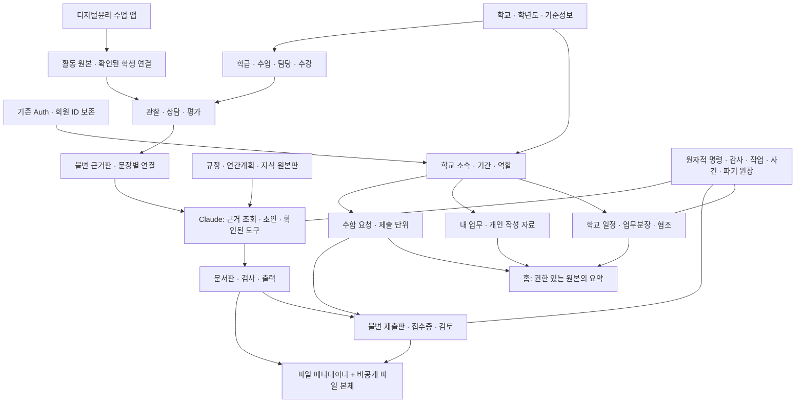

# 업무혁신시스템 DB 설계서

> 설계안 1.0 · 2026-10-11 · Codex
> 기준: 최종 「업무혁신시스템 기획서」, 5차 구현 `ff4a865`, 현재 저장소의 마이그레이션·신축 SQL 제안·TypeScript 계약.
> **상태: 통합 설계 / 실제 DB 미적용.** 기존 로그인·회원·운영 자료를 보존한다. 테이블 이름·제약은 구현할 계약이며, 운영 DB의 현재 구조·행 수를 실측했다는 뜻이 아니다. SQL 확정은 Claude Web, 실제 실행은 사용자라는 협업 규칙을 유지한다.

## 0. 결론: 어떤 DB를 만들 것인가

**기존 Supabase Auth와 회원 ID를 유지하고, 같은 운영 프로젝트에 학교별 경계가 있는 신축 업무 DB를 추가하는 방향을 추천한다.** 새 검증 환경에서 동일한 SQL과 권한을 먼저 시험한다. 프로젝트 구성은 계정·복구·실측 결과를 확인한 뒤 최종 적용한다. 기존 계정을 버리고 새 회원 테이블로 다시 가입시키는 방식은 사용하지 않는다.

현재 구현은 `public.workhub_*` 테이블과 `workhub_*` RPC를 전제로 한다. 이번 설계에서는 이 이름과 접속 계약을 유지한다. 스키마 이름을 바꾸는 것 자체가 학교 격리를 보장하지 않으므로, 우선 모든 관계·권한·저장 명령에서 학교 경계를 강제한다. 별도 스키마 이동은 실제 필요가 확인될 때 호환 계층과 함께 검토한다.

DB를 “완벽하다”고 부르는 기준은 표 개수가 아니다. **한 번 저장한 원본이 홈·문서·수합·학생 근거·AI에 일관되게 이어지고, 다른 학교·다른 작성자에게 새지 않으며, 정정·전출·실패·복구 때도 같은 계약이 지켜지는 것**이다. 아래 설계와 수용시험이 그 기준이다. 실제 DB 검증과 파일럿을 통과하기 전 완벽한 운영을 보장하지 않는다.

## 1. 문서 구성

| 문서 | 용도 |
|---|---|
| [연결 구조도](overview.html) | 전체 구조와 네 가지 업무 흐름을 선택해서 확인 |
| 이 문서 | 전체 연결 구조·설계 원칙·구축 우선순위·완료 조건 |
| [01 기반·권한·전환](01-foundation-security-migration.md) | 회원 보존, 학교·소속·역할, 기존 경로 대응, RLS·이관·복구 |
| [02 업무·수합·문서](02-workflows-documents.md) | 일정·업무·시트·수합·문서·파일·알림의 필드·관계·상태·명령 |
| [03 학생·수업 연계](03-students-integrations.md) | 학년도·명부·수강·관찰·상담·평가·생기부·활동 연결 |
| [04 지식·Claude·운영](04-ai-operations.md) | 지식판·검색·대화·도구 확인·작업·인계·보존·파기 |
| [05 SQL 구축 인계](05-build-handoff.md) | Claude가 확정 SQL을 작성하고 사용자가 적용할 순서와 검증표 |
| [기능·DB 연결표](coverage.md) | 기획 M00~M15·API-01~24와 구현 위치·후속 DB의 대응 |

기술 문서의 정확한 물리 테이블 명칭이 기획서의 예시 명칭보다 우선하는 **제안**이다. 기존 확정 D/P 결정을 자동 수정하지 않는다. 구현·승인·실측이 뒤따라야 한다.

## 2. 시스템을 연결하는 전체 구조

홈에는 별도 업무 원본을 복사하지 않는다. 읽기 권한을 통과한 일정·내 업무·의무·수업의 현재 상태를 조회해 요약한다. 캐시가 있더라도 캐시는 원본과 권한 버전으로 무효화할 수 있는 파생 자료다.

시간표는 현재 사용자 요청에 따라 보류한다. 다만 학교·학년도·학기·교사 소속·수업 ID는 미리 일치시켜, 재개할 때 학생 명부나 업무 DB를 다시 만들지 않게 한다. 시간표 집단과 학적 학급은 독립 수명주기를 유지한다.

## 3. 반드시 지킬 12개 설계 원칙

1. **계정은 사람, 소속은 학교에서 일할 자격이다.** 동일 계정의 학교별 권한·기간은 별개다.
2. **학교 표의 school_id는 필수다.** 학교별 FK는 학교 ID를 함께 묶는다. 다른 학교의 유효한 ID를 넣어도 저장할 수 없어야 한다.
3. **학교 안 개인 기록은 개인 소유이면서 학교 범위 자료다.** 관리자가 타인 관찰·상담·대화·미제출 초안을 기본 열람하지 않는다.
4. **열람·추천·의무는 별개다.** 홈 추천 조건을 열람권한으로 쓰지 않고, 제출 의무는 게시 시 단위와 책임자를 고정한다.
5. **현재 원본과 불변 판을 분리한다.** 수정·철회 후에도 당시 제출·근거·검토가 어떤 판을 가리켰는지 알 수 있어야 한다.
6. **관계와 수치는 정형 열, 확장 내용은 검증된 JSONB다.** 전체 학교나 전체 학기를 한 JSON에 저장하지 않는다.
7. **쓰기 명령은 원자적이다.** 권한·버전 검사, 원본 변경, 접수증, 최소 감사, outbox를 한 DB 트랜잭션에서 처리한다.
8. **재시도는 같은 요청 번호로 확인한다.** 접수증 조회도 현재 권한을 다시 검사한다.
9. **파일과 DB는 함께 관리하되 한 트랜잭션이라고 가장하지 않는다.** 업로드·검사·업무 연결·고아 정리는 단계별 상태로 보인다.
10. **AI는 DB 관리자가 아니다.** Claude가 만든 SQL을 실행하거나 임의 테이블을 쓰게 하지 않고 검증된 도구만 호출한다.
11. **정정은 파생 자료에 영향을 전파한다.** AI·문서·생기부를 자동 덮어쓰지 않고 재검토 대상으로 표시하며 확정 직전 원본판을 다시 확인한다.
12. **설계는 전체, 생성은 단계별이다.** 다음 기능이 실제 사용하는 테이블·권한·명령·시험을 묶어서 배포한다.

## 4. 기존 설계에서 유지할 것과 보완할 것

| 영역 | 현재 확인한 계약 | 이번 제안 |
|---|---|---|
| 로그인·회원 | auth.users, public.users, Google OAuth, 가입 승인 | UID·회원행·로그인 설정 보존. 새 회원 복제 없음 |
| 학교·소속 | workhub_settings/schools/memberships, workhub_context | 이름·기존 DTO 유지. 승인/재직 상태·학교 역할·기간·기준정보를 명시적으로 보강 |
| 일정 | calendar_events의 draft JSON, calendar_save/list/get, 자체 receipt/audit | 현재 API 보존. 학교복합 참조 보강, 공식 학사/공유 구분·불변판·기간 조회·대상 원본 전환 추가 |
| 개인 업무 | personal_tasks + task_receipts/task_audit, task_mutate/list/get | 현재 소유·멱등·충돌 계약 유지. 유니코드·기한 규칙을 SQL/화면과 일치 |
| 수합·학생 | TypeScript 로컬 store와 합성 시험 | 서버 모델·명령·RLS 구현 대상. localStorage를 실제 학생 저장소로 사용하지 않음 |
| 문서 엔진 | 검증된 HWPX·manifest·규정·template | 보호 자산 유지. 학교·학년도별 문서팩 버전과 출력 근거로 감쌈 |
| 기존 public/Storage 경로 | 일부 단일학교·전역 승인/관리자 가정 | 다학교 공개 전 각 경로를 제한·전환하고 회귀시험. 신축 membership만 막아서는 종결 아님 |
| 현재 SQL 제안 | database/workhub/001~004, 운영 적용 여부 미실측 | 삭제·재작성·자동실행 없음. Claude가 확정할 때 기존 시험과 호환성 대조 |

신규 표를 전부 작성한 거대한 한 파일을 곧바로 운영 SQL Editor에서 실행하는 방식은 권하지 않는다. 특히 기존 승인 is_active, users.role, public 자료와 Storage 정책의 관계를 먼저 확인해야 한다.

## 5. 공통 물리 계약

### 5.1 ID·기간·버전

- TEXT PK와 기존 회원 ID를 계승한다. 무작위 ID를 개인정보 보호 수단이나 권한으로 간주하지 않는다.
- 학교 원본에는 UNIQUE(school_id,id), 소속 참조에는 FK(school_id,member_id)→memberships(school_id,id)를 적용한다. 작성자의 user_id도 저장하는 경우 member와 user가 같은 사람인지 복합 FK 또는 검증 트리거로 강제한다.
- 일반 UPDATE로 school_id·owner·불변 revision을 바꾸지 못한다. 인계는 허용된 업무 객체만 전용 명령으로 처리한다.
- 신규 기간은 시작 포함·종료 제외다. **현재 membership.valid_through는 종료일 포함**이므로 계약을 몰래 바꾸지 않는다. 표시/호환 어댑터에서 명시적으로 변환하고 경계일 시험을 한다.
- 날짜 일정은 date, 실제 발생·접수·마감은 timestamptz(UTC), 표시와 날짜 판정은 학교 timezone을 사용한다. 현재 Asia/Seoul 전제도 별도 지역 확장 시 서버 정책으로 다룬다.
- 숫자 점수·배점은 numeric, 개수는 integer/bigint, 수강/담당은 관계표다. 미입력 NULL·0점·결시·평가제외를 구분한다.
- 수정 경쟁은 expected_version, 불변 근거는 revision_id+hash를 사용한다. 클라이언트 시각으로 제출시각을 만들지 않는다.

### 5.2 JSONB 사용 범위

허용: 버전이 있는 질문/양식 스키마, 검증된 답안 본문, 도구 인자의 정규화 snapshot, 설정값, 추출 위치. 금지: 교사·학생·제출 전체를 하나의 JSON 배열로 저장하고 그 안의 ID만으로 권한을 판정하는 방식.

기존 calendar.draft JSON은 즉시 제거하지 않는다. 정형 관계표를 도입할 경우 한쪽을 유일한 원본으로 정하고 동일 트랜잭션에서 호환 출력/조회용 파생값을 만든다. 서로 독립적으로 수정되는 JSON과 관계표 두 원본은 만들지 않는다.

### 5.3 학교/공통 범위

공통 지식·공통 문서팩·관련 작업만 명시적인 common scope를 허용한다. scope_type=common과 school_id IS NULL, scope_type=school과 school_id NOT NULL을 CHECK로 묶는다. 관계에는 DB 생성 scope_key+ID를 사용해 NULL이 복합 FK 검사를 건너뛰는 구멍을 막는다. 다른 교사의 개인 공간을 common으로 취급하지 않는다.

### 5.4 인덱스·목록

주 조회는 (school_id, owner/member/status/date, id) 순으로 맞춘다. 자식 FK 열에도 인덱스를 두며 PostgreSQL이 모든 FK 인덱스를 자동 생성한다고 가정하지 않는다. 기간 중첩은 range+배타 제약 또는 잠금 기반 검사로 다루되 실제 배포 환경에서 확장 지원을 확인한다.

리스트는 안정적인 정렬키+id를 cursor로 쓴다. 권한 필터 후 페이지를 만들고, 전체 학교/학생 목록을 브라우저로 내려 받아 걸러내지 않는다. 현재 배열 반환 calendar/task RPC는 호환 유지하고 새 `*_page` RPC를 추가해 화면을 단계적으로 옮긴다. 기존 RPC 반환형을 예고 없이 변경하지 않는다.

## 6. 권한 모델 — 메뉴 숨김만으로 해결하지 않는다

| 자료 | 읽기 | 변경·확정 |
|---|---|---|
| 공유 일정·학교 공지 | 현재 학교 소속과 자료 공개범위 | 작성자/승인 담당/학교 관리 권한. private 제외 |
| 본인 할 일 | 현재 학교의 본인 | 본인, 상태/버전 검사 |
| 미제출 수합 초안 | 지정 공동 작성자 | 공동 작성자는 초안, 책임자는 최종 제출 |
| 제출판·접수증 | 제출 단위 구성원과 지정 담당자 | 불변판. 검토는 지정 검토자, 판을 지정 |
| 학생 명부 | 현재 담당과 승인된 관리 범위 | 담당 명부 관리 명령 |
| 관찰·상담·평가·생기부 초안 | 현재 유효 접근을 가진 작성자 | 작성자 정정/철회; 관리자는 내용 자동 열람 금지 |
| 학교 지식 | 공개범위·시행판·대상 조건 | 지정 게시자. private 내용은 별도 보호 |
| AI 대화·기억 | 소속이 유효한 본인 | 본인과 제한된 실행기 |
| 지원 업무 | 상태·최소 메타데이터 우선 | 학교 공유 자료의 한시적 승인 범위. 개인기록·초안 제외 |

RLS, GRANT, 함수 EXECUTE, Storage, 서버 함수 본문의 권한 검사를 함께 설계한다. SECURITY DEFINER는 신뢰된 search_path와 완전한 객체 경로, 현재 actor 검사, 제한된 실행 권한이 필요하다. 서비스용 키는 사용자 권한을 대신하지 않는다. [Supabase RLS](https://supabase.com/docs/guides/database/postgres/row-level-security), [함수 권한](https://supabase.com/docs/guides/database/functions)

조회 때도 현재 DB의 승인·소속·역할을 확인한다. 오래된 JWT의 과거 권한이나 프런트에서 전달한 role을 권한 근거로 쓰지 않는다. 권한 회수는 이후 요청과 작업 확정에 적용되며 이미 사용자 기기에 내려간 파일까지 회수했다고 보장하지 않는다.

## 7. 반드시 끊김 없이 이어져야 할 여섯 흐름

| 흐름 | 유일한 원본과 원자적 확정 | 실패·정정 시 처리 |
|---|---|---|
| 일정 → 홈 → 알림 | 일정 원본·관련 조건 / 변경+receipt+outbox | 홈은 원본 재조회, 알림 전달 실패로 일정 롤백하지 않음 |
| 업무분장 → 협조·수합 → 인계 | 승인 배정·의무 ID / 기존 단위 책임 이전 | 전출 우선, 단위 복제·의무 수 증가 금지 |
| 문서 초안 → 출력 → 수합 접수 | 문서판·최종 파일 지문·제출판 / 검사된 파일만 접수 | 수정된 최종 파일은 재검사, 업로드 성공을 접수로 오인하지 않음 |
| 수업 앱 → 학생 연결 → 관찰 | 활동 원본판·교사 확인 매핑·관찰판 | 동명이인 자동 연결 금지, 재수신 멱등, 역순·동판 다른본문 격리 |
| 관찰·평가 → 생기부 문장 | 작성자의 불변 근거판·구간·지문 | 정정/철회 시 needs_review; 확정·출력 직전 원본판 동기 검사 |
| 학교 규정 → Claude → 도구 실행 | 게시/시행판과 확인된 제안 / actor·범위·입력·대상판 재검사 | 색인 지연·오래된 확인·권한 회수면 실행 중단/다시 확인 |

연결 관계를 단순히 `source_type + source_id` 문자열만 저장해서 끝내지 않는다. 업무 권한이나 사실의 근거가 되는 연결은 typed FK와 범위·부모 일치 제약을 가진다. 감사·outbox의 opaque ID는 설명용 메타데이터이며 권한을 만드는 관계로 사용하지 않는다.

## 8. 구축 단계 — 실제로 무엇부터 만들 것인가

| 단계 | 이번에 생성·보강할 것 | 화면 연결 조건 |
|---|---|---|
| R0 기반 | 기존 계정 보존 점검, 학교·소속·기준정보·학교 권한, 기존 일정/개인 업무 SQL 보강, 현재 RPC 유지 | 격리 DB에서 기존 계정 대응과 학교 분리·개인 업무·일정 왕복 통과 |
| R1 업무 | 공통 파일·문서함 최소부·작업/receipt/outbox, 수합·업무분장·공식 일정/가져오기·공지·알림·인계 | 담당자/공동초안/검토판/완료본/파일/정정·인계 전 과정 통과 |
| R2 수업 | 학년도·학기·과목·학급·수업의 필요한 선행부, 명부·담당·수강·관찰·상담·수업 앱 원본/매핑 | 작성자 개인권한과 전출·진급·동명이인·원문 정정 전파 통과 |
| R3 지능·문서 | 지식·문서팩·문서판·검사·Claude·평가·생기부·문장별 근거·작업 연결 | 정확한 시행판·확인된 쓰기·근거 동기 검사·학교 문서팩 일치 통과 |
| E 선택 확장 | 순수 개인 공간, 외부 자동 동기화 확대, 고급 검색/용량 최적화 | 별도 자격·비용·보존·지원 범위 확정 후 |
| 보류 | 시간표 솔버/교체/실시 테이블의 확정·구현 | 재개 시 공통 course/member/term ID와 연결 |

학년도·학기·과목·학급·수업 기준표는 R1의 업무·수합 단위에서 필요하므로 B04에 먼저 생성한다. 학생 명부·수강·개인 기록은 R2에서 추가한다. 학생 개인정보 표를 만들기 위해 시간표 구현을 기다리지 않는다. 기획의 DB-K→DB-J course_groups 의존은 이 설계의 공통 `workhub_courses`로 풀었다. 시간표 없이도 내 수업과 기록을 구현할 수 있다.

도메인별 내부 단계가 겹치는 경우 05의 실제 의존 순서가 우선한다. 번호가 뒤라는 이유로 없는 표를 FK로 참조하는 migration을 실행하지 않는다. 양방향 포인터는 자식표 생성 후 별도 제약 추가 또는 검증된 지연 제약으로 순서를 해결한다.

## 9. 전국 운영을 위한 성능·복구 조건

DB 하나가 전국 규모를 영원히 처리한다고 가정하지 않는다. 먼저 학교 ID로 분리된 관계·인덱스·명령을 갖추고, 실측에 따라 수직 확장·읽기 최적화·큰 append-only 표의 분할·학교별 배치를 검토한다. 처음부터 학교마다 DB 또는 수백 파티션을 만들지는 않는다.

- 단계별 1학교/10학교/확대 표본을 합성하고 홈·일정·수합집계·학생목록·검색을 EXPLAIN ANALYZE로 확인한다. 구체 규모·목표 응답시간은 05의 제안 수치로 시작해 운영 환경에서 검증한다.
- 개인 권한마다 쿼리 비용이 과도하게 늘지 않게 승인 관계와 정책 검사 열을 인덱싱한다. 안전하지 않은 materialized view로 개인정보를 한 곳에 모으지 않는다.
- RPC/worker의 DB 연결을 제한하고 긴 AI 호출 동안 DB transaction을 열어두지 않는다. 작업 claim과 결과 commit을 분리한다.
- DB 백업과 Storage 파일 본체 백업을 별도로 확보하고 같이 복원한다. [Supabase 백업의 범위](https://supabase.com/docs/guides/platform/backups)
- 복원 후 삭제·권한 회수 이력을 재적용한다. soft delete는 영구 파기가 아니다.
- 한 학교의 문제로 전체 DB를 되돌리지 않도록 격리 복원에서 해당 학교 자료를 대조하는 절차를 마련한다.

## 10. 확정 전에 남겨 둘 적용 항목

설계를 멈출 질문 목록이 아니라 **실제 적용 전 채워야 할 확인표**다. 안전한 기본안을 문서에 제시했으며 미확인을 완료로 표시하지 않는다.

| 항목 | 설계 기본안 | 적용 전 확인 |
|---|---|---|
| 운영 프로젝트 | 현재 Auth·UID 보존 | 실제 Supabase schema/trigger/grant/Storage·요금제·백업 상태 |
| 검증 환경 | 운영과 격리된 DB·파일 저장소 | 별도 프로젝트 또는 로컬 Supabase 가용성, OAuth 시험경로 |
| 학교 운영자 | 학교별 승인·역할 부여 | 첫 학교 코드·실제 관리자와 기존 회원 대응 |
| 개인 기록 | 작성자 전용, 관리자 본문 없음 | 보존·파기·전출 후 정정 절차 |
| 학년도/학기 | 학교별 기간과 설정 | 실제 학년도·학기·반·교과 자료 |
| 파일 | private 저장, 검증 후 도메인 연결 | 실제 업로드 한도·형식·스캔/추출·복구 환경 |
| Claude | 도구 계약·학교 범위·사용량 기록 | 모델·max_tokens·비용·전송 자료·보존·중지 기준 |
| embedding | 선택 구성, 차원/모델 분리 | 별도 공급자·비용·자료 전송 승인 |
| 공통 자료 | 검증된 게시자만 승인 | 공통 규정 출처·개정/시행일·학교별 적용 범위 |

## 11. 설계 검증과 구현 검증을 구분한다

이번 산출물의 검증은 기획–코드–SQL 이름·관계·상태·권한·구축 순서의 대조다. 실제 정책과 동시성의 증명은 Claude 확정 SQL 이후 격리 PostgreSQL/Supabase에서 수행한다.

출시 전에는 최소한 아래 결과가 있어야 한다.

- 기존 회원 UID·승인·프로필과 로그인 흐름 보존.
- 일반 교사/관리자/겸임/전출/미승인/worker/지원자의 허용·거부 시험.
- DB 직접 접근, RPC, 파일 다운로드, 오래된 URL, 캐시, AI 도구 모두 같은 권한 결과.
- 같은 요청·동시 수정·파일 부분 실패·worker 지연·응답 유실·인계 경합에서 허위 성공과 중복 확정 없음.
- 실제 Google 로그인과 Supabase/PostgREST·Storage를 포함한 종단 시험.
- DB+파일 복구, 삭제·권한회수 재적용, 실제 교사 사용성 확인.

## 12. 판단해서 정한 것

- **계정은 보존하고 DB는 추가 확장한다.** 사용자 재가입과 회원 이력 손실을 피하기 위해서다. 변경 지점은 01의 계정·소속 연결과 신규 RPC다.
- **현재 public.workhub 이름을 유지한다.** 검증된 연결 코드를 재사용하기 위해서다. 별도 schema로 옮길 때는 연결 어댑터·노출/GRANT·RPC·회귀를 함께 변경해야 한다.
- **관계와 불변판을 정교하게 둔다.** 제출·생기부·AI 근거의 정정과 책임을 재현하기 위해서다. 변경 지점은 각 도메인의 판·근거·상태 계약이다.
- **모든 미래 표를 지금 운영에 만들지 않는다.** 미사용 표의 RLS·관리 비용과 승인되지 않은 기능 노출을 피하기 위해서다. 05의 배치 목록에서 생성 범위를 조정한다.
- **시간표는 접점만 보존한다.** 현재 보류 지시를 지키면서 수업/학생 DB를 독립 진행하기 위해서다.

## DB 설계 산출물 검증 기록

2026-10-11 · 문서 변경. 다음은 설계 정합성과 기존 코드 회귀 결과이며 새 DB 스키마 실행 결과가 아니다.

- 기반/권한, 학교 업무/수합/문서, 학생/수업 연계, AI/운영을 나누어 설계한 뒤 상호 교차 검토했다.
- 지원 감사의 실제 실행자와 요청자 구분, common 파기/복원 경로, 학생 근거 소유계정, 선택 FK의 NULL 처리, 수합 draft/unit/schema 일치, 인계 typed 대상, 파일함/수합 선행 기준표 순서를 보완했다.
- 현재 전체 `npm test`: **962건 전부 통과**.
- 연결 구조도: Chrome에서 5개 흐름 선택, 1280/390/320px에서 가로 넘침 없음, JavaScript 오류 0, 외부 HTTP 요청 0. 실제 화면 이미지도 확인했다.
- 새 DB의 권한·동시성·마이그레이션·실계정·Storage 종단 검증은 미실행이다. 해당 시험은 확정 SQL 후 05의 DBV와 각 도메인 수용시험에 따라 수행한다.
- 문서 브랜치: `docs/workhub-database-design`, 기준: `feat/workhub-site-foundation`의 `ff4a865`. 운영 main 직접 수정 없음.
