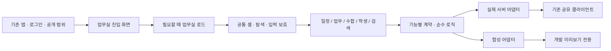

# 1차 통합 기준과 실행 순서

2026-10-13 · `chore/workhub-integration` · 기준 운영 main: `6165bcc`

이번 작업은 지금까지 만든 사이트와 설계를 같은 기준에서 검증하는 저장소 통합이다. 실제 DB 구축, 시간표 개발, 새 Claude 호출, 운영 공개는 실행하지 않는다.

## 포함 범위와 PR 정리

정확한 원격 커밋은 [PR 목록](pr-inventory.json)에 고정한다.

- 사이트: #2 → #4 → #6 → #7 → #8 → #9 → #10 → #13 → #14 → #15 → #16 → #17 → #18 → #19 → #20 → #21.
- 설계: #10에서 갈라진 #11 → #12 → #22.
- #3(Supabase 유지 자동 작업)는 운영 자동화 효과/설정 검토를 별도 단계로 남긴다.
- [#5(시간표 엔진)](https://github.com/EggPlayer88/daedong/pull/5)은 사용자의 보류 지시와 미해결 검토 사항 때문에 포함하지 않는다. 담당 교사를 T1→T2로 바꾸고 이전 시간표 위치를 유지하면 교사가 바뀐 칸을 changedCells=0으로 계산하는 결함이 확인됐다. 당시 교사를 보존하지 않고 새 교사 배정으로 이전 표를 재구성하는 [solver.py 원본](https://github.com/EggPlayer88/daedong/blob/6595dbac5ba0b32c28e9a7f3bb2562c6a0df6acb/packages/timetable/engine/solver.py#L65)과 [model.py 원본](https://github.com/EggPlayer88/daedong/blob/6595dbac5ba0b32c28e9a7f3bb2562c6a0df6acb/packages/timetable/engine/model.py#L267)이 재개 시 검토 근거다.
- 기존 운영 main의 로그인·회원·평가계획서·문서 엔진은 보존한다.

최신 사이트 끝과 설계 끝을 각각 merge commit으로 합쳐 원래 커밋과 검토 이력을 보존했다. PROGRESS.md의 충돌은 최신 사이트 상태에 최신 설계 링크/상태를 추가해 해결했다. 옛 설계 쪽의 “DB 우선 구축” 안내를 현재 실행 지시로 채택하지 않았다.

이 통합 PR이 병합되기 전에는 원래 PR을 삭제하거나 닫지 않는다. 사용자 병합 후 포함 커밋의 도달 가능성을 재확인하고, GitHub가 자동 정리하지 않은 PR만 “통합 PR에 포함”을 명시해 정리한다. 오래된 PR을 차례로 중간 배포하는 방식은 피한다. 동일 변경을 다시 squash/cherry-pick하지 않는다.

## 단계별 통합

| 단계 | 작업 | 완료 기준 |
|---|---|---|
| I1 이번 | 누적 사이트·설계 이력 통합, 초기 로딩/모듈 경계 개선, 문서 기준 정리 | 전체 회귀·빌드·브라우저·설계 검사 및 통합 이력 검사 |
| I2 병합 준비 | Claude의 통합본 검토, 사용자 화면 확인, 기존 서비스 영향 확인 | 지적 해결, 동일 커밋의 CI 성공, 사용자가 main 병합 |
| I3 데이터 연결 재개 후 | 승인된 최신 SQL/RPC와 어댑터 대조, 일정/업무 실제 왕복, 공통 파일·기본 메신저·파일 수합·학생 자료 단계 연결 | 실제 계정·학교별 권한·복구·파일 시험 |
| I4 별도 재개 후 | Claude 상담/비서·문서 작성, 시간표 엔진/확정/교체, 외부 수업 앱 확대 | 해당 기능 인수 조건과 운영 검증 |

I3는 이번에 자동 시작하지 않는다. I4의 보류 기능도 I1 통합 완료를 근거로 켜지 않는다. #3은 운영 자동화로 별도 검토한다.

## 코드의 확장 경계



- 공통 셸은 메뉴·학교 맥락·표시 설정·접근성·편집 보호만 맡는다. 수합·학생·업무의 상태 전이는 각 기능에 둔다.
- 표시/검증/검색 로직은 React 편집 화면에서 독립시킨다. 검색이 편집기 전체를 import하지 않도록 한다.
- 실제 연결과 합성 미리보기의 시작점을 분리한다. DB가 없을 때 합성 자료로 실사용 성공을 가장하지 않는다.
- 인증 클라이언트는 기존 공유 계층을 재사용한다. 기능별 새 클라이언트를 만들지 않는다.
- 어댑터 교체는 계약 대조 뒤 기능별로 진행한다. 아직 구현되지 않은 29 API 그룹을 이미 쓸 수 있는 서버로 취급하지 않는다.
- 새 기능도 모듈 등록·실제 연결 가능 범위·미리보기·원본 이동·테스트를 함께 정의한다. 메뉴 노출 확대는 별도 확인 사항이다.

이번에는 폴더 전면 이동이나 공통 만능 저장소를 도입하지 않는다. 현재 경계가 유효하며 대규모 재배치가 회귀 위험과 검토량을 늘리기 때문이다. 후속 구조 과제는 탐색의 메뉴명 중복 제거, 업무 타입의 수합 폴더 귀속 해소, 큰 화면 컴포넌트의 상태/표시 분리다. 실제 기능 확장 때 필요한 부분부터 수행한다.

## 기획과 현재 코드의 차이

기능 범위의 최신 설계는 [통합 DB v1.1](../database-integrated/README.md)이다. [초기 설계](../database/README.md), 기존 `database/workhub/*.sql`은 이력/시험용 제안이다. SQL 제안의 RLS·경합 시험 통과는 최신 190개 테이블 설계의 구현 완료를 뜻하지 않는다.

v1.1의 기존 재평가 F1~F9는 해결 완료가 아니다. B01·B02 확정 SQL은 F5·F6·F8을 반영한 계약의 재검토 후 작성하고, 나머지 항목도 해당 배치 전 정상·거부 시험으로 확인한다. [DB 재개 인계](../16-pilot-db-activation.md)의 선행 조건을 따른다.

신규 구현 티켓 21개는 계획 상태다. 파일 수합을 먼저 구현할 때는 다음 경로를 분리해야 한다.

- 파일형: 담당자 양식 등록 → 직접 방식 선택 → 대상별 게시 → 파일 제출 → 접수/보완 → 완료본 일괄 다운로드.
- AI 질문형: 양식 분석 → 질문/응답 → 파일 생성 → 제출자 확인 → 담당자 접수.
- 기존 COL-T04의 게시와 COL-T07의 검토/ZIP 중 공통 부분은 파일형에도 필요하다. COL-T03 분석/COL-T06 자동 생성의 완료를 파일형 전체의 선행 조건으로 삼지 않는다.
- 시간표 업무카드는 MSG-T03의 일반 카드 계약만 준비하고 시간표 동작은 보류한다.
- 구현 재개 시 위 분리를 세부 티켓과 인수 조건으로 확정한다. 이번 문서로 기존 티켓을 완료 처리하지 않는다.

## 재현 가능한 검사

```sh
npm run check:workhub:integration
npm run check:workhub:design
npm run check:workhub
npm test
npm run build
npm run build:workhub
npm run test:workhub:browser
```

`check:workhub:integration`은 전체 Git 이력이 필요하다. 19개 원본 커밋 포함·보류 이력 제외·보호 자산/SQL 제안 보존을 검사한다. 브랜치 삭제 후에도 commit 이력을 보존한다. 이 명령은 1차 통합 후보를 재현하는 엄격 검사이며 CI에서는 이 통합 브랜치의 PR에만 실행한다. 이후 승인된 DB/API 변경이나 보류 해제를 영구 차단하지 않는다. 새 통합 차수는 그때의 범위와 기준을 별도로 기록한다.

`check:workhub:design`은 설계 정합성과 61개 로컬 참조/원본 지문을 검사하며 결과 JSON을 갱신한다. 실제 DB나 외부 서비스에는 접속하지 않는다. 원본 18파일은 데스크톱에만 있으므로 CI에서는 저장소에 포함된 사본과 원본 스냅샷을 검사한다.

독립 PostgreSQL 경합 시험은 기존 GitHub Actions의 폐기 가능한 전용 DB에서 실행한다. 실사용 Supabase를 시험용으로 연결하지 않는다. 최종 검사 결과와 알려진 한계는 [통합 검증 결과](verification.md)에 기록한다.

## 검토 후 병합

1. 통합 PR의 최신 commit에서 필수 CI와 Vercel 결과를 확인한다.
2. Claude가 기존 코드 변경과 통합 추가 변경을 검토한다.
3. 사용자가 기존 서비스와 업무실 미리보기를 확인한다.
4. 사용자가 main에 병합한다. 이력 보존을 위해 merge commit 방식을 권장한다.
5. 정확한 포함 commit을 확인한 뒤 이전 PR을 정리한다. DB 적용/메뉴 공개는 별도 단계다.

기능 플래그와 메뉴 공개를 그대로 유지해도 기존 앱 로딩/이동에 영향이 생길 수 있으므로, 단순히 “superadmin 전용이니 운영 영향 없음”으로 승인하지 않는다. 통합본에는 기존 AuthContext의 회원 연결 실패 안내 문구 개선이 포함되어 있으며, 새로운 인증 정책은 추가하지 않았다.
