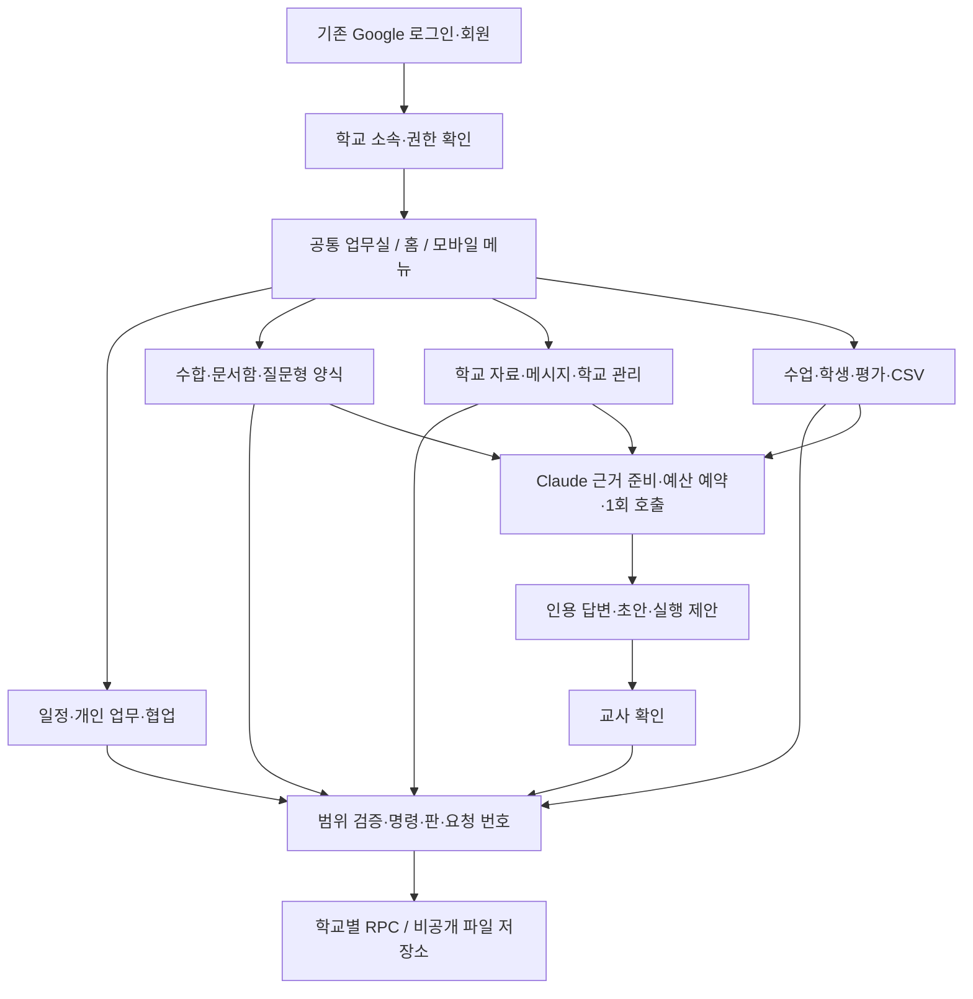

# 전체 시범 사용 통합 구축

기준: 2026-10-16 사용자 승인. 시간표를 제외한 전체 시범 범위의 앱 구축이다. 수동 실사용 검증은 마지막에 모아서 한다. **아래의 코드 구축 상태는 실제 학교 DB·Storage·Claude 연결 완료율이 아니다.**

후속 앱 오류 수정: [협업 인계·할 일·입력 오류 보완](app-contract-fixes.md). 아래 최초 통합 기록과 구분해 읽는다.

## 1. 이번 결과와 통합 이력

- 작업 브랜치 `feat/workhub-pilot-completion`, 시작점 #46 `fca179e`. #43의 2차 통합과 #45 HWPX 간소화, #46 사용성 개선을 원본 이력과 함께 포함한다.
- 사용자가 계획에서 부른 #47은 Claude의 R1S SQL PR 번호가 되었다. 앱은 별도 실제 PR 번호를 사용하며 작은 앱 PR 여러 개로 쪼개지 않는다.
- #3 운영 자동화, #5 시간표, #44 별도 검사기 서버 배포는 포함하지 않는다. 기존 파일 검사 작업자 코드는 보존하지만 활성화하지 않는다.
- 기존 로그인·가입 승인·회원·평가계획서 엔진/확정 양식·R0/R1 SQL은 변경하지 않았다. 신규 업무실은 여전히 superadmin 공개다.
- 코드에 새 서비스 경계를 만들고 SQL 호출·입출력 검증·복구·UI를 연결했다. 실제 SQL 확정은 Claude, 적용·외부 설정·일반 교사 공개는 사용자 담당이다.

## 2. 구현 상태표

`구축`은 해당 범위의 UI·도메인·어댑터·해당 서버 API·자동 검증을 구현했다는 뜻이다. SQL 없이 모든 새 화면이 실제 저장되는 상태를 뜻하지 않는다.

| ID | 구축한 기능 | 실제 활성화에 남은 조건 | 상세 계약 |
|---|---|---|---|
| W01 | 11개 공통 메뉴, 모바일 더보기, 기존 스킨/검색, 권한·연결 실패 격리, 입력/미확정 요청 보존, 화면 간 초안 전달 | 사용자 병합·배포 확인·일반 교사 공개 결정 | 이 문서, [검증](verification.md) |
| W02 | 학교 구성·학년/반·부서·교사 소속·유효기간·공식 담당, 전체 필드 충돌 비교 | 학교 관리 SQL, 기존 회원 연결 승인 | [학교 관리](school-admin-contract.md) |
| W03 | 기존 개인 업무 + 요청/수락/완료 확인 협업, 홈의 수합·보완·알림·후속 업무 요약 | 협업/홈 집계 SQL | [협업](cooperation-contract.md), [홈](knowledge-home-contract.md) |
| W04 | 일정 월/주/목록, 시트 붙여넣기·검증·변경 비교·일괄 반영, 원본/행 식별·중복/충돌 처리 | 대량 가져오기 SQL, 기존 R0 일정은 유지 | [일정 일괄](calendar-batch-contract.md) |
| W05 | HWPX 파일형 수합·공동 제출·검토·철회/정정·ZIP/CSV·마감/재개/기한 연장/보관/알림 | R1S·운영 명령 SQL, private Storage·서버 설정·학교 정책 | [수합 운영](collection-operations-contract.md), 기존 [R1S 요청](../42-hwpx-basic-collection-request.md) |
| W06 | 원본 HWPX의 실제 칸을 담당자가 질문과 연결, 답변/필수값 확인, 기존 서식으로 생성, 수합 첨부 연결 | 양식/응답/생성물 SQL·private Storage·서버 연결 | [질문형 HWPX](documents-contract.md) |
| W07 | 개인/허용 학교 문서함·종류별 초안·확인/보관·버전·사본·근거, Claude 초안 명시 채택, 기존 평가계획서 새 탭 | 문서함 SQL, AI 활성화. 일반 문서 본문은 텍스트, HWPX는 확인한 질문형 양식 사용 | [문서함](documents-contract.md) |
| W08 | 규정/연간계획/안내 원문·유효기간·초안/게시/종료, HWPX 원본 가져오기·추출 검토·해시/위치 연결 | 지식/원본 수입 SQL·private Storage·검색 근거 연결 | [학교 자료](knowledge-home-contract.md), [HWPX 수입](knowledge-import-contract.md) |
| W09 | Claude 학교 안내/개인 비서, 근거 인용, 문서·학생 초안, 개인 업무 제안 확인 실행, 메시지 초안 전달 | AI SQL, 승인 모델·예산·가격·키, 실제 공급자 연결 | [Claude](assistant-contract.md) |
| W10 | DM/그룹 메시지·대상 최종 확인·읽음·업무 알림·HWPX 첨부, 원래 요청 복구 | 메신저/알림 SQL·전용 Storage·기본 확인 API | [메신저](messaging-contract.md) |
| W11 | 나의 수업/학생 명부·관찰 누가기록·별도 권한 상담·정정/철회·출력 | 수업·학생·기록 SQL, 실제 명부/담당 연결 | [수업·학생](teaching-contract.md) |
| W12 | 판이 고정된 평가 기준·평가/정정, 선택한 학습 근거로 학생 초안, 철회·원문 변경 재검토 | 평가 SQL·Claude·문서함 근거 검증 | [평가·학생 초안](teaching-contract.md) |
| W13 | 디지털윤리 활동/평가 CSV 검증·학생 매칭·원문 저장·정정판·관찰 채택 | 활동 수입 SQL. 원천 사이트 자동 API 동기화는 추가 연결 범위 | [CSV 연결](teaching-contract.md) |
| W14 | 업무 인계/수락/취소, 영향 미리보기, 새 학년도 준비, 지문·판 충돌 보호, 운영 복구 안내 | 학년도/인계 SQL, 보존·학사기간 확정 | [인계·학년도](school-transitions-contract.md) |

## 3. 구조와 확장 방식

- UI/입력 검증/응답 계약/전송 어댑터를 모듈별로 나누고 새 모듈은 지연 로딩한다. 하나의 거대한 페이지나 범용 만능 mutation을 만들지 않는다.
- 공통 RPC 계층은 요청 전후 사용자·학교·소속 범위를 확인한다. 서버가 최종 권한을 판정하며 브라우저의 선택값은 권한 증거가 아니다.
- 쓰기는 원래 요청 번호와 내용을 함께 보관한다. 타임아웃을 저장 실패로 단정해 새 키로 중복 요청하지 않는다. 확정 거절·결과 미상·읽기 실패는 구분한다.
- 미저장 입력은 현재 탭 메모리에서만 보호한다. 새로고침·브라우저 종료 이후 복원이나 기기 간 자동 초안 저장을 약속하지 않는다. 민감 본문은 localStorage에 저장하지 않는다.
- AI는 답변·초안·제안만 생성한다. 메시지 전송·개인 업무 생성·수합 제출은 교사의 확인과 전용 명령을 거친다. 전 교사 메시지를 AI가 자동 발송하지 않는다.
- 학생 상담은 학습 근거와 분리한다. 학생 초안은 선택한 관찰/평가의 정확한 판·해시·철회 세대·구간만 연결하며 공유 문서로 승격하지 않는다.
- HWPX는 기본 구조/크기/해시 확인을 한다. 바이러스 검사 완료라는 표시를 하지 않는다. 질문형 치환은 실제로 검증한 문단/칸만 사용하고 복잡한 서식은 일반 파일형 수합으로 처리한다.
- 지식 원문은 업로드 즉시 공식 규정이 되지 않는다. 교사가 추출 결과·위치·적용 기간을 확인한 초안만 만들고 담당자가 게시한다.

## 4. 의도적으로 남아 있는 경계

1. 실제 DB·PostgREST·Storage·Claude 연결은 후속 SQL/설정이 필요하다. 미연결은 해당 메뉴에서만 준비 안내로 표시한다.
2. 자동 바이러스 검사·파일 정리 서버·예약 운영 자동화·시간표는 이번 활성화에 포함하지 않는다.
3. 외부 수업 사이트의 직접 자동 동기화, 대용량 서버 ZIP 작업, 모든 HWPX 구조의 자동 양식 인식은 구현 완료로 세지 않는다. 현재 CSV·브라우저 제한 내 ZIP·명시적 칸 매핑을 제공한다.
4. 홈의 메시지/협업/학생 후속 카드는 해당 목록을 열고, 수합/보완은 정확한 요청으로 이동한다. 전 메뉴를 한꺼번에 검색하는 서버 통합 검색은 아직 아니다. 기존 공통 검색은 일정·업무 범위다.
5. 공식 생기부 입력·나이스 연동·공문 결재·교사 공개 범위 확장은 자동화하지 않았다. 생성물은 교사가 검토하는 초안이다.

## 5. 다음 담당자와 문서

- Claude: [통합 SQL 작성 요청](sql-handoff.md), 각 계약의 실제 반환값·동시성·권한·기존 자료 보존 시험.
- Codex: 실제 SQL 결과와 현재 앱 parser 대조, 발견한 앱 결함 수정. SQL은 상대 브랜치에 직접 수정하지 않는다.
- 사용자: Claude 검토 후 병합, SQL 직접 적용, 승인 모델/예산·환경값 설정, 마지막 [실사용 확인](activation-checklist.md).
- 검토: [자동 검증 결과](verification.md), [Claude 검토 전달문](review-request.md).

## 판단해서 정한 것

- 앱은 한 통합 PR로 제공하되 SQL은 의존성 순서로 나눈다. 문제가 생긴 모듈만 비활성화할 수 있게 하기 위한 것이다. 분리 기준은 위 표와 각 readiness 계약이다.
- 새 모듈이 준비되지 않았다고 기존 R0 일정·업무·로그인까지 막지 않는다. 변경 위치는 ConnectedWorkspace, 각 모듈 경계, 공통 RPC 계층이다.
- 기존 평가계획서의 검증된 엔진은 그대로 이용하고 새 기능과 링크로 연결한다. 확정 양식 교체가 필요하면 별도 승인된 자산 작업으로 진행한다.
- AI 비용·모델은 사용자 승인 설정으로만 활성화한다. 코드가 기본 유료 모델을 선택해 호출하지 않는다. 변경은 assistant 정책 계약과 활성화 절차에서 한다.
