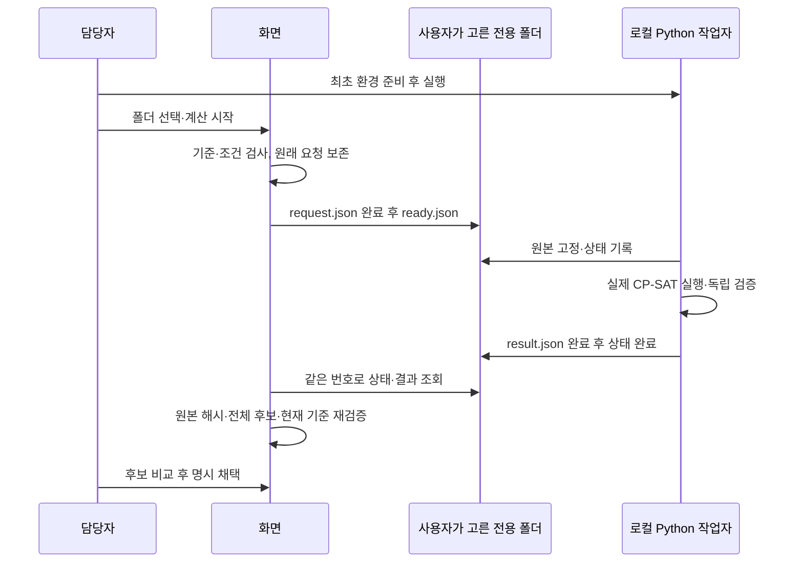

# 시간표 구축 마무리 묶음 — 2026-10-18

기준은 PR #65의 편성 사용성 보완 `c46c9a8` 이후다. 사용자가 Claude 검토를 기다리지 않고 구축을 계속하도록 요청하여, 앱·로컬 계산의 남은 주요 경로를 구현하고 독립 교차검토와 자동 시험을 진행했다. DB 설치·운영 배포·교사 공개와 코드 구현 완료는 구별한다.

## 교사가 달라진다고 느낄 부분

| 작업 | 이전 | 이번 구현 |
|---|---|---|
| 여러 교사 회의 시간 입력 | 교사·시간대마다 같은 입력 반복 | 대상 여러 명, 여러 요일, 실제 시작·종료를 선택하여 전체 영향 검토 후 한 번에 반영 |
| AI 조건 정리 | 수업명·시간대는 있으나 현재 고정/불가/선호와 수업별 허용 목록 누락 | 현재 조건·차시·개별 허용 목록을 짧은 별칭으로 전달. 범위 밖 정보와 길이 초과는 계속 차단 |
| 최적화 계산 | 요청 다운로드→명령 실행→결과 파일 업로드 반복 | 계산기를 한 번 실행하고 폴더를 연결하면 버튼 접수→상태 확인→결과 검증→후보 비교. 기존 파일 방식도 유지 |
| 공유 시간표 출력 | 화면 조회 위주 | 현재 조회한 실제 날짜 자료를 교사·학급별로 인쇄/PDF·XLSX 출력. 임시 변경·취소·실제 시각·판 보존 |

## 초기 준비와 조건

학교가 확정한 교사·학급/수강집단·시수와 시간표 준비 초안의 구분은 유지한다. 수업 일괄 구성·일과 복사·교시 편집은 이전 묶음에서 구현했다. 이번 일괄 조건은 현재 기준판 위에 추가하며 공식 필수조건을 지우거나 시수를 바꾸지 않는다.

- 대상은 안정된 ID로 선택한다. 같은 이름이 여러 개면 구별하고, 검색 결과를 바꿔도 숨은 선택을 임의로 버리지 않는다.
- 실제 시간 구간이 겹치는 연속 수업도 포함한다. 교사와 학급을 함께 선택해도 공동 수업 선호를 중복 집계하지 않는다.
- 필수 불가 시간과 선호 벌점을 구별한다. 기존 더 강한 선호를 낮추지 않는다.
- 이미 고정한 수업과 충돌하는 조건은 미리보기에서 계산이 막힌다는 사실을 표시한다. 담당자가 조건을 등록할 수는 있지만 생성 전 검사가 해결되지 않은 충돌을 계속 차단한다. 조건을 몰래 완화하지 않는다.
- 선택·구간 입력은 학교 범위의 탭 메모리에 보관한다. 기준자료/조건이 바뀌면 미리보기 확인을 새로 받는다. 미반영 입력이 있는 동안 다른 조건 작성·AI·계산·저장을 섞지 않는다.
- AI에는 선택한 대상 범위의 수업별 차시와 허용 시간대, 현재 고정·불가·선호, 조정 단계의 실제 배치를 보낸다. 범위 밖 참여자의 조건은 제공하지 않았다고 명시한다. 기존 P6 단일 실행권·예산·요청 복구를 사용하고 모델·단가·입력 한도를 변경하지 않는다.

## 로컬 최적화의 완전한 왕복

설치·정확한 파일 계약·한도·종료/복구 방법은 [engine-jobs.md](engine-jobs.md)를 따른다. 여기에는 공개 HTTP 서버나 DB 연결이 없다. PC에서 직접 실행하는 선택지이며, 학교 공용 계산 서버 배포를 완료한 것으로 표현하지 않는다.

폴더 권한은 사용자가 브라우저 선택 창에서 부여한다. 앱이 경로를 추측하거나 다른 폴더를 찾아 읽지 않는다. 브라우저 기능에 관한 근거는 [폴더 선택 API](https://developer.mozilla.org/en-US/docs/Web/API/Window/showDirectoryPicker), [파일 쓰기 API](https://developer.mozilla.org/en-US/docs/Web/API/FileSystemFileHandle/createWritable), [탭 간 잠금](https://developer.mozilla.org/en-US/docs/Web/API/Web_Locks_API)이다. 지원하지 않는 브라우저에는 기존 JSON 파일 왕복을 제공한다.

- 폴더에 계산기 초기 표식이 없으면 쓰지 않는다. 사용자 지정 경로를 원격 서버에 전송하지 않는다.
- 같은 번호·같은 원본은 재실행하지 않는다. 다른 원본, 바뀐 폴더, 과거 상태, 사라진 접수증, 변조된 결과를 정상으로 처리하지 않는다.
- 취소 표식은 요청일 뿐이다. 작업자가 실제 종료를 확인해야 취소 완료다. 결과 미상은 원래 번호를 유지한다.
- 작업자가 중단되면 원래 PID의 종료 여부를 확인하고 보수적으로 복구한다. 모르는 프로세스를 죽이거나 자동으로 새 계산을 실행하지 않는다.
- 미인수 로컬 작업이 있으면 새 파일 요청·결과 업로드·계산 검토 자료 삭제를 막는다. 독립감사에서 발견한 원요청 교체 결함을 이 잠금과 실제 왕복 회귀로 고쳤다.
- 편성 기준이나 권한이 바뀌면 늦은 결과를 현재 후보로 가져오지 않는다. 같은 탭의 재진입에서는 원래 폴더를 선택해 같은 요청을 확인한다.
- 계산 후보를 받는 것과 학교 서버에 초안을 저장·확정하는 것은 별도다. 로컬 결과는 자동 저장·배포하지 않는다.

## 공유 시간표 출력

현재 하루·주 또는 현재 조회한 기간을 선택한다. 공유 조회 최대 범위를 넘어 학기 전체가 들어 있다고 표시하지 않는다. 실제 날짜별 수업이므로 임시 교환, 특별일과, 취소 상태와 초 단위 실제 시각을 보존한다.

학급 필터는 조회 시각·기간·수업판까지 맞는 학급 ID 참조를 요구한다. 참조가 없으면 학급 이름으로 임의 그룹화하지 않는다. 교사 조회는 본체의 안정된 교사 ID를 사용한다. 완료된 교환도 현재 수업판·시각과 맞는 경우에만 변경 표식을 붙이며 개인 변경 사유는 출력하지 않는다.

미리보기의 페이지/행 제한으로 XLSX 전체 행을 자르지 않는다. 문자열 셀을 사용하고 식별자·판·조회범위 시트를 넣어 파일의 출처를 남긴다. 인쇄 팝업·파일 다운로드 실패 때 미리보기를 보존한다. 재조회나 선택 변경 뒤에는 새 미리보기가 필요하다.

## 전체 요구사항의 현재 경계

| 요구 흐름 | 구현된 실행 경로 | 실제 운영을 위해 남은 것 |
|---|---|---|
| 초기 학교 자료·수업시수·배정 | 공식 자료 조회 계약, 준비 입력·검산·초안·기준판 확정 앱 | T1 SQL 설치와 학교 실제 자료 대조 |
| 하드/소프트 조건·AI 수집 | 개별/일괄 조건, Claude 요청·제안 확인·검증 | 기존 P6 운영 준비 및 실제 Claude 응답 확인 |
| 생성·평가·조정 | 브라우저 Worker, 실제 로컬 CP-SAT 작업자, 독립검증·후보 비교·수동 조정 | 실제 학교 규모의 성능·품질 확인; 공용 계산 서버가 필요하면 별도 배포 |
| 확정·교사 배정·일정 연동 | 학기 전체 manifest 검사, 원자 명령·접수증·복구, 공유·홈·일정 읽기 투영 | T2 SQL의 실제 원장·잠금·권한·기간 반영 |
| 교사·학급별 한눈에 보기 | 주/일 화면, 안정 ID 검색, 인쇄/PDF/XLSX | 실제 교사 PC 인쇄·Excel 확인 |
| 임시 교환 | 서버 검증 후보 추천→본인 요청→당사자 동의→담당자 승인 앱 | 추천 RPC·동시 충돌 재검사·승인 원자반영·알림을 실제 DB에서 검증 |
| 행사·휴업·특별일과 | 영향 비교, 누락 차시/분, 확정 명령·복구 | T2 SQL 연결과 실제 학교 예외 자료 대조 |

초기 AI는 공식 기준판을 만든 뒤 조건 정리를 돕는다. 임시 교환의 현재 후보 추천은 검증 가능한 서버 계산 계약이며 Claude가 실제 교환을 수행하는 도구는 아니다. 다자 교환·대강/보강의 인사·추가 시수·보상 원장, 모든 과거 엔진의 공강/연강 규칙, 임의 타사 Excel 자동 인식은 완성으로 표시하지 않는다. 지원하지 않는 조건은 명시적으로 차단한다.

## 검증과 배포 경계

자동 검증은 전체 npm, 타입, 두 앱 빌드, 시간표 브라우저 전체, 보호 경계, CI 전체로 분리해 기록한다. 로컬 계산 시험은 실제 파일·Python·OR-Tools를 사용한다. 브라우저 폴더 선택 창 자체는 자동 시험에서 어댑터로 대체하지만 이후 파일은 소유한 실제 임시 폴더에 쓰고 읽는다. 학교 DB·Storage·Claude provider 응답은 실제 운영 성공으로 환산하지 않는다.

SQL 최종본 작성·적용 역할과 `main` 병합 주체는 기존 협업 규칙대로 유지한다. 이번 추가분은 새 SQL 필드를 요구하지 않지만 시간표 전체가 DB 없이 운영된다는 뜻은 아니다. SQL 원문·인증·비용·공개 범위를 바꾸지 않았다. 운영 배포/설정/실사용 확인은 구축 코드와 분리한다.

## 판단해서 정한 것

1. 담당자 PC 작업 폴더 연결을 추가했다. 공용 서버 업체나 비용을 임의 결정하지 않고 실제 자동 계산 경로를 만들기 위해서다. 경계는 `engine-jobs.ts`/`LocalTimetableEngine.tsx`와 `engine/jobs*`이며 후속 서버도 기존 계산 요청·응답 계약을 재사용할 수 있다.
2. 결과 인수 전 새 요청을 막는다. 원래 요청과 현재 작업의 연결이 끊기는 것을 방지한다. `onRequestLockChange`와 EnginePanel의 실행·정리 경로가 관리 지점이다.
3. 일괄 조건은 기존 exact 계약으로 정규화한다. 새 DB 종류를 만들지 않고 입력 횟수만 줄인다. `condition-batch.ts`에서 범위·중복·기존 조건 보존을 관리한다.
4. 출력은 현재 서버가 허용한 조회 범위의 사본이다. 재조회되지 않은 학기나 교사의 정보를 추정하지 않는다. `published-export.ts`와 공유 보드의 선택 범위가 관리 지점이다.
