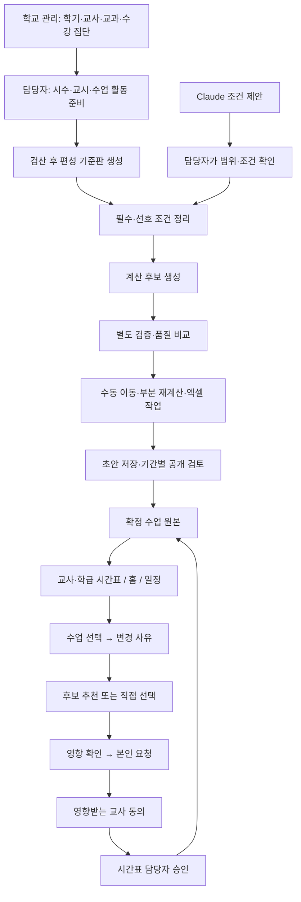

# 시간표 통합 구축 — 2026-10-18

최신 마무리 묶음은 [completion-finalization.md](completion-finalization.md)다. 조건 일괄입력·AI 현조건 전달·실제 로컬 계산 작업 연결·확정 시간표 출력을 추가했다. 아래 이전 단계 설명과 다르면 최신 문서를 우선한다.

후속 편성 사용성 보완은 [editor-usability.md](editor-usability.md)를 함께 읽는다. 일과 편집·요일 복사·수업 일괄 구성, 계산 전 충돌 설명, 두 수업 맞바꾸기·미배정 이어 배치, 후보의 수업별·교사별 비교를 기존 화면에 추가했다. 운영 연결 범위는 아래와 같다.

이 문서는 `feat/workhub-timetable-completion`의 현재 범위다. 기존 #54·#56을 #64 최종 앱 기준 `a7a6c86`에 합치고 초기 준비, 실제 계산 엔진, AI 조건 제안, 엑셀, 공유·교환, 홈 연결과 학기 전체 확정·학사 변경 실행을 함께 보완했다. `README.md` 및 이전 검증 문서는 당시 단계의 이력이며 현재 범위는 이 문서와 `completion-verification.md`를 먼저 본다.

## 교사가 사용하는 흐름

위 흐름은 앱·계산 코드와 서버 계약을 함께 그린 것이다. SQL이 설치되지 않은 단계는 준비 중으로 표시하며 실제 학교 시간표를 생성·저장·배포한 것으로 표시하지 않는다.

## 이번에 구현한 것

### 1. 초기 학교 편성 자료

- 공식 교사·학급/수강 집단·수업 배정을 읽고 실제 교시 시작/종료, 주당 시수, 1차시 또는 연속 활동, 허용 교시를 정한다.
- 공식 시수가 있는 수업은 시간표 화면에서 임의로 바꾸지 않는다. 미정 시수만 준비 초안에서 입력한다. 교사/학생 집단 배정은 학교·수업 관리에서 고친다.
- 미완성 준비 초안 저장과 기준판 확정을 구분한다. 시수 합계, 빠진 교사·학생집단, 허용 교시, 실제 시간과 자원 수용량을 먼저 검사한다.
- 자원별 배정 차시와 가능한 차시의 상한을 비교한다. 상한 검사를 통과했다고 전체 시간표가 존재한다는 뜻은 아니다.
- 초안과 미확정 명령은 현재 탭 메모리에 보관하며 기존 요청 번호로 복구한다. 브라우저 종료 이후 서버 미저장 입력 복원을 약속하지 않는다.

### 2. 조건과 Claude 도움

- 학교가 정한 필수조건과 담당자가 추가한 조건을 구별한다. 주간 편성 조건과 특정 날짜의 임시 변경을 혼합하지 않는다.
- 고정 수업, 교사·학급·공간의 불가 시간, 가능한 한 피할 시간을 입력한다. 조건 변경 후 기존 배치를 지우지 않고 재검사를 요구한다.
- 기존 Claude 비서 계약(`school_advice`)을 사용한다. 모델·단가·비용 정책을 새로 정하지 않았다. 현재 비서가 미준비면 호출하지 않는다.
- 교사/학급/공간을 선택해 필요한 자료만 요청에 넣는다. 긴 UUID는 검증 가능한 짧은 별칭으로 전달하고 원본 ID로 되돌린다.
- 조건 정리와 생성 후 배치 피드백을 구별한다. 배치 피드백은 선택 대상의 검증된 현재 배치를 함께 전달하고 설명·선호 제안으로 제한한다. AI 답변을 충돌 검사나 확정 승인으로 대신하지 않는다.
- 결과는 기준판·조건·원래 요청 번호와 대조한다. 제안 확인 전에는 조건을 반영하지 않으며 저장·메시지·교환 승인 도구를 AI에 주지 않는다.
- 제공자 결과 미상은 같은 입력과 요청 번호로만 확인한다. 새로운 유료 요청으로 자동 대체하지 않는다.

### 3. 실제 계산과 조정

- 기존 브라우저 Worker의 제한 탐색을 유지하고 Python OR-Tools CP-SAT 실행기를 추가했다.
- `timetable.solve.v1` 요청/응답은 requestId·SHA-256·기준판으로 연결한다. 최대 3개 후보를 앱의 별도 검증기로 검사한 뒤 비교한다.
- 실제 시간 겹침, 교사·수강집단·공간 수용, 시수, 필수 고정·불가 시간, 연속 블록을 검사한다. 이전 배치가 있으면 최소 변경을 우선한다.
- 지원하는 최적화는 변경 수업 수·이동 수·선호 벌점·교사 일일 최대 차시·동일 교과 요일 집중이다. 후보의 최적성은 해당 계산의 목적과 남은 후보 공간 안에서만 설명한다.
- 기존 엔진의 모든 공강·연강 규칙을 이식한 것은 아니다. 미지원 조건은 목록에서 드러내며 조용히 빼고 성공하지 않는다.
- 수업을 고정하고 선택 교사/학급만 다시 계산할 수 있다. 바깥 배치와 직접 고정한 수업은 유지한다.
- CP-SAT는 **PC 작업 폴더 연결 → 버튼 계산 → 상태·결과 자동 확인**과 기존 요청/결과 파일 왕복을 모두 제공한다. 일반 교사가 버튼 한 번으로 서버에서 대규모 계산하는 배포는 후속 단계다.

### 4. 엑셀 작업

- 실제 `.xlsx` 편집용·출력용 파일을 만든다. 편집용은 조건/배치 변경과 미완성 작업 보관에 사용한다.
- 학교·학기·기준판·원본 지문과 공식 목록을 대조하고 변경 개수, 조건 삭제, 미배정을 먼저 보여 준다.
- 불완전한 배치는 초안으로 이어갈 수 있지만 확정 검사를 통과한 것으로 표시하지 않는다.
- 읽는 범위는 이 시스템의 XLSX 양식이다. 임의의 타 서비스 엑셀 양식을 자동 인식하는 기능은 아니다. 매크로·수식·병합·외부 연결은 받지 않는다.
- 표준 공유 문자열과 inline 문자열, 한글·이모지·빈 셀을 지원한다. 출력 셀은 문자열로 만들어 수식처럼 보이는 사용자 입력도 실행하지 않는다.

### 5. 확정·공유·임시 교환

- 기존 확정 미리보기·명시 확인·접수증·원키 복구, 요청→당사자 동의→담당자 승인을 유지한다.
- 교사 주간표와 모바일 당일 목록, 안정된 ID로 구분하는 학급별 보기, 수업 선택 후 변경 요청을 제공한다.
- 서버가 검사한 최대 3개 교환 후보를 비교한다. 후보 선택만으로 요청하지 않으며 기존 미리보기와 최종 확인을 다시 거친다.
- 학기 전체 확정은 전체 목록의 각 쪽을 끝까지 자동 검증한다. 전체 건수·순서·지문·기간·쪽 간 회차 중복을 검사하고 진행·중지 기능과 명시 확인을 제공한다. 명령에는 고정 참조만 보내고 단일 접수증의 결과를 확인한다. 13,001회차·66쪽 검사를 자동 회귀에 포함했다.
- 행사·휴업과 특별 일과는 대상 학급의 실제 수업 시각으로 전후 변화를 비교한다. 공동 수업의 일부 학급 선택, 과거 수업, 처리 중이거나 반영된 교환이 충돌하면 반영을 막는다. 취소 차시와 줄어든 수업 분을 표시하며 보강은 담당자의 별도 검토로 남긴다.
- 확정·학사 변경·기존 교환은 공통 요청 보관과 단일 쓰기 잠금을 쓴다. 결과 미상 중 다른 변경과 입력 폐기를 막고, 재진입·조회 실패·미리보기 만료 뒤에도 원래 요청 번호로 접수증만 조회한다. 확인된 작업의 입력만 지우고 다른 작업 초안은 보존한다.
- 위 두 실행 흐름의 **앱과 서버 전송 계약을 구현**했다. 시간표 SQL이 아직 없어 실제 학교 DB에서 확정하거나 학사 변경을 반영한 상태는 아니다.

### 6. 홈·학교 일정

- 홈의 오늘과 학교 일정에서 선택한 날짜의 내 수업을 별도로 조회한다. 최대 5개를 먼저 보여 주고 원본 시간표로 이동한다.
- 취소/실시 상태와 원본 회차 ID·판을 유지한다. 일반 일정 저장 함수를 호출하거나 별도 일정으로 복제하지 않는다.
- 미설치·조회 실패·서버가 확인한 0건을 구별한다. 시간표 조회 실패가 일정·업무 화면 전체를 막지 않는다.

## 구조와 확장 경계

| 경계 | 위치 / 역할 |
|---|---|
| 순수 편성 규칙 | `packages/timetable/src`: 검증·조건·품질·CP-SAT 계약 |
| 계산 실행 | `packages/timetable/engine/runner.py`: Supabase·인증과 분리 |
| 초기 준비 | `preparation.ts`, `preparation-server.ts`, `TimetablePreparationPanel.tsx` |
| AI | `assistant.ts`, `assistant-bridge.ts`, `TimetableAssistantPanel.tsx`; 기존 P6 재사용 |
| 엑셀 | `xlsx.ts`(파일 형식), `workbook.ts`(시간표 의미), `TimetableWorkbookPanel.tsx`(확인 UI) |
| 운영 원본 | `operations-server.ts`: 기존 exact v1 유지 |
| 운영 확장 | `operations-next-contracts.ts`, `operations-next-server.ts`: 별도 next.v1 |
| 학기 전체 확정 | `publication-execution-*`: 전체 페이지 검증·고정 참조 명령·접수증·복구 |
| 학사 변경 | `school-day-execution-*`: 대상 전체 대조·실제 시각 변경·접수증·복구 |
| 홈 조회 | `operations-calendar.ts`, `TimetableAgendaPanel.tsx`: 읽기 전용 투영 |

공통 설정·검증 코드가 UI에 흩어지지 않도록 분리했다. 시간표 관련 화면은 지연 로딩한다. SQL 원문·기존 회원·로그인·비용 설정·일반 교사 공개 범위는 변경하지 않았다.

## 다음 큰 작업 묶음

1. 앱 구축은 검토 대기 없이 진행했다. T1 초기 준비/편성, T2 날짜별 확정·교환 SQL 최종본 작성·적용은 기존 협업 역할에 따라 진행한다. 기존 1~8단계 통합 완료와 별도 승인 단계로 다룬다.
2. 완성된 학기 전체 확정·학사 변경 앱 계약에 SQL의 잠금·원장·원자적 반영을 연결한다. 학교 규모의 전체 기간을 잘라 저장하지 않는다.
3. PC 로컬 계산의 실행·취소·상태·결과 조회는 연결했다. 공용 CP-SAT 서버가 필요하면 배포·인증 경계를 별도 승인 후 연결한다. 모델 비용 승인과 계산 서비스 비용/운영 선택을 섞지 않는다.
4. 날짜별 임시 변경의 실제 잠금·동의·담당자 승인·알림·시수 이력을 검증한다. 휴업/특별일과의 DB 반영과 대강·보강은 여기서 함께 정교화한다.
5. 배포 후 실제 학교 자료로 생성 성능, Supabase 왕복, 권한 분리, 교사 PC Excel, Claude 실제 응답을 한 번에 확인한다.

현재 단계는 **폭넓은 앱·엔진 통합 후보**다. 전국 학교 실사용 완료나 운영 활성화 완료로 환산하지 않는다.
